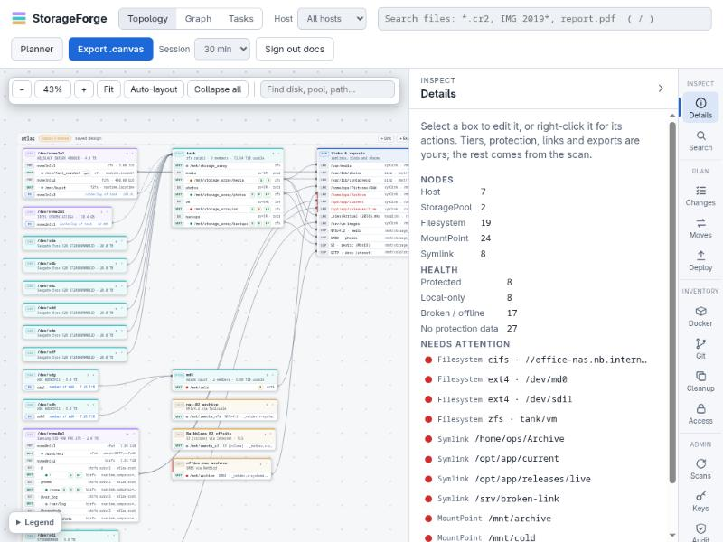

# StorageForge

Map, plan and change the storage on a fleet of Linux machines from one place. StorageForge indexes every host over SSH with no agent, shows what it found as an editable topology, checks every plan against that index, and turns plans into scripts that report before they change anything.



## Why it exists

Storage on a few Linux machines tends to live in shell history, an old wiki page and one person's memory. The questions that matter are hard to answer from there: which data has only one copy, which containers use this folder, will this copy fit, and what happens if this disk is missing when the job runs?

Monitoring tools show how full a disk is. Backup tools copy what you point them at. Configuration tools apply what you describe, but they don't know what is on the disk. StorageForge joins those up: it keeps a searchable record of what every host holds, and checks each plan against that record before anything runs.

## What it does

- **Finds files on every host.** Search by name, size, age, host or folder from the web UI or the CLI, and see what changed between scans, duplicate folders and cold data.
- **Maps the storage.** Disks, pools, datasets, mounts, links, shares and the copies between them, as an editable topology and a graph, with 3-2-1 protection health on each. It reads btrfs, ZFS, LVM, mdadm and LUKS layouts.
- **Designs hosts.** The planner covers devices, mounts, links, RAID capacity and protection, and exports Bash, Ansible, systemd and blueprint files.
- **Plans changes.** Folders, btrfs, ZFS and LVM tasks, mounts and drives, in order, like a playbook for storage.
- **Moves and protects data.** Copies, cutovers, mirrors, rsnapshot, git mirrors and snapshot sends. Existing rsnapshot and snapper jobs can be imported.
- **Deploys NFS and SMB shares**, for the server and each client.
- **Builds storage tasks from blocks**, with guards such as "require mounted", then runs them by hand or on a timer.
- **Shows Docker, Podman and Git inventory:** which containers use a folder, which repositories have unpushed work or only one copy.
- **Raises alerts** for failed jobs, drift, disk and pool health, and sends them to your alert channels.
- **Writes reports:** Markdown architecture reports and Obsidian `.canvas` exports.

## How it works

1. **Scan.** A bound vault key connects over SSH, and tools already on the host read it: `find`, `findmnt`, `lsblk`, `df`, plus `zpool`, `git` and `docker` when present. Scans change nothing and install nothing.
2. **Look.** Topology, search and the inventory panels answer from the index, without connecting to a host.
3. **Design.** Mark tiers, protection, exports and links. Your intent survives rescans.
4. **Plan.** Stage changes, moves, shares or a task. Each one is checked against the index as you edit.
5. **Act.** Download the script and run it yourself, or deploy it through a runner on the host that only runs scripts StorageForge signed. Run with no options, a script only reports `ok`, `missing` or `conflict`.
6. **Rescan.** The next scan shows the result, and flags drift if something deployed was changed by hand.

The rules every feature follows are in [Concepts](docs/concepts.md#the-rules), and the protections are in [Security](docs/security.md). In short: SSH keys are encrypted at rest and held in memory only for the length of a task, trash and cutovers rename instead of deleting, drive tasks have three separate locks, and the audit log is hash-chained.

## Quick start

From `storageforge-indexer/`, with Docker and Compose v2:

```bash
docker compose up -d --build
docker compose exec storageforge storageforge-index user add admin
docker compose exec storageforge storageforge-index vault generate --name fleet
```

Add the printed public key to `~scan/.ssh/authorized_keys` on a host, then bind and scan it:

```bash
docker compose exec storageforge storageforge-index vault bind --key fleet --host 10.0.20.0/24 --user scan
docker compose exec storageforge storageforge-index scan --host 10.0.20.5
```

Then open `https://<this machine>:8443` and sign in. To try it without touching a real host, `examples/demo/demo.sh` runs the whole flow against a disposable SSH target. [Getting started](docs/getting-started.md) has the details, including running it without Docker.

## Where it stands

- Version 0.3.0. Releases are tagged `vX.Y.Z`; see the [changelog](CHANGELOG.md).
- It is meant for a LAN behind its TLS proxy. Do not publish it on the internet. The one port that may face it is the optional [tunnel for remote nodes](docs/remote-nodes.md).
- The [KVM lab](docs/kvm-lab.md) tests scans and deploys on real VMs across Debian, Ubuntu, Fedora, Arch, openSUSE, Rocky Linux and AlmaLinux. Alpine can be scanned, but deploys are refused because it has no bash or systemd. The lab tests through the API, not the web pages.
- The CI workflow is written and its commands pass by hand, but it has not run on a runner yet.

## Find your way around

| Where | What |
| :--- | :--- |
| [docs/](docs/README.md) | All documentation, starting with [getting started](docs/getting-started.md) and [concepts](docs/concepts.md) |
| [storageforge-indexer/](storageforge-indexer/README.md) | The code |
| [StorageForge-Website/](StorageForge-Website/index.html) | The one-page project website, as static files |
| [CHANGELOG.md](CHANGELOG.md) | What changed |
| [CONTRIBUTING.md](CONTRIBUTING.md) | Working on it |
| `notebook/` | Audit findings and the roadmap, as an Obsidian vault |
