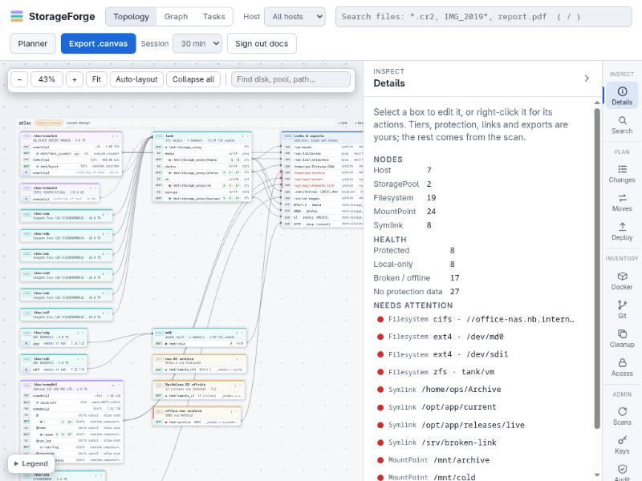

# StorageForge documentation

StorageForge maps, plans and changes the storage on a fleet of Linux machines from one place. It indexes every host over SSH with no agent, shows what it found as an editable topology and graph, checks every plan against that index, and turns plans into scripts that report before they change anything. Run those scripts yourself, or deploy them through a signed runner on each host.



> **No promises.** It will probably work, but it runs root commands on your machines and devices, comes with no warranty of any kind, and nobody who wrote it is liable if it breaks something. Keep tested backups and a way in that doesn't depend on it, and try it on something disposable first. The full version is at the top of the [project README](../README.md).

The code lives in [`storageforge-indexer/`](../storageforge-indexer). Its [README](../storageforge-indexer/README.md) is the short version; these pages are the full one.

## Start here

| Page | What it covers |
| :--- | :--- |
| [Install and set up](install.md) | The full guide: what you need, settings, certificates, the first admin, a first host with read-only and deploy access, libvirt, the console, Tailscale, alerts, backups, remote nodes, without Docker, upgrading and removing |
| [Getting started](getting-started.md) | Install with Docker or pip, create an account, add a key, scan your first host, run the demo |
| [Concepts](concepts.md) | How the parts fit together, and the rules every feature follows |

## Every feature

The [feature guide](features/README.md) catalogues every feature, with how it works and screenshots from the KVM lab. [What StorageForge can do](capabilities.md) is the same ground as one tree, from the code, with each leaf a thing it can do; read it when you want to know whether something exists.

## Using it

| Page | What it covers |
| :--- | :--- |
| [Web UI](web-ui.md) | The views, the side panels, context menus, and the other pages the header links to, including [Workloads](workloads-page.md) |
| [Planner](planner.md) | The design tool at `/planner`: devices, mounts, links, RAID, protection, export |
| [Scanning and search](scanning-and-search.md) | What a scan reads, guardrails, incremental sync, read-only access, git and Docker discovery, search patterns |
| [Plans and scripts](plans-and-scripts.md) | Staged changes, data moves, NFS/SMB shares and block-built storage tasks, and the scripts they produce |
| [The Workloads page](workloads-page.md) | Every container and VM as one tree, how to read it, actions and the create wizard as plans, and the Proxmox VE steps. Built, not lab-tested |
| [Change plans](change-plans.md) | How a plan goes from saved to applied (check, report, apply from the report, 409 on a changed plan), and the runtime-install step |
| [Platform connections](api-connections.md) | Proxmox VE, Backup Server and Datacenter Manager read through their APIs: the least each token needs, the read-back, the pinned certificate, and what a taken-over web app can do with a token |
| [Secrets for plan steps](secrets.md) | The secret store: secrets made, shown once, brought to a step on the runner's stdin, rotated and removed, and what the web app can get from it |
| [Deployments](deployments.md) | Deploy access, the signed runner, deployed jobs, alerts and drift |
| [Remote nodes](remote-nodes.md) | Hosts behind NAT that dial in through a locked-down tunnel |
| [The agent](agent.md) | The optional agent, switched on per host: its two programs, accounts and one sudoers line, runtimes, signed plugins and manifest, and what it can and cannot do. Built, not lab-tested |
| [Network filesystems and remote storage](network-filesystems.md) | Mounting an rclone remote (with rclone crypt on top), the share wizard's protocols beyond NFS and SMB (SFTP, S3, WebDAV, rclone serve, iSCSI, NVMe over TCP, NBD, virtiofs, GlusterFS), and where each secret lives. Built, not lab-tested |
| [Proxmox, TrueNAS and XCP-ng](appliances.md) | Connecting to these platforms, and what StorageForge can do on each |

## Running it

| Page | What it covers |
| :--- | :--- |
| [Security](security.md) | Key vault, the key enclave and its kernel with the VEX that goes with it, audit log, accounts and sessions, host identity, container hardening |
| [Ransomware defense](ransomware-defense.md) | The Security panel: decoys, retention holds, the host-side brake, quarantine, playbooks, evidence and what has and has not been tested |
| [Operations](operations.md) | Configuration, backups, certificates, retention, logs, upgrades, dependency updates |
| [Disaster recovery](disaster-recovery.md) | What to keep elsewhere, and rebuilding on a new machine |
| [Console](console.md) | A terminal on a host or VM in the browser: SSH over LAN or Tailscale, or a VM's serial console, with every session audited and optionally recorded in full |
| [VMs on libvirt](vms.md) | The VM panel, disk-only snapshots with filesystems frozen by the guest agent, revert and delete, scheduled VM snapshots and backups, changing a VM, libvirt networks and pools, and copying a VM as it is to another libvirt host |
| [Toolbox](toolbox.md) | Tools from a signed catalog (WireGuard with its peer manager, Cockpit, Uptime Kuma), installed on hosts as change plans, safest method first, with risk labels, overrides, removal that keeps data, adapters that read each tool's status, custom entries signed on your own machine, and what the catalog's signature does and does not protect. Built, not lab-tested |
| [Workloads](workloads.md) | Compose stacks, LXC containers and Incus instances with their labels and firewall rules, image updates with rollback, VMs from ISOs, placement advice, MAC at deploy, Quadlets, adopting a workload with drift, quiesced stacks, externally managed workloads, and Terraform, OpenTofu and Puppet exports. Built, not lab-tested |
| [Cloning and migrating hosts](host-migration.md) | Copying a server or desktop between physical machines and VMs in any direction, for testing or migration. Design; the package list is built |
| [Target hosts](target-hosts.md) | What a scanned or changed machine needs, and SSH for sending snapshots |
| [Network devices](network-devices.md) | Routers, switches and firewalls, the one network language, changes with a rollback on the device, the opt-in scanner, the management planner |
| [Standardized firewall (MikroTik-style DSL)](standardized-firewall-mikrotik.md) | A specification for one firewall language for every host, compiled to each backend |
| [Standardized network stack (MikroTik-style DSL)](standardized-network-stack-mikrotik.md) | A specification for one language for the whole network stack, compiled to each backend |
| [Infrastructure map](infrastructure-map.md) | Networks, firewalls, listeners, containers and VMs across hosts, who can reach what, and planning from it |
| [KVM lab](kvm-lab.md) | The disposable test VMs, the test tiers and the distributions they cover |
| [Troubleshooting](troubleshooting.md) | Common messages, what causes them and what to do |
| [CLI reference](cli-reference.md) | Every `storageforge-index` command |
| [API reference](api-reference.md) | Every HTTP route |
| [Database](database.md) | Schema, migrations, how queries use the indexes |

## Records

| Page | What it covers |
| :--- | :--- |
| [UI audit, 2026-11-04](audit-2026-11-04-ui.md) | How the screens are organised and behave, the planner against what the platform has learned since it was written, and 41 findings with evidence |
| [Bug hunt, 2026-11-25](bug-hunt-2026-11-25.md) | The findings of the full-codebase audit that were still open when 0.6.0 was cut, each labelled confirmed, plausible or unverified |
| [Bug reports, 2026-11-10](bug-reports-2026-11-10.md) | Six bug reports and UI defects, fixed in 0.5.1 |
| [Lab validation, 2026-11-01](lab-validation-2026-11-01.md) | Storage orchestration in the KVM lab, aimed at edge cases and recovery |
| [Test audit, 2026-11-03](test-audit-2026-11-03.md) | What the test suites covered, the lab tier and feature map added, and the bugs they found |
| [Test report, 2026-11-16](test-report-2026-11-16.md) | The test blocks, random tests, coverage, stress runs on SQLite and PostgreSQL, the bugs they found, and the crash |
| [Ransomware defense audit, 2026-11-02](audit-2026-11-02-ransomware-defense.md) | The first implementation of the roadmap, what was wrong with it, and what was found while replacing it |
| [Feature audit, 2026-11-01](audit-2026-11-01-features.md) | Code compared with the docs and exercised in the lab, and what disagreed |
| [Code audit, 2026-11-01](audit-2026-11-01-code.md) | Bugs found by reading the code, and what was checked and found fine |
| [Consistency audit, 2026-10-29](audit-2026-10-29.md) | Places where the code, the README and the rules in [Concepts](concepts.md) disagree, found while writing these pages |
| [Deployments design](../deployments-design.md) | The original design for deploys (2026-10-27) |
| [Competitive landscape](competitive-landscape.md) | Similar tools across the industry, historical precedents (EPICSHELTER), and feature matrix |
| [Security audit, 2026-10-28](../security-audit-2026-10-28.md) | Findings and fixes |
| [Security parameters](../security-parm.md) | The threat model and hardening checklist, from 2026-10-26 |
| [Roadmap](../notebook/Roadmap.md) | The order the findings were worked in, up to 2026-11-01. The release plan is the roadmap below |
| [Roadmap](../roadmap.md) | Everything still open, under 0.6.0. The 0.4.0 release roadmap and the other finished and superseded roadmaps are in [the archive](../archive/roadmaps/) |
| [UI and UX roadmap](../archive/roadmaps/ui-ux-roadmap.md) | The detail behind the roadmap's UI and UX items: how the screens should change, in order, and how the planner grows to match the platform |

These pages are also published as the project wiki, on Forgejo and on GitHub. Edit them here, then build and push each one: each build replaces that wiki, and a link that leads nowhere stops it. Links to files outside `docs/` take the address form of the host given in `--repo-url`.

```bash
python3 docs/build-wiki.py --push                                    # the Forgejo wiki
python3 docs/build-wiki.py --push --remote git@github.com:Cy3brnetics/StorageForge.wiki.git \
    --repo-url https://github.com/Cy3brnetics/StorageForge          # the GitHub wiki
```

GitHub makes a repository's wiki only when its first page is saved in the browser, so open the Wiki tab and save any page once before the first push.

Screenshots were taken from a local instance with one scanned demo host (`nas-demo`, the container from `examples/demo`) and the `atlas` example design.
