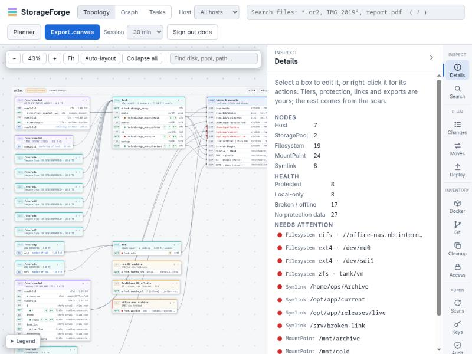

# StorageForge documentation

StorageForge maps, plans and changes the storage on a fleet of Linux machines from one place. It indexes every host over SSH with no agent, shows what it found as an editable topology and graph, checks every plan against that index, and turns plans into scripts that report before they change anything. Run those scripts yourself, or deploy them through a signed runner on each host.

The code lives in [`storageforge-indexer/`](../storageforge-indexer). Its [README](../storageforge-indexer/README.md) is the short version; these pages are the full one.

## Start here

| Page | What it covers |
| :--- | :--- |
| [Getting started](getting-started.md) | Install with Docker or pip, create an account, add a key, scan your first host, run the demo |
| [Concepts](concepts.md) | How the parts fit together, and the rules every feature follows |

## Every feature

The [feature guide](features/README.md) catalogues every feature, with how it works and screenshots from the KVM lab.

## Using it

| Page | What it covers |
| :--- | :--- |
| [Web UI](web-ui.md) | Topology, Graph and Tasks views, the side panels, context menus |
| [Planner](planner.md) | The design tool at `/planner`: devices, mounts, links, RAID, protection, export |
| [Scanning and search](scanning-and-search.md) | What a scan reads, guardrails, incremental sync, read-only access, git and Docker discovery, search patterns |
| [Plans and scripts](plans-and-scripts.md) | Staged changes, data moves, NFS/SMB shares and block-built storage tasks, and the scripts they produce |
| [Deployments](deployments.md) | Deploy access, the signed runner, deployed jobs, alerts and drift |
| [Remote nodes](remote-nodes.md) | Hosts behind NAT that dial in through a locked-down tunnel |
| [Proxmox, TrueNAS and XCP-ng](appliances.md) | Connecting to these platforms, and what StorageForge can do on each |

## Running it

| Page | What it covers |
| :--- | :--- |
| [Security](security.md) | Key vault, audit log, accounts and sessions, host identity, container hardening |
| [Operations](operations.md) | Configuration, backups, certificates, retention, logs, upgrades, dependency updates |
| [Disaster recovery](disaster-recovery.md) | What to keep elsewhere, and rebuilding on a new machine |
| [Target hosts](target-hosts.md) | What a scanned or changed machine needs, and SSH for sending snapshots |
| [KVM lab](kvm-lab.md) | The disposable test VMs, the test tiers and the distributions they cover |
| [Troubleshooting](troubleshooting.md) | Common messages, what causes them and what to do |
| [CLI reference](cli-reference.md) | Every `storageforge-index` command |
| [API reference](api-reference.md) | Every HTTP route |
| [Database](database.md) | Schema, migrations, how queries use the indexes |

## Records

| Page | What it covers |
| :--- | :--- |
| [Feature audit, 2026-11-01](audit-2026-11-01-features.md) | Code compared with the docs and exercised in the lab, and what disagreed |
| [Code audit, 2026-11-01](audit-2026-11-01-code.md) | Bugs found by reading the code, and what was checked and found fine |
| [Consistency audit, 2026-10-29](audit-2026-10-29.md) | Places where the code, the README and the rules in [Concepts](concepts.md) disagree, found while writing these pages |
| [Deployments design](../deployments-design.md) | The original design for deploys (2026-10-27) |
| [Security audit, 2026-10-28](../security-audit-2026-10-28.md) | Findings and fixes |
| [Security parameters](../security-parm.md) | The threat model and hardening checklist, from 2026-10-26 |
| [Roadmap](../notebook/Roadmap.md) | What is planned next, and every finding behind it |

These pages are also published as the project wiki. Edit them here, then run `python3 docs/build-wiki.py --push`: each build replaces the wiki, and a link that leads nowhere stops it.

Screenshots were taken from a local instance with one scanned demo host (`nas-demo`, the container from `examples/demo`) and the `atlas` example design.
