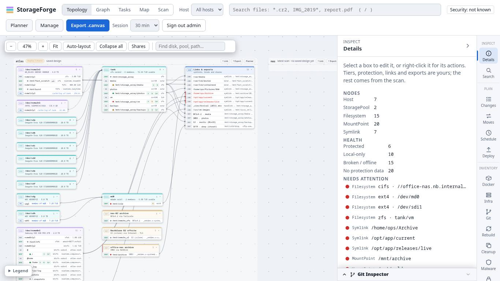
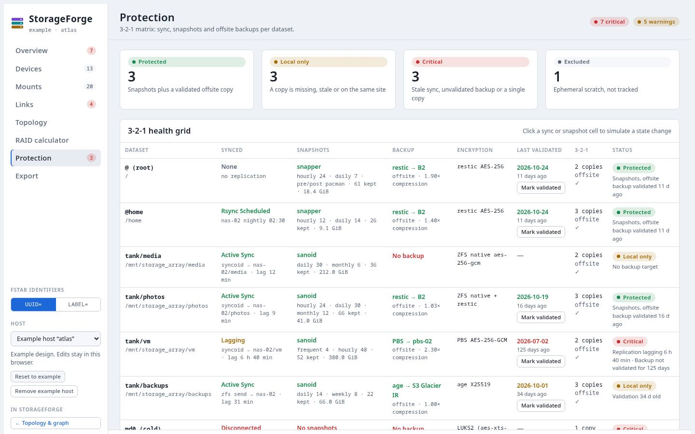
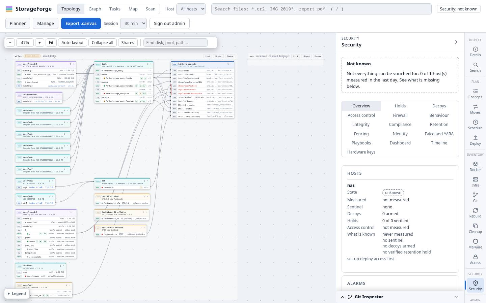
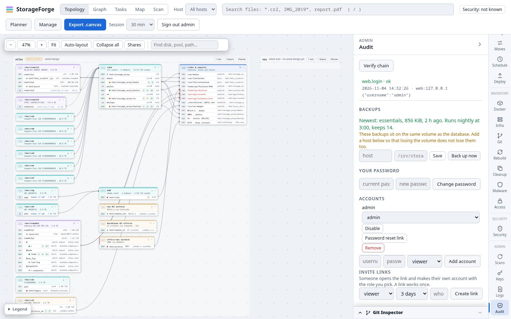
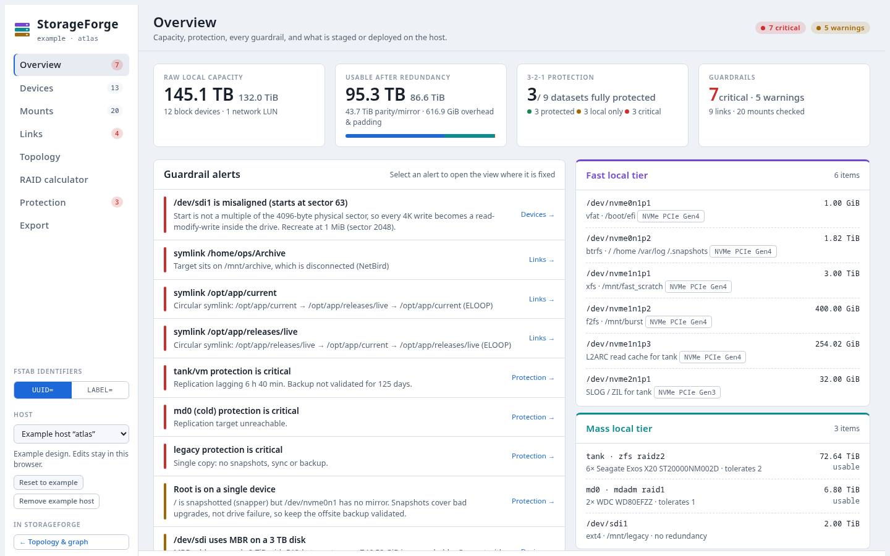
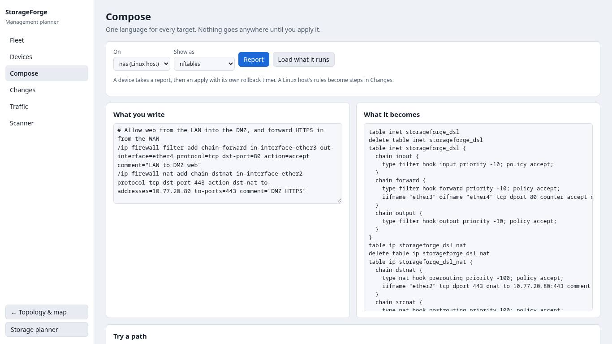
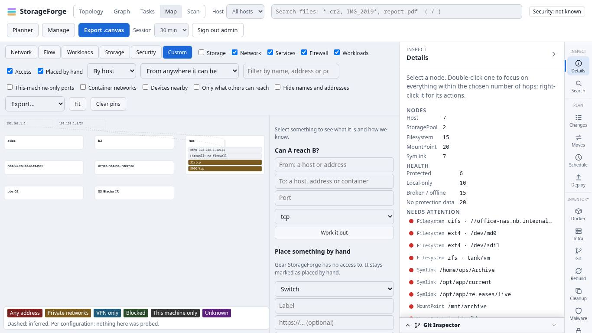
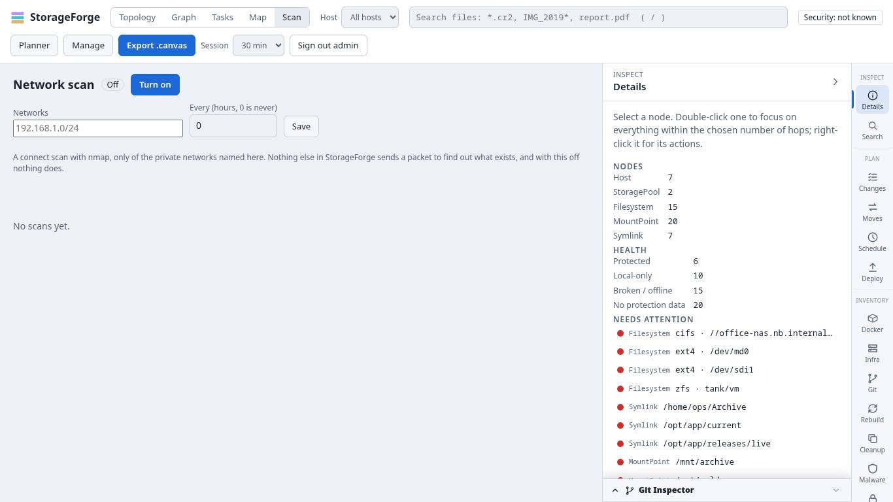

# UI audit, 2026-11-04

A read of the web UI (`storageforge-indexer/storageforge_index/static/`), and a pass through it in a real browser. It looks at how the screens are organised, how they behave from a keyboard, how consistent the three pages are with each other, and, as asked, how well the planner has kept up with what the platform learned after it was written: the infrastructure map, routers and the one network language, workloads, ransomware defense and host logs.

It is the evidence behind the UI and UX items in the [roadmap](../roadmap.md), which decides what is done and when. The detail of each item is in the [UI and UX roadmap](../archive/roadmaps/ui-ux-roadmap.md). The audit rules number findings `SF`, `PF` and `EQ`. These are design findings, so they get their own series, `UX-01` to `UX-41`. If you would rather fold them into `PF` and `EQ`, the numbers can be swapped in one pass: nothing else refers to them.

**Scope.** Branch `docs/ui-ux-roadmap`, cut from `dev-expanded-networking` at `2cac2d6`. The working tree also held uncommitted changes, including the new Logs panel in `app.js` and `index.html`, and they were audited as they stood. Read in full: `index.html`, `app.js`, `session.js`, `login.html`, `login.js`, `planner.html`, `planner.js` (except the RAID engine and the script generators), `manage.html`, `manage.js`, `mapview.js` (except the export helpers), `netscanview.js`, `infraview.js`, the tokens and layout of `style.css`, `planner.css` and `manage.css`, and the start of `securityview.js` and the end of `securitymore.js`. Read in part, by function map and targeted search: `topology.js`, `deployview.js`, `changes.js`, `moves.js`, `tasks.js`, `scheduler.js`, `sharewiz.js`, `checks.js`. **Not read:** `filemap.js`, `gitview.js`, `dockerview.js`, `rebuildview.js`, `fsbrowse.js`, `search.js`, `enroll.js`, and most of `style.css` beyond its tokens and the parts searched for. Findings there would not have been seen.

**What was run.** A throwaway probe kept outside the repository, as the audit rules ask. It seeded a temporary SQLite database the way `tests/test_browser_smoke.py` does, imported the `atlas` example, served the real app on localhost and drove headless Chromium through Playwright as one admin. It measured the rail, the header, the map and the tab order at 1920×1080, 1440×900, 1366×768, 1280×720, 1024×768 and 390×844, tried a keyboard edit in the planner, took 23 screenshots and listened for page errors and console errors or warnings. A second probe typed paths and passwords into nine text fields, with controls, and tried the proposed fix for UX-40 by serving a patched `app.js` through the browser, so the repository stayed as it was. A third checked the other keyboard handlers: the context-menu keys, Escape, `\` and the topology's single keys.

**What was not run.** A screen reader. Firefox and Safari. Zoom to 200% and forced-colors mode. A touch device. A colour-vision simulator. A fleet of any size: the seed has two hosts, so the map, the topology and the logs were never seen with real volumes. Anything that needs a scan or a deploy on a real host (the KVM lab was not used). A finding marked **read** was traced through the code and not reproduced, and it says so.

**Result of the pass.** No page errors and no console errors or warnings on any page, mode or panel visited: the main page in five modes and six panels, the planner in seven of its eight views (not the RAID calculator), `/manage` in two. The strict CSP held.

## Status

Phase 0 of the [UI and UX roadmap](../archive/roadmaps/ui-ux-roadmap.md) has fixed these, each with a test that fails on the old code: UX-02, 12, 14, 18, 19, 28, 29, 32, 39, 40 and 41 in full, and UX-01, 09 and 13 in part. UX-01 is fixed except that the rail's groups do not collapse yet (phase 2). UX-09 is fixed except that the chip is still only on the main page (phase 1). UX-13 is fixed in Details and the map's lists, and the Security tables and the file map still cut their rows without saying (phase 1). The commits are `7f749d1`, `eb6b9f6`, `0e3e7d6`, `84a7775`, `5d194bc`, `607fd65` and `ac79c0f`.

Phase 1 has fixed UX-09 (now on every page), UX-10, 11, 15, 16, 20, 22 and 23, and UX-03 in part (the pages link to one another and all can sign out; one Plan workspace is phase 2), in `a80bfa7`, `8260a13`, `e3b4b09`, `2e91cf5` and `7b04018`. UX-22 is fixed for colours, the button, the dialog, the field, the toast and the chip; the card, table and pill move page by page. UX-23's native modules are held back (the roadmap's B6). The other findings are open.

One thing here was wrong: UX-29 says the assumed /24 is wrong for a /16, which the scanner refuses. A /20 is the widest range it takes.

## Short version

Nothing here stops a release. The UI is careful about what it says (*not measured*, *inferred*, *out of sight*), builds its pages with `textContent` and `esc()` rather than trusting data, and ran without a script error. The problems cluster in four places.

1. **Structure.** One side rail holds everything, including a 16-part security console and the account forms, and on a laptop the rail's lower half, with Security and Logs, is off the screen with nothing to say so.
2. **Three UIs, not one.** The app, the planner and `/manage` share a palette but not a vocabulary, a fetch wrapper, a confirm, a re-authentication dialog or a way to navigate.
3. **Keyboard handling.** A global `/` shortcut eats the slash typed into any text field, passwords included. The map has no focusable node, and the planner drops focus after every edit.
4. **The planner has not grown with the platform.** It annotates storage. It cannot add a disk or a share, and it knows nothing of networks, workloads, security or logs. It also contains the one wrong answer found in the audit: a hard-coded rule that decides what counts as "offsite".

## Count by severity

The audit rules rate harm. For a UI the same ladder reads: **High** is a main feature that a group of people cannot reach or use in a common setup, a wrong answer in a protection indicator, or typing that is changed on its way in; **Medium** is a common task made harder than it should be, a message that misleads, or two paths doing one job; **Low** is tidiness, or needs an unusual setup. Effort is S under a day, M a few days, L a week or more.

| Severity | Count | Findings |
| :--- | :--- | :--- |
| High | 6 | UX-01, UX-04, UX-17, UX-18, UX-32, UX-40 |
| Medium | 26 | UX-02, 03, 06, 07, 08, 09, 10, 11, 13, 15, 19, 20, 22, 23, 24, 26, 27, 28, 29, 30, 31, 33, 34, 35, 36, 38 |
| Low | 9 | UX-05, 12, 14, 16, 21, 25, 37, 39, 41 |

By effort: 16 are S, 17 are M and 8 are L.

## Read these first

**UX-40. The `/` shortcut eats the slash typed into any text field.** `app.js:401-404` moves focus to the search box on `/` wherever focus is, with no check for a text field, an open dialog or a modifier key. The `\` shortcut below it (`app.js:671-674`) skips text fields and modifier keys, and the Tasks undo (`tasks.js:461-462`) skips text fields. So typing a path starts a search. In the browser, `/mnt/x` typed into the Scans host field leaves the field empty, puts `mnt/x` in the header's search box, sends `GET /api/search?q=mnt/x` and swaps the panel you were in for Search. Eight text fields behaved that way, among them the backup folder, the Logs filter, the topology finder and the map filter, and the app's own placeholders invite typing paths there (`/srv/storageforge-backups`, `/mnt/data01/media`). Passwords are worse. In the Keys panel's ssh-copy-id password and in Change password, `pa/ss` leaves `pa` in the field and types `ss`, in the clear, into the search box and on to `/api/search?q=ss`, which the server's own request log recorded. In the modal **Confirm your password** dialog the focus cannot move, so the `/` is dropped without a sign and `pa/ss` arrives as `pass`: a password with a slash in it cannot be typed to confirm a deploy. This has a security side (a password tail reaches the access log), so it may deserve an `SF` number as well. The fix is the guard the `\` handler already has, plus open dialogs. I tested it by serving a patched `app.js` through the probe, and did not apply it: all nine fields keep what was typed, no search is sent, and `/` with nothing focused still moves to the search box.

**UX-01. The rail hides Security and Logs on a laptop.** The rail needs about 1000 px of height and scrolls with its scrollbar turned off (`style.css:89`). At 1440×900 the last four buttons (Scans, Keys, Logs, Audit) are below the fold. At 1366×768 Access and Security go too, and at 1280×720 Malware as well. Nothing in the rail says there is more. Two of the newest features, Security and Logs, are among the hidden ones.

The same screen shows UX-02 (the header is two rows tall, and its one filled blue button exports a graph canvas, a graph-only action that stays visible in every mode) and UX-13 (the Health block counts 15 broken items, "Needs attention" lists 12, and nothing says three are missing).

**UX-18. The planner drops keyboard focus after every edit.** Every change ends in `render()`, which replaces the whole view with `innerHTML` (`planner.js:550`, `planner.js:1070`), and nothing puts focus back. In the browser: select a partition, type in **Label**, press Tab. The next field, **Filesystem**, has been destroyed and focus lands on `<body>`. A keyboard user cannot move through the inspector form. The planner also has no undo, which the Tasks editor has.

**UX-32. The "offsite" column decides from the example's host names.** `copies321()` counts a copy as offsite if the sync target's text matches `/nas-02|office|b2|S3/i` (`planner.js:356`). Those are names from the built-in example. On a real fleet a LAN machine called `office-nas`, or any name containing `b2`, reads as offsite. The same row's **Status** pill uses the explicit `backup.offsite` flag, so one row can disagree with itself, and does in the example: `tank/media` is *Local only: no backup target* and also *2 copies, offsite ✓*.

**UX-17. The map cannot be used without a mouse.** `#mpsvg` is `role="img"`, which hides its children from assistive technology, and it has no focusable node (zero, counted). Selecting, expanding a host (double-click) and panning are pointer-only (`mapview.js:220-242`). There is no list or table version of the same data. It is the newest and largest view, and the one most used during an incident.

**UX-04. The side panel is the home for everything, including consoles.** Eighteen panels share a 380 px column. Security has 16 sub-panels in a three-column grid of buttons, with a dashboard and a timeline inside it. The Audit panel holds the audit log, backups, your password, accounts, invites and roles, with fields squeezed until their placeholders read "current pas" and "userna". The code says so itself: *the panel is a narrow rail, so a "table" is a stack of rows* (`securityview.js:26`).

**UX-22 and UX-23. Three UIs.** `.btn`, `.pill`, `.chip`, `.panel`, `.rail`, `.cnt` and `.empty` are defined separately in `style.css` and `planner.css` with different meanings (`.panel` is the side panel in one and a card in the other), `manage.css` has its own `.mg-*` copies, and the status colours have three sets of names. There are four fetch wrappers with different behaviour on a 401 or a re-authentication: the planner cannot re-authenticate at all and tells you to go to the main page (`planner.js:989`), and `/manage` has a second password dialog. The result is three visual dialects, below.

**UX-31. The planner can annotate a host but not design one.** Nothing in `planner.js` adds to `S.disks`, `S.pools`, `S.remotes` or `S.exports`, and the inspector handles a partition, disk, pool or remote only (`planner.js:661-719`). An export drawn in Topology cannot be selected, let alone edited. The RAID calculator is a scratchpad with no way to turn its answer into a pool. See [The planner](#the-planner).

**UX-08. There is no router.** The URL does not change with the view, panel, host or selection; the hash is read once at boot and then cleared (`app.js:1200`); nothing listens for `hashchange` or `popstate`; and a link to another part of the app has to reload the page (`netscanview.js:78`). `/manage` reads its hash once and stays on `/manage` through every view change. Only the planner writes `#view@host`.

## Findings

Evidence is `file:line` as the code stands today. **Verified** is *proven* when it was reproduced and recorded here, *read* when it was traced through the code and not run.

### Structure and navigation

| # | Finding | Evidence | Sev | Effort | Verified |
| :--- | :--- | :--- | :--- | :--- | :--- |
| UX-01 | The rail clips its lower groups with no cue | `style.css:89` (`overflow-y: auto; scrollbar-width: none`); rail needs about 1000 px; hidden items per viewport are in [Measurements](#measurements) | High | S | proven |
| UX-02 | The header has 13 controls, wraps to two rows at 1440 px or less, and its only primary button is a graph-only export | `index.html:11-27`; header 54 px high at 1920, 97 px at 1440 and below; `topology.js:1135` hides only `#graph`, `.legend`, `#hopsfield` and `#reset`, so `Export .canvas` shows in Map, Tasks and Scan | Medium | S | proven |
| UX-03 | Three planning surfaces under four names, joined three ways | Header says Planner and Manage; the pages say "StorageForge Planner" and "Management Planner"; the link back says "Storage planner"; the map has "Design mode". Hand-offs to Changes: planner by `localStorage` and a page load (`planner.js:932-943`), `/manage` by a link (`manage.js:195`), map by `showTab` (`mapview.js:517`). `planner.html` has no link to `/manage` | Medium | M | proven (names, links), read (hand-offs) |
| UX-04 | The side panel is the home for everything, including consoles that need width | 18 panels in 380 px; Security has 16 sub-panels (`securityview.js:8`, `securitymore.js:6`); Audit holds seven unrelated things | High | L | proven (screens), read (code) |
| UX-05 | Panels are named for one thing and hold another | The `copies` panel is "Cleanup" yet holds the capacity trend and "what changed in the last scan" (`index.html:108-129`); Access (scan access) is under Inventory; Malware is under Inventory while Security has its own group; Logs is under Admin | Low | M | read |
| UX-06 | Three canvases draw the same storage and nothing says which to use | Topology (editable designer), Graph then Structure (force layout of the same nodes), Map with its Storage layer; Files sits under Graph | Medium | M | read |
| UX-07 | The global host picker leaves panels at a dead end | "Pick a host at the top of the page" for 5 of the 16 Security sub-panels (`securityview.js:109-111`), and Infra then Network and Firewall (`infraview.js:56-60`); the picker is in the header, not the panel | Medium | S | read |
| UX-08 | There is no router | `app.js:1200` clears the hash after boot; no `hashchange` or `popstate` handler in any file; `netscanview.js:78` reloads the page to follow an in-app link; `/manage` keeps its URL through view changes | Medium | M | proven (`/manage`), read (rest) |
| UX-09 | The security banner is not on every page, and its detail needs a hover | Only `index.html` has `#threatbanner`; `/planner` and `/manage` have none, though the changelog says "a line at the top of every page"; the detail is `b.title` (`securitymore.js:293`); the secure state reads "Nothing wrong found" while the others read "Security: …" (`securitymore.js:292`) | Medium | S | proven (absence), read (copy) |

### Feedback, state and errors

| # | Finding | Evidence | Sev | Effort | Verified |
| :--- | :--- | :--- | :--- | :--- | :--- |
| UX-10 | Native dialogs make the decisions, and take structured input | 39 calls in 12 files: 29 `confirm`, 6 `alert`, 4 `prompt`. `prompt` takes a scan interval and quiet hours (`topology.js:892-894`), snapshot keep counts (`deployview.js:562`) and a `user@host` (`tasks.js:258`). `alert` reports an error or a refusal in six places. Retiring a host, which deletes its index, graph, history and design, is a plain `confirm` (`topology.js:900`). Three confirm styles exist: native, inline in the planner, and `<dialog>` | Medium | M | read |
| UX-11 | Progress and results are visual only | No spinner, skeleton or animation in any stylesheet; about thirty text-only "Loading…" and "Working…" lines; no `aria-busy`; seven live regions in the whole UI (toast, search, enroll, file map), so a save, a dry run or an error in a panel (a colour class such as `st-failed`) is not announced | Medium | M | read |
| UX-12 | Only one panel guards against answers arriving out of order | `secRender` keeps a `turn` counter (`securityview.js:105`); search (`app.js:676`), host logs (`app.js:1041`), Infra, map reloads and Scan do not | Low | S | read |
| UX-13 | "Needs attention" shows 12 of 15 and does not say so | `app.js:491` `.slice(0, 12)`; the Health block above it counts 15 (screenshot). The map's coverage and changes lists are capped at 20 the same way (`mapview.js:337`, `mapview.js:562`) | Medium | S | proven |
| UX-14 | Copy that does not match the screen | In Map, Tasks and Scan the Details panel still says "Select a node. Double-click one to focus…" and counts storage-graph nodes (`topology.js:1143-1145`); the map's mode **Storage** and its layer **Storage** share a label; `/manage` Compose's **Report** stages steps in Changes for a Linux host but only reports for a device (`manage.js:189-198`) | Low | S | proven (Details), read (rest) |
| UX-15 | Work in progress is protected unevenly | Topology has a `beforeunload` guard (`topology.js:1129`); the planner keeps drafts in `localStorage` but has no guard and asks with `confirm()` when you switch host (`planner.js:1040`); Compose's text and the map's staged steps (`MP.draft`, `mapview.js:444`) are in memory only; Compose's **Load what it runs** replaces the editor without asking (`manage.js:220`); an expired session empties the page (`session.js:4-9`) | Medium | M | read |
| UX-16 | Times are shown three ways | UTC ISO strings in logs, audit and invite expiry (`app.js:850`, `app.js:1032`); local `toLocaleString()` in jobs, backups, the map and `/manage`; "UTC" written out in one place (`app.js:427`). Seven small time formatters, none shared | Low | S | read |

### Keyboard, screen reader and contrast

| # | Finding | Evidence | Sev | Effort | Verified |
| :--- | :--- | :--- | :--- | :--- | :--- |
| UX-17 | The map cannot be used without a mouse | `mapview.js:220` `role: 'img'`; zero focusable nodes in `#mpsvg`; select, expand and pan are pointer-only (`mapview.js:222-242`); the Structure canvas has the same limit | High | M | proven |
| UX-18 | The planner drops keyboard focus after every edit | `planner.js:550` and `planner.js:1070`; edit **Label**, press Tab, `document.activeElement` is `body`; no undo | High | M | proven |
| UX-19 | Five text pairs fail contrast, three things | 19 of 24 measured text pairs pass AA. `--faint` as text, 3.13 dark and 3.03 light (planner column heads and eyebrows at 10.5 px: `planner.css:87`, `planner.css:107`); the rail's group labels at 8.5 px and 70% opacity, 3.37 and 3.05 (`style.css:90`); the light theme's Access badge, 4.05 (`style.css:102`). Everything else passes, `--protected` and `--local-only` in the light theme only just (4.51, 4.59) | Medium | S | proven (computed) |
| UX-20 | Widgets lack the semantics they imply | The rail is a `tablist` with `aria-selected`, but the panels are not `tabpanel`, nothing is `aria-controls`, and the arrow keys do nothing (`index.html:270`, `app.js:599-632`); 14 tab stops from page load to the first control in the canvas and no skip link; `title`-only tooltips carry information a keyboard or touch user cannot reach, among them the security banner's detail | Medium | M | proven (tab stops), read (rest) |
| UX-21 | Colour carries meaning alone in the canvases | The Structure graph fills nodes green, amber, red or grey with no second cue (`app.js:255`), and `--protected` against `--broken` is the pair most often confused. The map's legend is labelled in text, which is right | Low | S | read |
| UX-40 | The `/` shortcut eats the slash typed into any text field | `app.js:401-404` has no check for a text field, an open dialog or a modifier; the backslash shortcut (`app.js:671-674`) skips text fields and modifiers and the Tasks undo (`tasks.js:461-462`) skips text fields; eight fields lose the `/` and start a search; a typed password after its first `/` goes to the visible search box and the server's log; the modal re-authentication dialog drops the `/`, so a password containing one cannot be typed. The suggested guard was tested through the probe | High | S | proven |
| UX-41 | Three smaller handlers ignore where the focus is | `Menu` and `Shift+F10` open the app's context menu from inside a text field (`app.js:566-570`), where right-click skips fields (`app.js:559-560`): proven in a Tasks block, with right-click in the same field as the control; Moves steps have the same shape (`moves.js:145`), read only. The backslash shortcut toggles the side panel behind an open modal dialog (`app.js:671-674`): proven. Escape closes the share wizard and the Shares manager at once and discards the edit with no question (`sharewiz.js:29`, `sharewiz.js:313`), where Changes, Moves and Tasks ask: proven. Escape also clears the graph's focus and the file map's destination pick from anywhere (`app.js:403`, `filemap.js:676`): read | Low | S | proven, read (Moves, the Escape pair) |

### Consistency and foundations

| # | Finding | Evidence | Sev | Effort | Verified |
| :--- | :--- | :--- | :--- | :--- | :--- |
| UX-22 | One palette, three vocabularies | `.btn`, `.pill`, `.chip`, `.panel`, `.rail`, `.cnt`, `.empty` and `.tabs` differ between `style.css` and `planner.css`; `manage.css` repeats them as `.mg-*`; status colours are `--protected`/`--local-only`/`--broken`, `--ok`/`--warn`/`--crit` and `--bad`/`--warn`/`--ok`; the planner uses an IBM Plex stack and the others the system stack | Medium | L | proven (screens), read (CSS) |
| UX-23 | There is no shared UI kernel | Four fetch wrappers: `api` (`app.js:24`), `apiJSON` (`planner.js:984`), `call` (`manage.js:42`) and `call` (`search.js:11`), each with its own 401 and re-authentication; a second password dialog (`manage.js:27`); `el()` defined in `topology.js:20` and `manage.js:12`, and used by `app.js` through load order; four size formatters and seven time formatters; `typeof loadScheduler === 'function'` guards; `boot()` at the end of `topology.js`; about 20 script tags | Medium | L | read |
| UX-24 | Four plan editors, one pipeline | Changes 410 lines, Moves 277, Tasks 466, Schedule 571: each with its own picker, dirty flag, check, script and deploy plumbing for what is one Plan, Check, Script, Deploy story | Medium | L | read |
| UX-25 | Type, spacing and layering have no scale | 21 distinct `font-size` values from 8.5 px to 40 px, with 40 declarations at 12 px in `style.css`; z-index values 0 to 60 chosen file by file | Low | M | read |

### Feature screens: map, Compose, Scan, Logs

| # | Finding | Evidence | Sev | Effort | Verified |
| :--- | :--- | :--- | :--- | :--- | :--- |
| UX-26 | The map spends its screen on controls | At 1366×768 the toolbar has 24 controls on four or five rows (169 px), leaving the canvas 621×502; the map adds a 300 px side column of eight sections (`mapview.js:86`) beside the app's own 445 px panel, whose **Details** stays idle because the map writes to `#mpdetail`, not to it | Medium | M | proven |
| UX-27 | The map's planning tools show their machinery | The what-if list prints task types, "gw-01: fw-rule" (`mapview.js:510`), where the planner has plain-language `taskLabel`; Design mode takes hand-written JSON in a six-row textarea with raw `JSON.parse` errors (`mapview.js:540`) and no "start from what was read"; per-node forms accept empty fields and leave validation to the server (`mapview.js:446-484`) | Medium | M | read |
| UX-28 | Compose is a text box | No highlighting, inline markers (unsupported lines are listed under the editor, `manage.js:167`), snippets or forms; one built-in example; the what-if wants from, to and port typed in, with nothing proposed from the rules just written and nothing saved as "must stay open"; the Changes view makes one request per device in series and lists devices only (`manage.js:245`); "Scanner" is a view that only links elsewhere (`manage.js:275`) | Medium | L | read |
| UX-29 | Scan groups every host under an assumed /24 | The key is the first three octets plus `.0/24` (`netscanview.js:48`), wrong for a /16, /23 or /25 and for IPv6, though the scanned ranges are known (`cfg.ranges`); no table, sort, filter or diff; history is a `<select>` | Medium | S | read |
| UX-30 | Host Logs is a form and a list | UTC without saying so (`app.js:1032`); no time range or volume view; a per-host freshness list only when there is a problem (`app.js:1070`); the empty state cannot tell "nothing collected" from "no match"; filters apply only on **Search**; no way in from a host, alert, mount or device, and `takeLink` reads only `host`, `tab`, `view` and `panel` (`app.js:1197-1211`) | Medium | M | read, screen |

### The planner

**What it is today.** `/planner` has eight views (Overview, Devices, Mounts, Links, Topology, RAID calculator, Protection, Export) over a model held in the browser (`disks`, `pools`, `remotes`, `links`, `exports`, `protection`) and saved as a `storageforge/v1` blueprint. It is the most polished page in the product, and its **Guardrail alerts** (a severity bar, what is wrong, why, and a link to where it is fixed) are the best pattern anywhere in the UI. Its two bridges to the rest of StorageForge are good ones: the **Across StorageForge** card on Overview (staged changes, moves, shares, jobs, drift, unreadable folders) and **Export** then **Change plan**, which turns the design into Changes tasks.

It can edit a partition's filesystem, label, mount point and options; subvolumes; a pool's level, ashift, encryption and mount; a dataset's mount, recordsize, compression and sync; a remote's link state, mount and options; links; and the cells of the protection grid. It cannot add or remove a disk, partition, pool, remote mount or export, and it cannot select an export. Of everything the platform has learned since it was written, it knows nothing.

| # | Finding | Evidence | Sev | Effort | Verified |
| :--- | :--- | :--- | :--- | :--- | :--- |
| UX-31 | It can annotate a host but not design one | No code adds to `S.disks`, `S.pools`, `S.remotes` or `S.exports` (searched); `inspector()` handles part, disk, pool and rem only (`planner.js:661-719`) and `selectNode` has no `exp` (`planner.js:1071-1079`); the RAID calculator cannot create a pool | Medium | L | read (searched) |
| UX-32 | "Offsite" is decided by example host names | `planner.js:356` `/nas-02\|office\|b2\|S3/i` against the sync target; the **Status** pill uses `backup.offsite` instead, so a row can say *Local only* and *offsite ✓* together (`tank/media` in the example) | High | S | proven (example), read (real fleets) |
| UX-33 | A click both simulates and records | `planner.js:1114-1116`: a click on a sync or snapshot cell changes it, and the change is saved with the design that feeds reports and the graph; the header says "to simulate a state change" (`planner.js:890`). Rows that were observed say `From: …` and refuse edits (`planner.js:880`, `planner.js:1112`); a row somebody typed does not say it is declared | Medium | M | read |
| UX-34 | No network | A remote's `via` and an export's `clients` are free text (`planner.js:68-70`, `planner.js:84-87`); the planner cannot say who can reach an export, which rule decides, or what a mount depends on (interface, VLAN, MTU, tunnel), though `/api/map/reach`, `/api/map/exposure`, `/api/network` and `/api/firewall` exist | Medium | L | read |
| UX-35 | No workloads | Path to service names come from a fixed list (`SERVICE_HINT`, `planner.js:444`), not from what the host runs; the planner cannot show which containers or VMs sit on a mount (`/api/workloads` carries each mount), warn when a database sits on bulk storage, or show what an edit touches | Medium | L | read |
| UX-36 | No security posture | Protection shows 3-2-1 only; holds, retention, immutability, decoys and quarantine reach (`/api/map/coverage`) do not appear, though the map marks workloads nothing protects | Medium | M | read |
| UX-37 | No path from a device or mount to its logs | Host logs are searchable, but nothing in Devices, Mounts or Protection opens them for `sdb`, `zed` or a mount, and Logs reads no filter from a link | Low | S | read |
| UX-38 | The planner is cut off from the rest | The **In StorageForge** links cover seven panels (`planner.js:994`), not Infra, Security, Logs, Map or `/manage`; no security banner; **Stage in Changes** hands off through `localStorage` and a page load; a change plan needs a scan first; **Refresh from latest scan** is all or nothing; saved designs have no history | Medium | M | proven (links, banner), read (rest) |

**What the platform knows that the planner does not.**

| Capability | Where it lives | In the planner today | What it would take |
| :--- | :--- | :--- | :--- |
| Storage hardware and layout | scans, `/api/planner/design` | annotated; no add or remove | planned hardware, a pool created from the calculator, a free-space-aware partition editor |
| Shares (NFS, SMB) | share wizard and manager in the main app | drawn in Topology; no editor | a Shares view that embeds the wizard and its checks |
| Network: NICs, bridges, VLANs, MTU, routes, WireGuard | `/api/network`, the map, `/manage` | nothing | a Network tab, and validated forms that stage `net-*` steps |
| Who can reach what | `/api/map/reach`, `/api/map/exposure` | nothing | "Reachable from" on exports and remotes, naming the deciding rule |
| Firewall rules | `/api/firewall`, map staging (`fw-rule`) | nothing | rule steps for the service behind an export, with a ghost preview |
| Workloads | `/api/workloads` | a fixed list of path hints | workloads on each mount, placement guardrails, dependency preview |
| Security posture | `/api/security/*`, `/api/map/coverage` | 3-2-1 only | provenance, retention, hold and immutability columns, *not measured* where unread |
| Host logs | `/api/hostlogs` | nothing | related log lines per device, pool and mount, as a link |
| Deployed jobs, drift, staged work | `/api/planner/activity` | **yes**, on Overview | keep; mark individual objects |
| Design against scan | `/api/planner/changes`, map `designs/<id>/compare` | whole-design plan and refresh | per-object missing, different, extra and unknown, and adopt |
| Export to other tools | map designs: Bash, Ansible, Terraform, Puppet | fstab, units, JSON, YAML, ASCII | the same targets once the two design documents meet (a decision) |
| Report, dry run, apply | Changes, `/manage`, Security's three buttons | stages through `localStorage` | one shared Change review |

### Docs

| # | Finding | Evidence | Sev | Effort | Verified |
| :--- | :--- | :--- | :--- | :--- | :--- |
| UX-39 | The Web UI page describes three views and fourteen panels | `docs/web-ui.md` line 5 says "three views"; the UI has five (Map and Scan are new) and 18 panels. Infra, Malware, Security and Logs have no row, and Map, Scan, `/manage` and the header's Manage link are not mentioned | Low | S | proven |

## Fix order

Each step makes the next one cheaper, and the roadmap follows it.

1. **Small defects with no decision in them:** UX-40 first, which is a few lines (UX-41 is the same kind of fix), then UX-01, 13, 14, 18, 19, 29, 32, 39, and the copy of 09. Several are an afternoon.
2. **One kernel,** so the rest is built once: a single `api()`, one dialog component to replace the 39 native calls, live-region and busy helpers, one time policy, a latest-wins guard (UX-23, 10, 11, 12, 15, 16, 25).
3. **One vocabulary and a router** (UX-22, 08). Moving a panel is cheap once its address is a route and its buttons are shared.
4. **Structure:** the rail, the header, the host picker, Security and the account forms out of the rail, the planners under one roof, the keyboard and landmark work (UX-02, 03, 04, 05, 07, 09, 20).
5. **The planner, then the map, Compose, Scan and Logs** (UX-31 to 38, then 17, 26 to 30). They are last because they are the largest, and each one wants the kernel and the router.

## Verdict per feature

| Feature | Built the right way? | Verdict |
| :--- | :--- | :--- |
| Topology designer | Yes: DOM tables, focusable rows, a `beforeunload` guard, drag to make a backup target | Keep |
| Graph, Structure | Duplicates the map's Storage layer and the designer | Decide (UX-06) |
| Tasks editor | Yes: palette, templates, live checks, undo and redo | Keep; the model for the other plan editors |
| Changes, Moves, Schedule, Deploy | The right pipeline, four times, in a rail | Share one component; give Deploy room |
| Infrastructure map | Right ideas (evidence on every line, confidence, what-if, time travel), wrong container | Give it space and a keyboard (UX-17, 26, 27) |
| Scan | Sound and opt-in | Fix grouping (UX-29) |
| `/manage` | A sound engine (report, timer, rollback, what-if) behind a thin editor | Grow the editor (UX-28) |
| Planner | The best-looking page, with a narrow scope and one wrong answer | Fix correctness and keyboard now; grow its scope (UX-31 to 38) |
| Security | The right content, with its honest "not measured" language, in the wrong container | A workspace (UX-04) |
| Host logs | A minimal first version, as the roadmap says it should be | Time range, freshness, entry points (UX-30) |
| Re-authentication and host-key dialogs | Yes: native `<dialog>`, a hidden username for password managers, a host key shown before a password goes | Keep; the model for every other confirm |
| Accounts, roles, invites, backups | Work, in the wrong place | Move out of the rail (UX-04, 05) |

## What was done well

- **The language of the product is its best UX asset.** *Not measured*, *inferred*, *out of sight*, *per configuration: nothing here was probed*, evidence on every map line, a caveat on every reach answer. Keep it, and make every new screen show its source and age.
- **Report, dry run, apply.** Security's *Show script, Dry run, Apply*, `/manage`'s report then apply with a rollback timer and its warning that a change blocks the SSH StorageForge comes in on, Deploy's read-only report first. Share one component and every screen gets this.
- **Safe page building.** The main app builds with `textContent` and DOM calls, the planner escapes and scrubs what it loads, and the strict CSP held across every page visited.
- **Dialogs that think about the user.** Re-authentication has a hidden username for password managers; the host-key dialog shows the fingerprint before a password is sent; a signed-out page empties itself and returns you with `next=` and your hash.
- **Context menus with full keyboard support**, on the menu key and Shift+F10, with a way to keep the browser's own menu.
- **The topology canvas's single-key shortcuts** (`+`, `-`, `0`, `f`, Esc) skip text fields and modifier keys, and the file map's tree uses the standard tree keys: the model for one shortcut rule everywhere.
- **The Tasks editor**: palette, templates, live checks, undo and redo.
- **The planner's Guardrail alerts** and KPI tiles, its `#view@host` URLs, and its **Across StorageForge** card.
- **A resizable, collapsible panel** that remembers its width; `/` and `\` shortcuts.
- **Contrast is mostly right:** 19 of 24 text pairs pass AA, in both themes, and the map's legend is written out in words.
- **A latest-wins guard** in Security (`turn`), which only needs to spread.

## Measurements

Taken by the probe on 2026-11-04, headless Chromium, the real server, a temporary database with the `atlas` example and one scanned host.

| Viewport | Header | Canvas stage | Rail items below the fold |
| :--- | :--- | :--- | :--- |
| 1920×1080 | 54 px, one row | 1475 px | none |
| 1440×900 | 97 px, two rows | 995 px | Scans, Keys, Logs, Audit |
| 1366×768 | 97 px | 921 px | Access, Security, Scans, Keys, Logs, Audit |
| 1280×720 | 97 px | 835 px | Malware, Access, Security, Scans, Keys, Logs, Audit |
| 1024×768 | 97 px | 579 px | Access, Security, Scans, Keys, Logs, Audit |

The side panel is 445 px wide with its rail at every width tested, so at 1024 px it takes 44% of the screen. At 390×844 the header is 245 px high (29% of the screen) and the page does not overflow sideways.

**Map at 1366×768.** Toolbar 169 px high with 24 controls; canvas 621×502; side column 300 px wide holding 1110 px of content; app panel 445 px. `#mpsvg` has `role="img"` and zero focusable descendants.

**Scan at 1366×768.** The page is a settings form and an empty list; the Details panel beside it still shows storage-graph counts and the graph's instructions, and `Export .canvas` is still the header's one blue button (UX-14, UX-02).

**Tab order.** 14 tab stops from page load to the first control inside the canvas: Topology, Graph, Tasks, Map, Scan, Host, Search, the security banner, Planner, Manage, Export .canvas, Session, Sign out, and then **Deploy 2 shares**. No skip link.

**Planner focus.** Select a partition, focus `#i-label`, type `x`, press Tab: before, `input#i-label`; after, `body`.

**The `/` shortcut.** Each field was focused and typed into on a fresh page load, with the keyboard.

| Field | Typed | The field ends up holding | The search box holds | Search sent |
| :--- | :--- | :--- | :--- | :--- |
| Scans: host to scan | `/mnt/x` | nothing | `mnt/x` | yes |
| Keys: key name | `a/b` | `a` | `b` | no, one character |
| Keys: ssh-copy-id password | `pa/ss` | `pa` | `ss` | yes |
| Audit: new password | `pa/ss` | `pa` | `ss` | yes |
| Audit: backup folder | `/srv/backups` | nothing | `srv/backups` | yes |
| Logs: text | `/var/log` | nothing | `var/log` | yes |
| Topology: box finder | `/mnt/cold` | nothing | `mnt/cold` | yes |
| Map: filter | `/mnt` | nothing | `mnt` | yes |
| Confirm your password (modal) | `pa/ss` | `pass` | nothing | no |

Controls: the search box itself, a `\` typed into a text field (that shortcut is guarded), and the planner's mount point field (a page that does not load `app.js`) all keep what is typed, and `/` with nothing focused moves to the search box as designed. With the guard in place (`/` ignored in a text field, under an open dialog, and with Ctrl, Alt or Meta held) all nine cases keep what is typed, no search is sent, the designed behaviour is unchanged and `Ctrl+/` is left alone.

**Every keyboard handler**, from a search of all the scripts for `keydown`, `keyup`, `keypress` and `accesskey` (there are no `keyup`, `keypress` or `accesskey` uses). Tested rows say so.

| Key | Bound to | Where it acts | Skips text fields | Result |
| :--- | :--- | :--- | :--- | :--- |
| `/` | `app.js:402` | whole page | no | UX-40, proven |
| `Menu`, `Shift+F10` | `app.js:566-570` | whole page | no (right-click does) | UX-41, proven in a Tasks block |
| Backslash | `app.js:671-674` | whole page | yes, and skips modifiers | ignores an open modal, UX-41, proven |
| Escape | `app.js:403`, `filemap.js:676` | whole page | no | clears the graph focus and the file map pick from anywhere, read |
| Ctrl or Cmd+Z, with Shift to redo | `tasks.js:461-465` | whole page, Tasks mode only | yes | fine; no Ctrl+Y; read |
| `+` `=` `-` `0` `f`, Esc, Enter or Space on a row | `topology.js:1023-1030` | inside the topology canvas | yes, and skips modifiers | fine, proven: `f+-0=` typed into its find box arrived intact |
| Enter, Shift+Enter, Esc | `topology.js:567` | the topology find box | n/a | fine |
| Arrows, Enter, Space | `filemap.js:536-560` | inside the file map tree | no check for the row's checkbox | read only: the tree claims Space on the checkbox, and the map needs scanned file data to try it |
| Arrows, Home, End, Esc, Tab | `app.js:528-534` | an open context menu | n/a | fine; Esc stops there |
| Arrows | `app.js:663` | the panel's resize grip | n/a | fine |
| Enter | `fsbrowse.js:119` | the folder browser's path box | n/a | fine |
| Enter, Space | `planner.js:1098` | `role=button` elements in the planner | n/a | fine |
| Esc on a dialog | native `cancel` | each `<dialog>` | n/a | re-authentication and host key reject properly; the share wizard and Shares manager close at once (UX-41, proven) |

With nothing focused only `/` and `\` do anything at page level (proven); `?` does nothing, and nothing in the UI lists the shortcuts. `/manage`, `/search`, the sign-in and enroll pages have no key handlers, and the planner has only the Enter and Space one.

**Contrast**, WCAG ratios for text on its background. Failing pairs are in bold.

| Pair | Dark | Light |
| :--- | :--- | :--- |
| `--muted` on panel, panel-2, bg | 5.83, 5.42, 6.30 | 6.19, 5.77, 5.47 |
| **`--faint` on panel (planner heads, eyebrows)** | **3.13** | **3.03** |
| **Rail group label, muted at 70% on panel-2, 8.5 px** | **3.37** | **3.05** |
| Rail button label, 10 px | 5.42 | 5.77 |
| Accent on panel; `.btn.pri` text on accent | 7.09; 7.15 | 5.22; 5.22 |
| `--protected`, `--local-only`, `--broken` on panel | 8.96, 9.67, 6.10 | 4.51, 4.59, 5.19 |
| Access badge, `#1a1200` on `--local-only` | 10.18 | **4.05** |
| `--unknown` as a dot (non-text, needs 3:1) | 3.79 | 3.03 |

The probe's checks (rail items visible at 1366×768, focus after Tab in the planner, tab stops to content, no console errors on every page) are the ones to turn into regression tests in `tests/test_browser_smoke.py` as each fix lands. The probe itself stays out of the repository.
