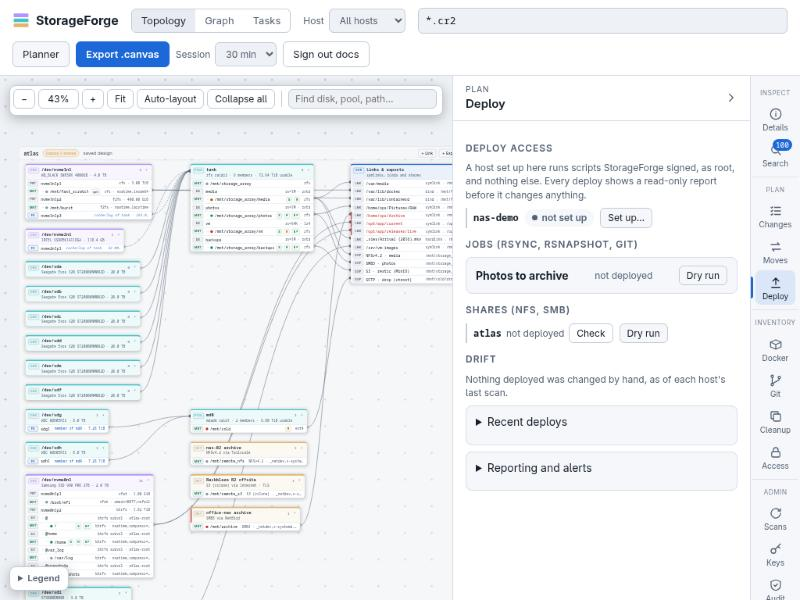

# Deployments

Every plan can be downloaded as a script. **Deploy** runs the same script on the hosts from the web UI instead: a read-only report first, then apply. It works through a small runner on each host that runs only scripts StorageForge signed, for that host, in the last 10 minutes.



The full design and its reasoning are in [deployments-design.md](../deployments-design.md).

## How a deploy reaches a host

```text
 vault: storageforge-signing (ed25519) ──SSHSIG──► request = header (host, machine, issued, nonce, args) + script + signature
 vault: storageforge-deploy  (ed25519) ──ssh────► storageforge-deploy@host
     authorized_keys: restrict,command="sudo -n /usr/local/sbin/storageforge-run"
     sudoers:         storageforge-run, and storageforge-job --serve *   (nothing else)
     storageforge-run checks, in order:
       the signature verifies (ssh-keygen -Y verify, namespace storageforge-deploy)
       host is this machine's short name, and machine is its /etc/machine-id
       issued less than 10 minutes ago (and not more than 5 in the future)
       the nonce was never used (claimed atomically)
       args match a strict character set
     then: bash <script> <args> as root; output and exit code come back over ssh
```

The deploy key alone runs nothing: every request needs a fresh signature from the signing key, which never leaves the vault. Every signed script also brings an older `storageforge-run` up to date, so hosts set up earlier get new checks without rerunning the setup. Refused requests exit with code 97 and are logged to `/var/log/storageforge/run.log` on the host.

Hosts need OpenSSH 8.1 or later for `ssh-keygen -Y`.

## Setting up deploy access

Once per host, either:

- **Deploy → Set up…** in the web UI, with a sudo password typed into the request: the scan user's own, or an admin account's. The password is used for that one SSH session and never stored. Afterwards StorageForge binds the deploy key to the host and proves a signed run works.
- **By hand:** download the setup script (`POST /api/deploy/setup-script`, or `storageforge-index deploy setup-script`), run it as root on the host, then press **I ran it: test** so StorageForge binds the key and tests a signed run.

The setup creates the `storageforge-deploy` system user (no password, root-owned `authorized_keys`), `/etc/sudoers.d/storageforge-deploy` (checked with `visudo -cf`), `/usr/local/sbin/storageforge-run`, and `/etc/storageforge/allowed_signers`. The removal script (`--remove`, or **Remove** in the UI) undoes all of it.

## Running a deploy

`POST /api/deploy/start` with a kind and a reference:

| Kind | Ref | Hosts, in order | Report | Apply |
| :--- | :--- | :--- | :--- | :--- |
| `shares` | server host | the server, then each client (including clients the last deploy had and the design dropped, so their mounts are removed) | `shares-<host>.sh` | `--apply` |
| `jobs` | move plan id | source hosts first (serve config and keys), then the hosts that run the jobs | job configs that would change | install jobs and timers; `remove: true` deploys an empty plan, removing its jobs |
| `changes` | change plan id | each host in the plan | `changes-<plan>.sh` | `--apply`, plus `--destructive` when asked |
| `tasks` | task id | the task's host (and its previous host, to uninstall) | dry run | `--install`; `run: true` runs once; `remove: true` uninstalls |
| `schedules` | schedule id | the scheduled task's host | dry run (`--report`) | install client runner, config, cron file; `run: true` runs once; `remove: true` uninstalls |

Scans record each host's package manager (apt, dnf, yum, zypper or pacman) and whether it has the NFS server (`exportfs`), Samba (`smbd`), the client mount helpers (`mount.nfs`, `mount.cifs`), `rsync` and `rsnapshot`. The share check uses this to say what a deploy would install, such as `the deploy installs nfs-kernel-server with apt-get`. A host that lacks a program and has no known package manager is a critical problem: install the program by hand and rescan. When the deploy runs, the script looks again on the host itself, and installs what is missing at that moment with the package manager it finds. A failed install is a conflict that shows the package manager's last lines and fails that host.

Move plan jobs work the same way for `rsync` (on the host that runs the job and, when the source is elsewhere, on the source) and `rsnapshot` (on the host that runs the job). The plan check says what a deploy would install. On dnf and yum, rsnapshot comes from EPEL, which must already be enabled.

The report runs first on every host. Apply stops at the first host that fails. Every host involved must have deploy access, or the request is refused with the list of hosts to set up. Each run is recorded in `deploy_runs` (output capped at 256 KiB) and in the audit log; the UI polls `GET /api/deploy/groups/<id>` while it runs.

**Smooth execution:**
- **Cancel:** A running deploy can be cancelled (`POST /api/deploy/groups/<id>/cancel`). Upcoming queued hosts will not start; **Force stop** additionally terminates SSH processes for any currently running scripts.
- **Retry:** If a deploy fails, is cancelled, or finishes incompletely, **Retry failed hosts** (`POST /api/deploy/groups/<id>/retry`) re-runs only the unfinished hosts with fresh keys.
- **Stale dry run protection:** Applying from a report checks that the plan has not changed since the dry run was inspected (`report_group`). If modified, Apply refuses with code 409 so changes are reviewed before running.
- **Scan confirmation & log capture:** Scans read completion records written by the runner (`/var/lib/storageforge/run/runs.jsonl`) and storage tasks (`/var/lib/storageforge/tasks/`). A scan matches nonces to confirm actual execution results on the host. If a script or scheduled task failed, a signed read-only log fetch runs automatically over deploy access (once per problem) to retrieve journal and runner logs.

## Deployed jobs

Deploying a move plan turns each step into a job with the id `p<plan>-<step>`. A job runs on its destination host and pulls from its source through `storageforge-job`, a static program the deploy installs.

**On the destination (the host that runs the job):**

| File | Purpose |
| :--- | :--- |
| `/usr/local/sbin/storageforge-job` | runs, verifies, cuts over, lists and packs snapshots |
| `/etc/storageforge/jobs/<id>.conf` | the job's settings |
| `/etc/storageforge/jobs/<id>.key` (0600) | the job's own SSH key for the source |
| `/etc/storageforge/jobs/<id>.token` (0600) | the token it reports with |
| `sf-job-<id>.service` and `.timer` | the run, scheduled for mirror, rsnapshot and git steps (and per level for rsnapshot) |
| `sf-job-<id>-verify.timer` | optional weekly or monthly checksum verify |
| `/var/lib/storageforge/jobs/<id>/runs.jsonl` | one line per run |

**On the source:** `/etc/storageforge/serve/<id>.conf` (allowed root, pre/post commands, snapshot mode) and a forced-command line for the job's key in `storageforge-deploy`'s `authorized_keys`. Through it the key can only run `pre`, `post`, `snap`, `unsnap`, `ping`, `rsync --server --sender` and `git-upload-pack` for paths under the job's root. It refuses `--remove-source-files`.

Keys and tokens are made fresh on every apply and travel only inside the signed request. StorageForge keeps the public key and the token's SHA-256. Each deploy only touches its own plan's jobs (the `p<plan>-` prefix) and removes those the plan no longer has. A plan with deployed jobs cannot be deleted until they are removed.

**One run:**

1. A run outside its window (for example `01:00-06:00`) exits as skipped; a run is stopped at the end of its window and the next one resumes.
2. Day or night bandwidth limit, by start time.
3. `pre` on the source (stop a stack, dump a database).
4. On btrfs, a read-only snapshot of the source subvolume; `post` runs straight after it, so a stopped stack is only down for the snapshot.
5. The transfer: rsync for copy, move and mirror; `rsnapshot <level>` for rsnapshot; `git remote update` for git.
6. Snapshot removed, `post` if it has not run yet (a trap runs it even when the transfer fails).
7. The result goes to `runs.jsonl` and to `<report URL>/api/jobs/report` with the job token.

**Actions** on a deployed job: Run, Dry run, Verify (`rsync --checksum` dry run listing differing files), Pause, Resume, Cutover (move steps, after a clean verify), Log (journal), and for rsnapshot jobs Snapshots, browse a folder in one, and Restore. A restore goes back to the source as `<path>.restored-<time>` and never overwrites anything. Across hosts it is a tar stream from a signed `pack` run into a signed `unpack` run.

## Reporting, alerts and drift

**Report URL.** Set it under **Deploy → Reporting and alerts** to the address hosts can reach StorageForge at. For an `https` URL with the self-signed certificate, jobs trust the certificate in `STORAGEFORGE_REPORT_CA_FILE` (compose sets it). Scans also read the last runs from `runs.jsonl`, so history fills in even when a report could not be sent.

**Alerts** are evaluated every 5 minutes and right after a job reports:

- a job failed;
- a job is stale (no good run for twice its schedule period plus an hour);
- a scheduled task failed or failed server verification;
- a schedule is stale (no verified run for twice its period plus an hour);
- a verify found differences;
- drift on a host;
- a deploy failed.

Besides failed, late and differing jobs and drift, alerts cover what scans and the server already know:

- a host's latest scan failed;
- a mount seen in the last 30 days is gone (after that it counts as removed on purpose);
- a filesystem is over `STORAGEFORGE_DISK_WARN_PCT` or `STORAGEFORGE_DISK_CRIT_PCT` full, from the last scan (network shares and RAM disks don't count);
- a pool is not healthy, or reports device errors;
- the nightly backup failed, or the newest is over 3 days old;
- the HTTPS certificate ends within 30 days.

Open alerts show in the Deploy panel. Each opening and resolving can also go to ntfy (URL, topic, optional token), Gotify (URL, token) or a webhook. Alert URLs may not point at loopback, link-local or multicast addresses, redirects are not followed, a stored token is dropped when its server changes, and the test button reports only HTTP status codes. Private LAN addresses are allowed, since a self-hosted ntfy is the usual setup.

**Drift** has two kinds:

- **pending:** the plan or design changed since its last deploy (shown, not alerted);
- **changed on the host:** apply runs record checksums of the files they wrote, StorageForge's own fstab lines and the timers they own. Each scan checks them; anything changed by hand is drift.

## CLI

```bash
storageforge-index deploy status                 # hosts, jobs with their last runs, drift
storageforge-index deploy setup-script [--remove] > setup.sh
storageforge-index deploy alerts                 # evaluate and notify now; exit 1 while any are open
```
