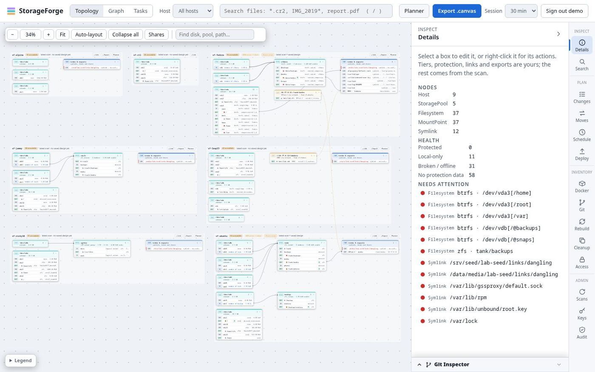

# Feature guide

Every feature StorageForge has, what it does, how it works and where to find it. These pages give the working picture with screenshots from a real lab. The [reference pages](../README.md) hold the full detail, and each section links to them.

| Page | Covers |
| :--- | :--- |
| [Discovery](discovery.md) | Scans, read-only access, search, Docker, Git, cleanup, capacity, host configurations |
| [Views](views.md) | Topology, Graph (Files and Structure), Details, context menus, canvas export |
| [Planning](planning.md) | Planner, change plans, move plans, shares, storage tasks, the scheduler |
| [Deploying](deploying.md) | Deploy access, the signed runner, jobs, the sync engine, existing snapshot jobs, alerts, drift, remote nodes |
| [Administration](administration.md) | Vault and keys, accounts, roles, invites, audit log, backups, sites, retiring hosts |

## Catalogue

**Lab** says how each feature was checked for these pages, on 2026-11-01:

- **Used:** run for real against the lab VMs, or for an account feature, against the local server.
- **Shown:** the screen was opened and captured, but the action was not carried out.
- **Tiers:** not run for these pages. The [lab test tiers](../kvm-lab.md#test-tiers) cover it, and their last results are in that page.
- **Not run:** neither of the above.

| Feature | Web UI | CLI | Lab |
| :--- | :--- | :--- | :--- |
| [Scan a host](discovery.md#scans) | **Scans**, host menu | `scan` | Used |
| [Scan schedule and quiet hours](discovery.md#scans) | Host menu | | Not run |
| [Read-only scan access](discovery.md#read-only-scan-access) | **Access** | `access` | Shown, Tiers |
| [File search](discovery.md#search) | Header, **Search**, `/search` | `search` | Used |
| [File changes between scans](discovery.md#capacity-and-changes) | **Cleanup** | `changes` | Shown |
| [Capacity trend](discovery.md#capacity-and-changes) | **Cleanup** | | Shown |
| [Duplicates and cold data](discovery.md#cleanup) | **Cleanup**, Graph > Files | `dupes`, `folders` | Shown |
| [Docker and Podman inventory](discovery.md#docker-and-podman) | **Docker** | `docker` | Shown |
| [Git inventory and inspector](discovery.md#git) | **Git**, Git Inspector | `git` | Shown |
| [Host configurations and reinstall script](discovery.md#host-configurations) | **Rebuild** | `config` | Shown |
| [Topology editor](views.md#topology) | **Topology** | | Used |
| [Shares manager](views.md#topology) | Topology toolbar | `shares` | Used |
| [File map](views.md#files) | **Graph > Files** | | Shown |
| [Structure graph](views.md#structure) | **Graph > Structure** | `graph` | Shown |
| [Canvas export](views.md#canvas-export) | **Export .canvas** | `graph canvas` | Not run |
| [Markdown report](views.md#reports) | | `export-markdown`, `report` | Not run |
| [Planner](planning.md#planner) | `/planner` | | Shown |
| [Change plans](planning.md#change-plans) | **Changes** | `plan` | Used (check only), Tiers |
| [Move plans](planning.md#move-plans) | **Moves** | `moves` | Used |
| [NFS and SMB shares](planning.md#shares) | Topology, **Deploy** | `shares` | Used |
| [Storage tasks](planning.md#storage-tasks) | **Tasks** | `tasks` | Used |
| [Scheduler](planning.md#scheduler) | **Schedule** | `schedule` | Used (created, not run), Tiers |
| [Deploy access](deploying.md#deploy-access) | **Deploy** | `deploy setup-script` | Used |
| [Signed deploys](deploying.md#signed-deploys) | **Deploy**, every plan | `deploy` | Used |
| [Deployed jobs](deploying.md#deployed-jobs) | **Deploy** | `deploy status` | Used |
| [Sync engine](deploying.md#sync-engine) | Move step options | | Tiers |
| [Existing snapshot jobs](deploying.md#existing-snapshot-jobs) | **Deploy** | | Used (found, not imported), Tiers |
| [Alerts](deploying.md#alerts) | **Deploy** | `deploy alerts` | Used, with ntfy |
| [Drift](deploying.md#drift) | **Deploy** | `deploy status` | Shown, Tiers |
| [Remote nodes](deploying.md#remote-nodes) | **Deploy** | `remote` | Shown (tunnel off), Tiers |
| [Key vault and bindings](administration.md#key-vault-and-bindings) | **Keys** | `vault` | Used |
| [Host identity](administration.md#host-identity) | Prompts, **Deploy** | `hosts` | Used |
| [Keys added by hand](administration.md#keys-added-by-hand) | | `hosts keys` | Not run |
| [Accounts and sign-in](administration.md#accounts-and-sign-in) | **Audit** tab, header | `user` | Used |
| [Roles](administration.md#roles) | **Audit** tab | `role` | Used |
| [Invite and reset links](administration.md#invite-and-reset-links) | **Audit** tab, `/enroll` | `site init` | Used (link made and opened) |
| [Audit log](administration.md#audit-log) | **Audit** | `audit` | Used |
| [Activity log](administration.md#activity-log) | none | `log` | Not run |
| [Backups and restore](administration.md#backups-and-restore) | **Audit** tab | `backup`, `restore` | Used (automatic nightly run only) |
| [Sites and reset](administration.md#sites-and-reset) | Site name in header | `site`, `reset`, `docker/sf-site` | Not run |
| [Retire a host](administration.md#retire-a-host) | Host menu | `hosts remove` | Not run |
| [PostgreSQL](administration.md#databases) | | | Not run: the lab uses SQLite |

The panels and routes this guide was checked against, and what disagreed, are in the [feature audit](../audit-2026-11-01-features.md).

## How these screenshots were made

They come from StorageForge at the code of commit `b7364bd`, served on `127.0.0.1` with a throwaway database. It scanned and deployed to a seven-VM [KVM lab](../kvm-lab.md), seed `437553544`: `sf-ctl`, `sf-ubuntu`, `sf-fedora`, `sf-alpine`, `sf-leap15`, `sf-jammy` and `sf-rocky10`. The lab's own `demo.py` filled it, then a change plan, a move plan, a schedule, a role, a viewer account and an invite were added through the API.

Hosts in the lab are small, and many folders show as unreadable because read-only access was left off so that panel has something to show.
