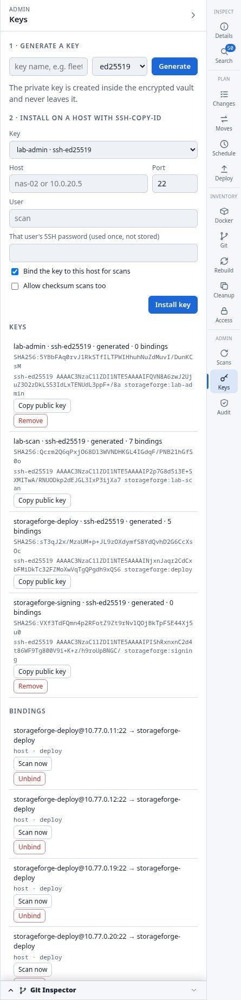
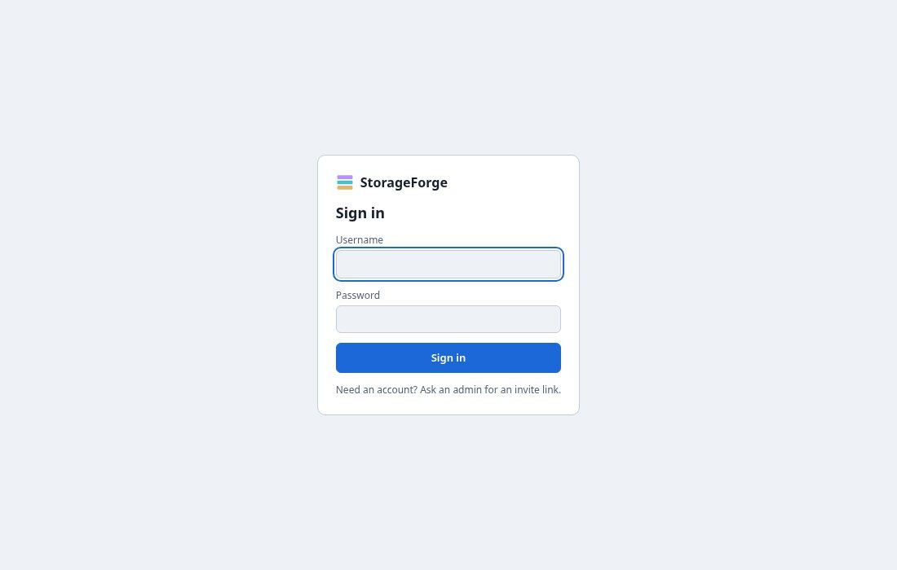
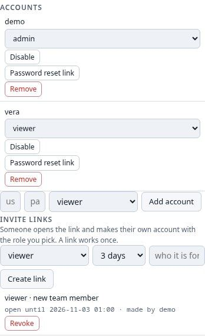
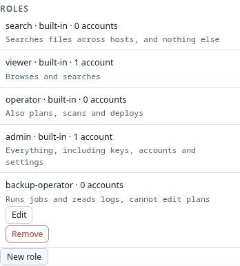
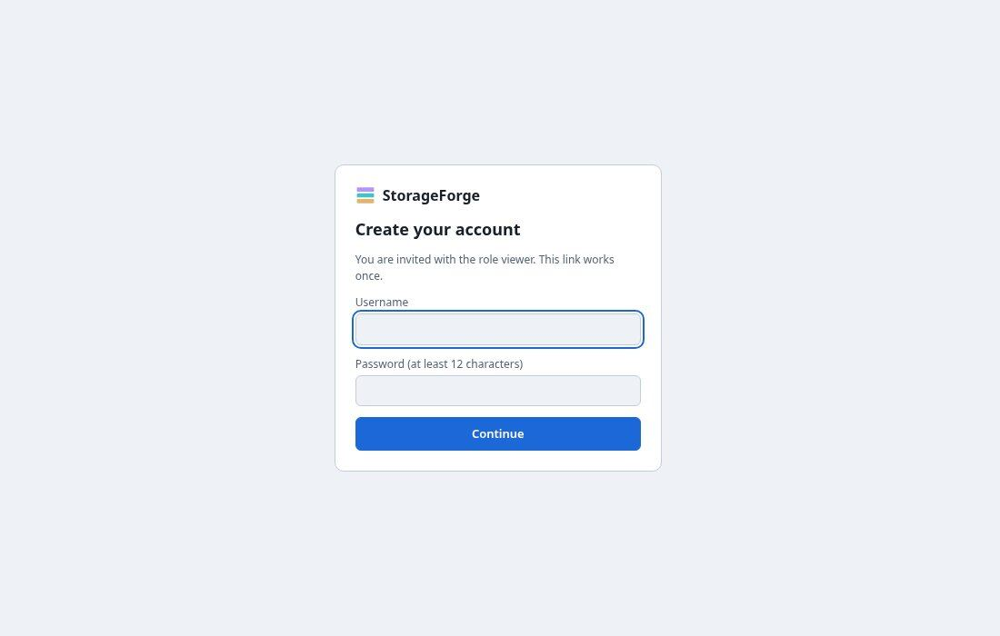
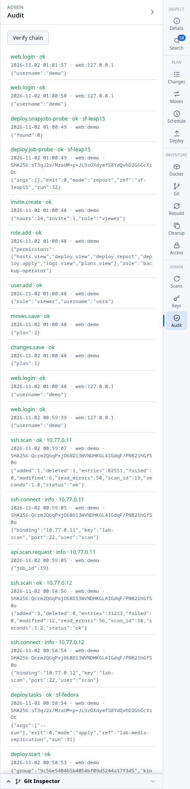
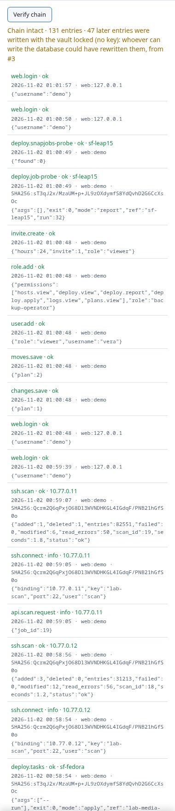
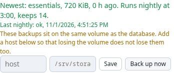

# Administration

Keys, accounts, the audit trail, backups and sites. The **Audit** tab holds more than its name suggests: the audit log, your own password, backups, accounts, invite links and roles.

Full detail: [Security](../security.md), [Operations](../operations.md), [Disaster recovery](../disaster-recovery.md).

## Key vault and bindings

SSH private keys live encrypted in the database, under a secret that is never stored there.

1. **Generate a key** (ed25519 or RSA 4096). The private key is made in the vault and never leaves.
2. **Install on a host** runs `ssh-copy-id` with the host user's password once, and checks that key login works.
3. **Bind** it. A binding says which key and user may reach which host, glob or CIDR, and for what: `scan`, `checksum` or `deploy`.

At run time a key is decrypted into locked memory and given to a short-lived `ssh-agent`. Rotate the secret with `vault rotate-secret`. `vault policy generate-only` refuses imported keys, so a key can't be reused across clients.

Backups never contain the vault secret. **Keep it somewhere else**: without it the vault can't be decrypted.

## Host identity

Hosts are pinned to their SSH host key and machine id. A machine claiming a name in the index is refused, and a changed host key must be confirmed against its fingerprint. A signed deploy runs only on the machine it was signed for.

## Keys added by hand

Scans read `authorized_keys` for root and accounts with UID 1000 and up. `hosts keys` lists them against the vault, and `hosts allow-key` accepts one. Generate-only sites raise an alert for the rest.

## Accounts and sign-in

Local accounts only. Passwords need at least 12 characters, and repeated failures are limited.

A session lasts 30 minutes, and each user can raise their own to 8 hours from the header's **Session** menu. Open pages clear themselves when it ends. Commands on hosts need the password typed in the last 5 minutes. The last enabled admin can't be removed. CLI: `user`.

## Roles

An account can do only what its role allows. Built-in roles can't be changed:

| Role | Allows |
| :--- | :--- |
| `search` | File search only |
| `viewer` | Browsing and searching, and reading logs, plans and deploys |
| `operator` | Also scans, plans, scripts, deploys, including destructive ones, deploy setup and Git sync |
| `admin` | Everything, including keys, accounts, settings and raw commands |

**New role** builds a custom one from the permission catalogue (`permissions.py`). High-risk permissions, which can lead to root on hosts, are marked. `hosts.command` is the one that lets someone write raw commands, and only `admin` has it by default. CLI: `role`.

## Invite and reset links

An admin creates a link for a role that expires in days. The person opens it and picks their own name and password. The token sits in the URL's `#fragment`, so it never reaches a proxy's logs. A link works once, and dies if its role comes to allow more. A reset link dies if the account changes, and a newer link cancels the last one.

## Audit log

Every connection, scan, sign-in, plan save and deploy is appended to a hash chain, and an HMAC keys it when the vault is unlocked.

**Verify chain** or `audit verify` finds an edited, deleted or reordered row. It also tells you about entries written with no key:

That warning appears here because this lab server was started before `vault init` ran, so it had no audit key until a restart. Entries like these could be rewritten by anyone who can write the database. Initialise the vault before the first start, as both install routes do.

## Activity log

`/api/log` merges the audit log, deploy runs, scan jobs, installed-task runs and logs fetched from hosts into one list, with filters and CSV, JSON or text export. CLI: `log`. It has no screen in the web UI.

## Backups and restore

Each night at `STORAGEFORGE_BACKUP_HOUR` the server writes an **essentials** backup and keeps 14. It holds everything a rescan can't rebuild: encrypted keys, users, designs, plans, settings, deploy state and the audit log. A **full** backup also has the file index. Set a host and folder to copy each backup off the machine, and the panel warns until you do. Those copies are encrypted with a key from the vault secret.

`restore` replaces the database, with the server stopped, and refuses another site's backup because a backup holds that site's keys. See [Operations](../operations.md#backups) and [Disaster recovery](../disaster-recovery.md).

## Sites and reset

One install holds one site, usually one client.

- **`site init --name`** names a new site, refuses imported keys and prints the first admin's link.
- **`reset --site-name NAME`** archives this site out of the new one's reach and starts over with a new database, vault and secret. It refuses while the server runs, or while jobs or deploy access remain on the old machines, unless given `--abandon-deployed`.
- **`docker/sf-site`** runs several isolated sites on one machine: `new`, `list`, `up`, `down`, `logs`, `admin`, `reset`, `archive`, `remove`. Each has its own database, vault, secrets, certificate, port and network.
- **`sf-site audit`** reports keys and machines shared between sites. **`sf-site overview`** shows every site's hosts, last scan, open alerts and last backup.

Generated scripts on a named site carry a `# Site:` line. See [Starting a new site](../operations.md#starting-a-new-site).

## Retire a host

**Retire…** on a host's menu, `hosts remove NAME`, or `DELETE /api/hosts/<name>` removes it from search, the graph, the scheduler and alerts. The audit log and deploy history stay. It is refused while anything is deployed there or a scan is running.

## Databases

SQLite by default, or PostgreSQL with the `postgres` extra. See [Database](../database.md). The lab runs SQLite only. CI runs the test suite on both.
