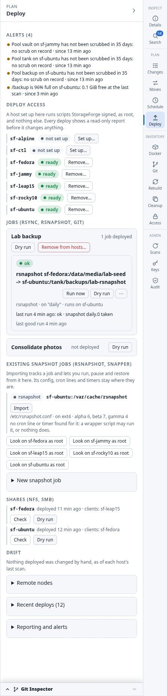
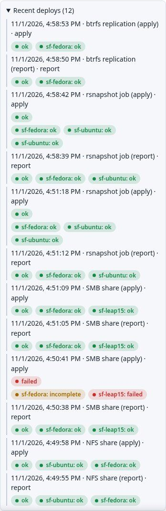
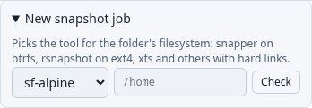
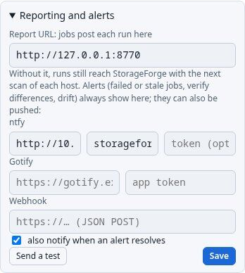
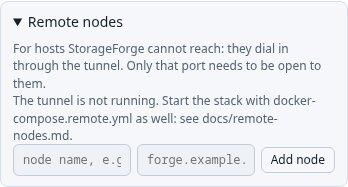

# Deploying

A deploy runs a plan on its hosts through a small runner that accepts only scripts StorageForge signed. The **Deploy** panel holds all of it.

Full detail: [Deployments](../deployments.md).

## Deploy access

Set up once per host. **Set up…** takes a sudo password, for the scan user or an admin account, used for that one SSH session and never stored. If the account has passwordless sudo, the password isn't checked, and the result warns you. You can also download the setup script and run it yourself, then press **I ran it: test**.

The setup creates the `storageforge-deploy` user, its sudoers file, `/usr/local/sbin/storageforge-run` and `/etc/storageforge/allowed_signers`. **Remove…** undoes all of it. A host that can't run deploys is refused with the reason. In the lab, `sf-alpine` is refused: it has no bash or systemd.

## Signed deploys

Every deploy has two stages:

1. **Report:** the script runs read-only on every host, and you read what it would do.
2. **Apply:** runs from that report, host by host, and stops at the first failure. If the plan changed after the report, it is refused with 409 so you review it again.

Each script is signed for one machine and one run. Replayed, expired, tampered or misdirected requests are refused. Anything that runs on a host needs your password typed in the last 5 minutes.

Running deploys can be cancelled, with **Force stop** to end running SSH sessions. **Retry failed hosts** re-runs only what didn't finish. Scans read the runner's completion records, so an outcome is confirmed even if the connection dropped, and an apply that left steps undone shows as `incomplete`, not `ok`.

## System updates

**Update all hosts** installs operating system updates on every host set up for deploys, all at once. **Check for updates** shows what is waiting first. One host failing doesn't stop the others, and nothing reboots: hosts waiting for a reboot are marked. See [Deployments](../deployments.md#system-updates).

## Deployed jobs

A deployed move plan step becomes a job, `p<plan>-<step>`, run on its destination by `storageforge-job` from systemd timers. Each job has its own SSH key, limited by a forced command on the source, and its own report token.

One run checks its window and bandwidth limit, runs `pre`, takes a read-only btrfs snapshot where possible, transfers, runs `post`, and reports. **Actions:** Run now, Dry run, Verify, Pause, Resume, Cutover (for moves, after a clean verify), Log, and for rsnapshot, browsing and restoring snapshots.

Every job takes `.storage.lock` on its destination volume. Copies and mirrors share it, and rsnapshot and git take it alone. In the lab, the rsnapshot job from `sf-fedora` to `sf-ubuntu` shows `snapshot daily.0 taken`.

## Sync engine

Optional per step, off by default, and it needs a redeploy:

- **Routes:** try the LAN first, then a ZeroTier, NetBird or Tailscale address, checking the same host key on each, and move route if one drops during a run.
- **Pre-transfer dedup:** files already at the destination under another name are hashed and made locally with a reflink, so they don't cross the network. Needs `python3` on both hosts.
- **Snapshot streams:** mirror steps can use `btrfs send` or `zfs send`.
- **Room check:** data and metadata headroom before a large transfer.
- **duperemove** on a timer in the run window.

See [Sync engine](../deployments.md#sync-engine).

## Existing snapshot jobs

Scans find rsnapshot and snapper jobs that StorageForge didn't deploy. In the lab, one turned up on `sf-ubuntu`: the distro's sample `/etc/rsnapshot.conf`, noted as having no cron line or timer.

**Import** tracks a job and changes nothing on the host. You can then run it, pause it, change retention and restore from it, and it counts towards alerts and the 3-2-1 matrix. **Look as root** repeats the search as a signed read-only script, for what the scan user can't read. **Forget** only stops tracking.

**New snapshot job** picks the tool from the folder's filesystem: snapper on btrfs, rsnapshot on ext4, xfs and others with hard links, and neither on zfs, vfat, exfat or cifs.

## Alerts

Evaluated every 5 minutes and right after a job reports. Open alerts head the Deploy panel.

| Source | Alerts |
| :--- | :--- |
| Jobs and schedules | Failed, stale, a verify found differences, failed server verification |
| Deploys | A deploy failed, drift |
| Scans | Scan failed, a mount gone, disk over the warn or critical level, pool unhealthy or device errors, no recent scrub, btrfs running out of unallocated space or metadata |
| Server | Nightly backup failed or over 3 days old, HTTPS certificate ending within 30 days, a key shared between sites or not in the vault on a generate-only site |

Alerts can also go to **ntfy**, **Gotify** or a **webhook**, with **Send a test**. Set **Report URL** to an address hosts can reach, or runs only arrive with the next scan. In the lab, a 96% full `/backup` on `sf-ubuntu` opened an alert and reached ntfy.

## Drift

Apply runs record checksums of the files they wrote, StorageForge's own fstab lines and the timers they own. Each scan compares them.

- **Pending:** the plan or design changed since its last deploy. Shown, not alerted.
- **Changed on the host:** someone edited a managed file by hand. This raises an alert.

## Remote nodes

For hosts StorageForge can't reach, such as those behind NAT. The node dials out over a reverse SSH tunnel and then scans and deploys like any other host. The tunnel opens one port that carries forwarded connections only, so a stolen node key can do no more than that. It is off until you add `docker-compose.remote.yml`, and the panel says so:

See [Remote nodes](../remote-nodes.md). CLI: `remote add`, `list`, `revoke`.
