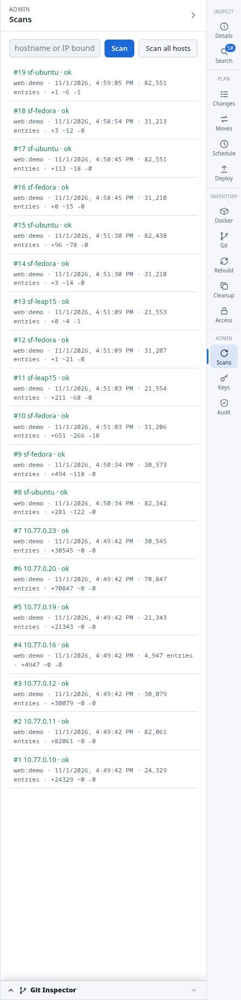
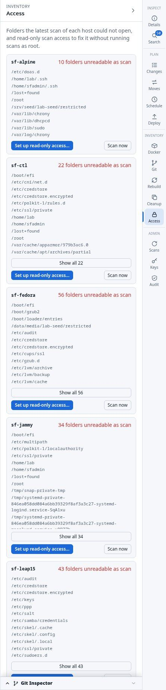
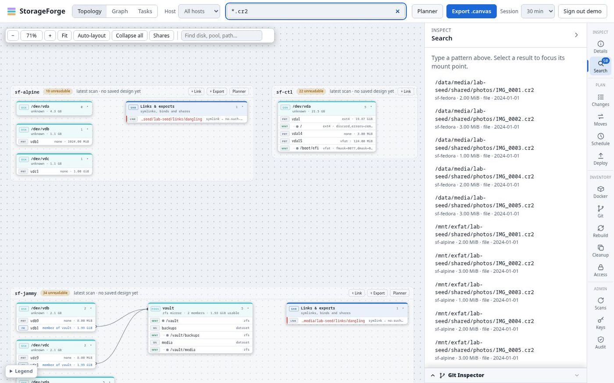
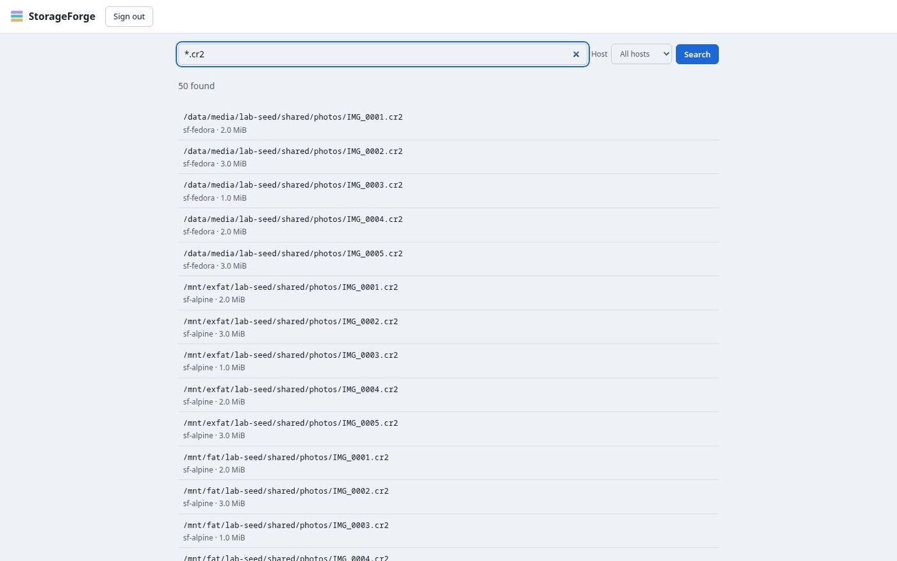
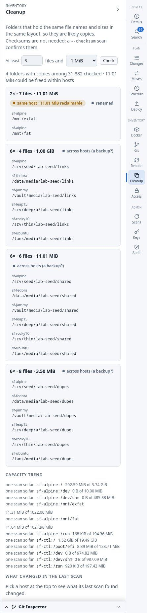
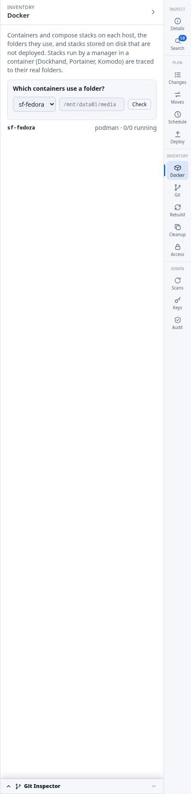
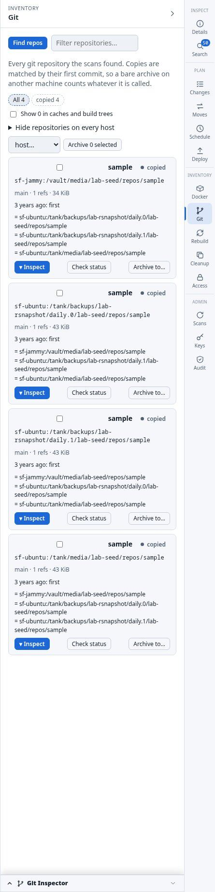
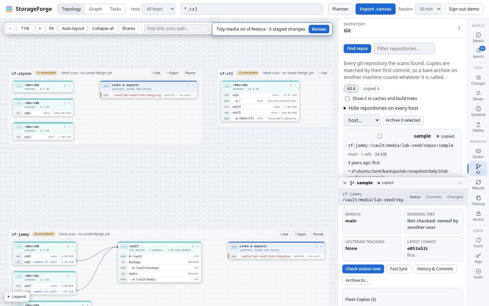
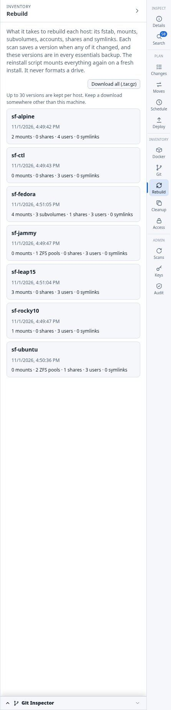
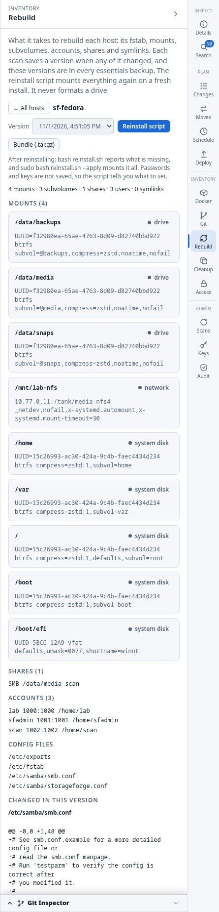

# Discovery

Everything StorageForge knows starts with a scan. Views answer from the resulting index and never connect to a host.

## Scans

A scan is one read-only walk of a host over a single SSH session, with no agent. It reads the inventory (disks, mounts, pools, btrfs state, package manager), walks every eligible mount with `find`, compares the result with the index and applies only the differences. It then reads Git repositories, containers, snapshot jobs, host configuration and the checksums of files it deployed, and rebuilds the host's graph.



**To use it:** bind a vault key to the host ([Keys](administration.md#key-vault-and-bindings)), then press **Scan** or **Scan all hosts** in the **Scans** panel, or choose **Scan now** on a host's menu. On the CLI, `storageforge-index scan --host nas-02`.

- **When:** bound hosts rescan every 6 hours by default (`STORAGEFORGE_SCAN_INTERVAL`), and up to `STORAGEFORGE_SCAN_WORKERS` run at once. A host can have its own interval and quiet hours (`/api/hosts/<name>/schedule`).
- **What it walks:** local filesystems. Network and RAM filesystems are skipped with a reason in the log, such as `network filesystem: index it on its source host`.
- **What it won't do:** a truncated stream, an SSH error or more than half of a mount vanishing leaves the index as it was.
- **Result states:** `ok`, `partial` when a mount couldn't be read, and `failed`.
- **Checksums:** `--checksum`, or the `checksum` action on a binding, hashes only files whose size matches another file's. That is what confirms duplicates.

Full detail: [Scanning and search](../scanning-and-search.md).

## Read-only scan access

Scans run as an ordinary user, so `/root`, `/etc/ssl/private` and other users' homes can't be opened. The **Access** panel lists what each host's last scan couldn't read.



**Set up read-only access…** fixes that without scanning as root. It gives the scan user private copies of `find` and `sha256sum` that carry `CAP_DAC_READ_SEARCH`. It runs once over SSH with a sudo password that is never stored. If the account has passwordless sudo, sudo never checks that password, and the result warns you. The CLI prints the same script: `storageforge-index access script --host nas-02`.

## Search

Shell-glob search across every host, answered from the index. Press `/` to reach the header box. Selecting a result focuses its mount in the topology.



Each pattern uses the cheapest index that can answer it, so `*.cr2` is an extension lookup, not a table scan. The web search returns at most 500 results. Accounts with only the `search` role land on a plain search page at `/search`:



```bash
storageforge-index search "*.cr2" --host node-01 --size-gt 100MB
storageforge-index search "*invoice*2024*" --type f --newer-than 90d --format json
```

Right-click a result to show its folder, list the largest files there, stage a rename, trash or permissions change, or copy its folder to another disk.

## Cleanup

The **Cleanup** panel finds space to win back. Its tab is titled "Likely copies and cold data".



- **Duplicate folders:** the same names, sizes and layout, within and across hosts. No checksums are needed; a `--checksum` scan confirms them. Copies are marked `across hosts (a backup?)` when that is the likely reason.
- **Identical files:** from scans run with checksums.
- **Cold data:** folders whose newest file is older than a cutoff (1, 2 or 5 years) above a size. **Move…** starts a step in [Moves](planning.md#move-plans).

The [file map](views.md#files) shows the same duplicates visually. CLI: `dupes` and `folders`.

## Capacity and changes

Also on the **Cleanup** panel:

- **Capacity trend:** each mount's usage over 30 days and when it will fill at the current rate (`GET /api/capacity`). `STORAGEFORGE_FILLS_UP_DAYS` sets the warning.
- **What changed in the last scan:** files added, changed and removed, grouped by folder (`GET /api/file-changes`, or `storageforge-index changes`).

## Docker and Podman

After the walk, each scan asks the host's engine what exists, directly or through `sudo -n`.



The panel shows compose stacks (`running`, `partly running`, `stopped`, or `stored` for a compose file nothing was deployed from), their containers, the folders and volumes they use, unused volumes and containers mounting the Docker socket. **Which containers use a folder?** answers from the index. Stacks kept by Dockhand, Portainer, Komodo or Dockge are translated to host paths through the manager's mounts.

Plan checks use this too: changes, moves and tasks warn when a step touches a folder a running container uses.

## Git

Scans find working copies and bare repositories. Repositories with the same first commit hold the same history, so copies are matched whatever they are called.



Each repository is `uncommitted`, `unpushed`, `behind`, `single copy`, `copied` or `archived`. **Find repos** asks a host over SSH, which is the one action in this panel that connects. **Archive to…**, alone or for several selected repositories, adds a `git` step to a move plan, and a per-host list hides paths you don't care about.

**▾ Inspect** opens the Git Inspector drawer along the bottom of the page, with **Status**, **Sync**, **Commits** and **Changelog** tabs for one repository:



Unlike the rest of this page, the inspector reads over SSH. These routes are POST only, rate limited and audited. They run Git with repository config disabled, and **Sync** is a signed run that needs [deploy access](deploying.md#deploy-access).

## Host configurations

Each scan saves a new version of a host's storage configuration when it changes: fstab, crypttab, mdadm, NFS and Samba files, mounts, subvolumes, accounts and symlinks. Passwords in those files are blanked before they reach the database.





Open a host to see each item and what changed between versions. Download a bundle, or a **reinstall script** that takes a freshly installed machine back to every drive mounted. It reports unless given `--apply`, never partitions or formats, and finds filesystems by UUID. It contains everything it needs, so it works with StorageForge gone. It tells you what it can't restore, such as account passwords and Samba password databases.

See [Rebuild a host](../disaster-recovery.md#rebuild-a-host-after-reinstalling-it). CLI: `config list`, `diff`, `script`, `export`.
