# Planning

Nothing changes on a host while you plan. Every plan is saved, checked against the index and turned into a script that only reports until told otherwise. You run the script yourself or [deploy](deploying.md) it.

| Plan | Scope | Script | Changes things with |
| :--- | :--- | :--- | :--- |
| Change plan | Folders, btrfs, ZFS, LVM, mounts, drives, on any hosts | `changes-<plan>.sh`, or Ansible | `--apply`, plus `--destructive` |
| Move plan | Copies between folders on any hosts | `<plan>.sh` | `--run`, `--verify`, `--cutover`, `--install` |
| Shares | NFS and SMB exports of one server and its clients | `shares-<host>.sh` | `--apply` |
| Storage task | A block program on one host | `task-<name>.sh` | `--run`, `--install`, `--uninstall` |

Full detail: [Plans and scripts](../plans-and-scripts.md).

## Planner

`/planner` designs one host at a time. It edits the same design the topology shows. A scanned host opens as a design built from its latest scan, and the example host **atlas** is there to explore. **Save design** stores it, and **Refresh from latest scan** updates the hardware while keeping what only you know.

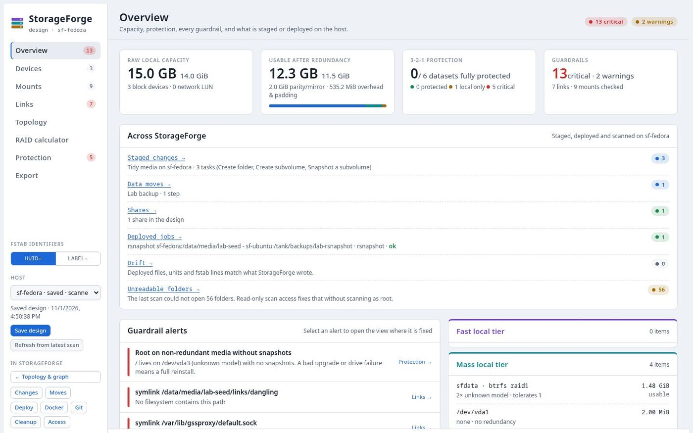

| View | What it's for |
| :--- | :--- |
| **Overview** | Capacity, 3-2-1 state, guardrail alerts, and what the rest of StorageForge holds for this host |
| **Devices** | Disks by tier, partitions, pools and remotes. Select one to edit it. |
| **Mounts** | The mount tree, conflict checks, and the generated fstab line and systemd unit |
| **Links** | Symlinks, bind mounts and hard links, with health checks, boot ordering and scenario presets |
| **Topology** | Drives through to exports, as columns. Hover to trace. |
| **RAID calculator** | Usable space, parity, padding, rebuild exposure and write amplification |
| **Protection** | The 3-2-1 grid per dataset. Click a cell to simulate a change. |
| **Export** | The change plan that gets the host to this design, plus fstab, units, blueprints and an ASCII tree |

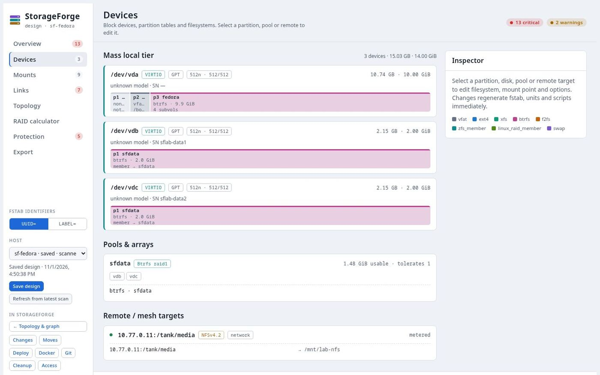

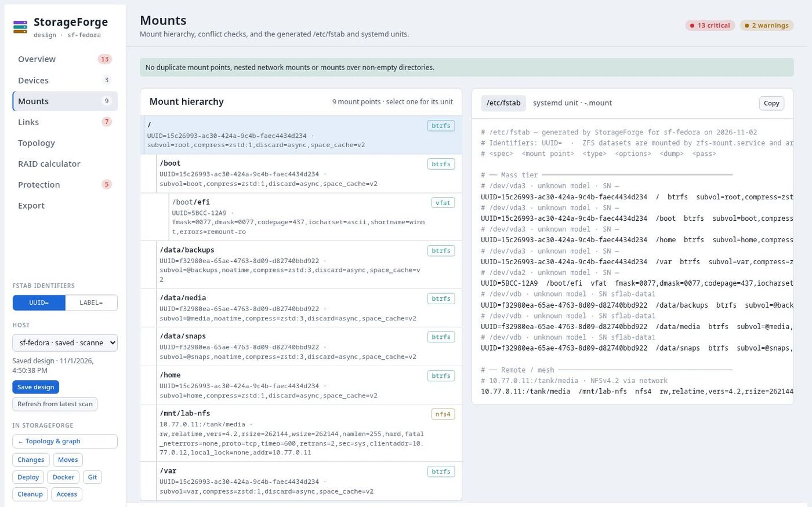

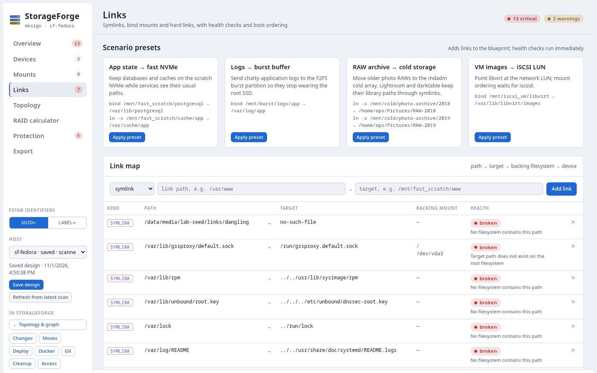

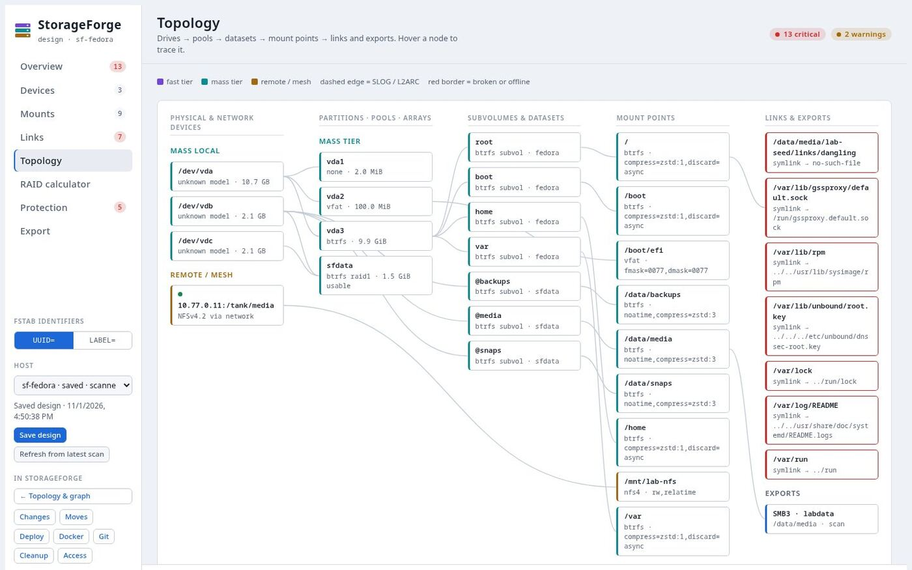

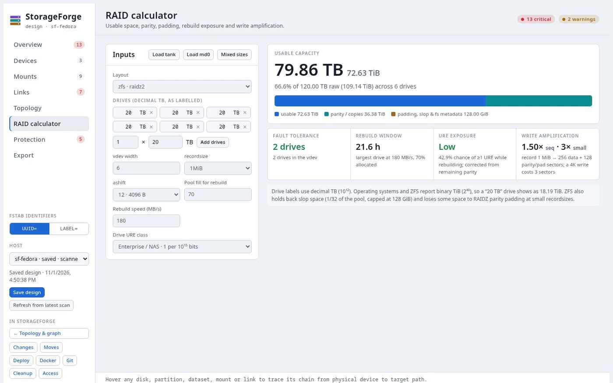

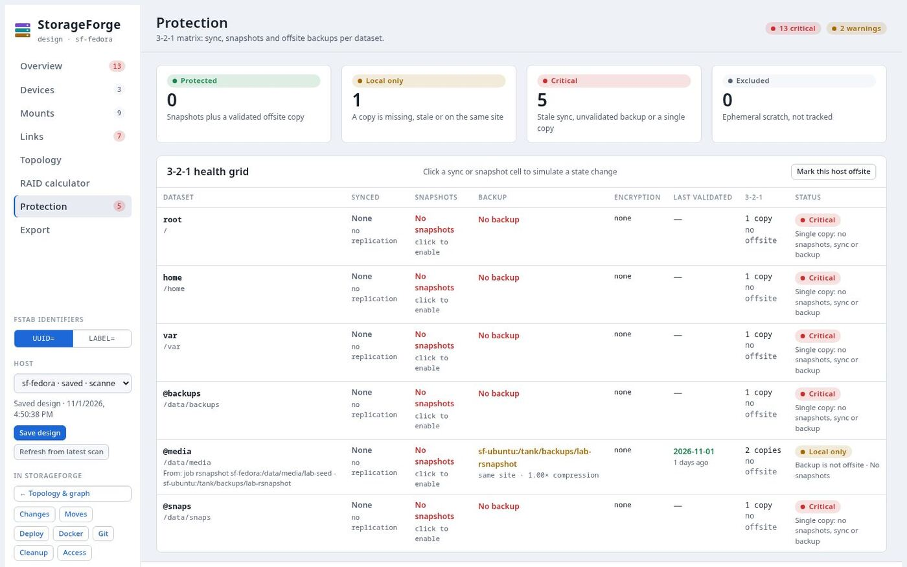

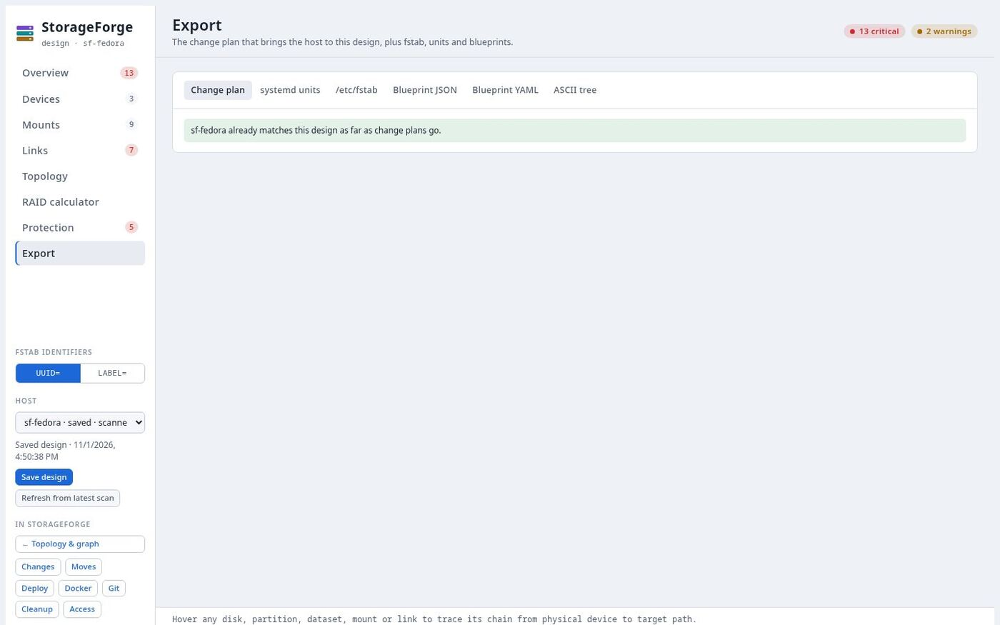

**Export** only stages additions and edits. Anything that would erase data the scan saw is listed under **By hand** instead, and drive tasks arrive unconfirmed until you type the device again. See [Planner](../planner.md).

## Change plans

An ordered list of tasks, each on one host, like an Ansible playbook for storage. Stage them from the topology or the **Changes** panel.

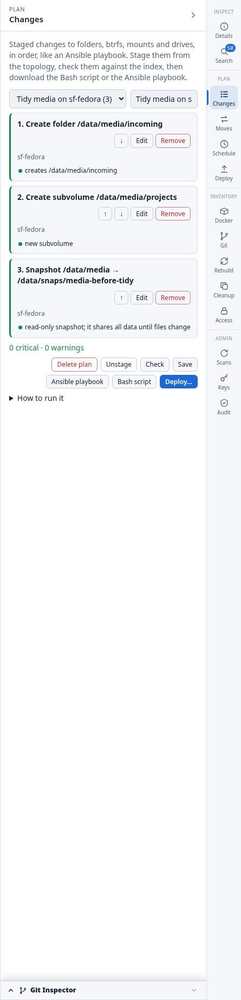

| Group | Tasks |
| :--- | :--- |
| Files and folders | Create folder, rename, move to trash, symlink, owner and permissions |
| btrfs | Subvolume, snapshot, folder to subvolume, add, replace or remove a device, convert profile, reclaim space, grow, restore from a snapshot, quotas, scrub, send |
| ZFS | Create a pool or dataset, snapshot, send, scrub |
| LVM | Create or extend a volume group, create, grow or snapshot a logical volume |
| Mounts | Add a mount, change options, unmount |
| Drives | Partition, add a partition, tune, format, label |

**Check** walks the plan in order, so later tasks see what earlier ones create. It flags missing sources, renames across filesystems, formatting a mounted device, profiles needing more devices than the pool has, mounts over full folders, running containers on the path, and tasks that undo each other.

Then choose **Bash script**, **Ansible playbook** or **Deploy…**. Drive tasks have three locks: the device typed twice, `--destructive`, and a refusal to touch anything mounted, swapped on, or part of RAID, LVM or LUKS. Trash goes to `.storageforge-trash/<date>/`, and fstab is backed up and restored if `findmnt --verify` rejects the result.

## Move plans

Each step copies data from one folder to another, on the same host or across hosts.

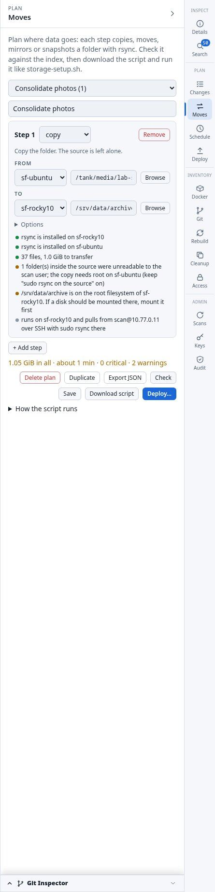

| Method | What it does |
| :--- | :--- |
| `copy` | rsync, leaving the source alone |
| `move` | Copy, verify, then cut over. The source is renamed to `<name>.migrated-<date>`, not deleted. |
| `mirror` | Keeps a copy in step, on a timer when deployed |
| `rsnapshot` | Rotating hard-linked snapshots at the destination |
| `git` | A bare archive copy of a repository, refreshed on each run |

**Check** looks at free space and estimates the time from the indexed size, and warns about containers using the folder. Run the script yourself, or deploy it so each step becomes a [job](deploying.md#deployed-jobs). Steps can start from **Move…** in Cleanup or **Archive to…** in Git. Plans can be duplicated and exported as JSON.

## Shares

Add an NFS or SMB export from a mount's menu in the topology, and list the clients that mount it. The share wizard checks paths, names and access rules. One deploy then sets up the server and each client:

- **Server:** installs what's missing, then writes the export and reloads it. SELinux labels are handled.
- **Clients:** appends an fstab line with `_netdev,nofail,x-systemd.automount` after a backup, and mounts the share. SMB credentials go in a `0600` file. A different existing line for the same mount point is a conflict for you to fix.

The Samba account itself stays yours to create, with `smbpasswd`. The lab's demo shows the order: apply, add the account, apply again. Until the account exists, the client's mount fails and that run shows as `failed`.

## Storage tasks

Small programs built from blocks that run on one host, by hand or on a systemd timer. Start from a template or drag blocks in.

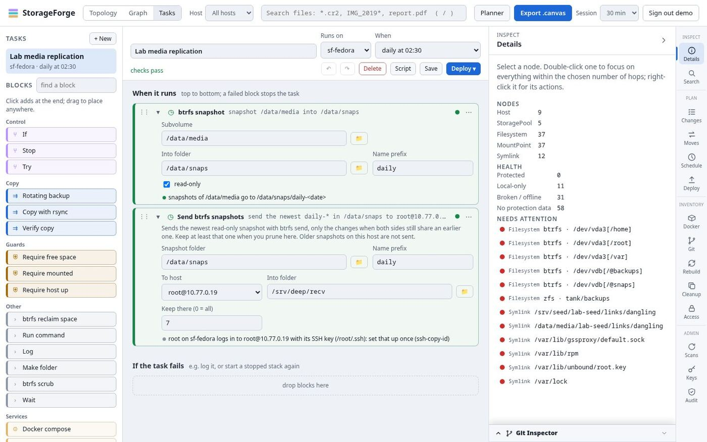

| Group | Blocks |
| :--- | :--- |
| Guards | Require mounted, Require free space, Require host up |
| Control | If, Try, Stop |
| Copy | Copy with rsync, Rotating backup, Verify copy |
| Snapshots | btrfs and ZFS snapshot, prune and send |
| Services | Docker compose and systemd stop, start, restart |
| Other | Make folder, scrub, btrfs reclaim space, Run command, Wait, Log |

Every block is checked while you edit. A copy onto a data disk with no guard is flagged, because if that disk is missing the copy fills the system disk. So is a mirror whose source could be unmounted, because it would empty the copy. Runs take a lock so they never overlap. **Run command** and **command succeeds** need the `hosts.command` permission. CLI: `tasks list`, `check`, `script`, `import`.

In the lab, this task snapshotted `/data/media` on `sf-fedora` and sent it to `sf-leap15`.

## Scheduler

The **Schedule** panel runs a storage task, change plan, move plan, shares configuration or shell command on a host, on a cron schedule.

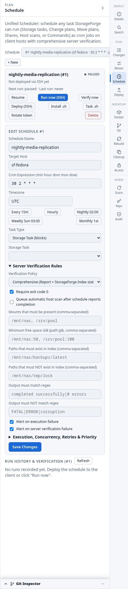

- **Timing:** 5-field cron, a timezone, allowed time windows, jitter, and a skip, queue or replace concurrency policy.
- **Running:** a timeout, retries, and nice and ionice. Fired by a systemd timer, or cron where the host has no systemd.
- **Checking it worked:** a run is `reported` when the host says it finished, `verified` once output patterns and mount, free-space and path rules pass against a scan newer than the run, and `verify_failed` or `failed` otherwise.
- **Actions:** **Resume**, **Run now (SSH)**, **Verify now**, **Deploy (SSH)**, **Install .sh**, **Task .sh**, **Rotate token**, **Delete**.

Schedules can't run destructive steps, and a schedule installed on a host can't be deleted until it is uninstalled. They don't run on the StorageForge server, and scans aren't scheduled here: set the host's own scan interval. CLI: `schedule`.
