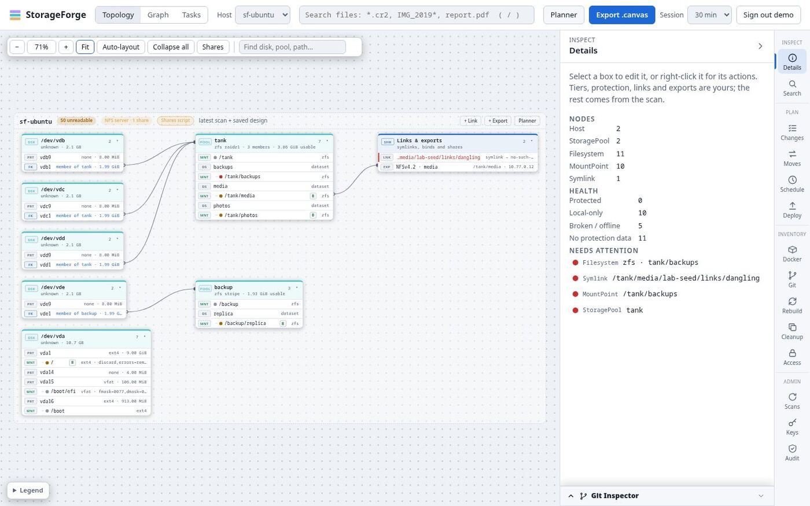
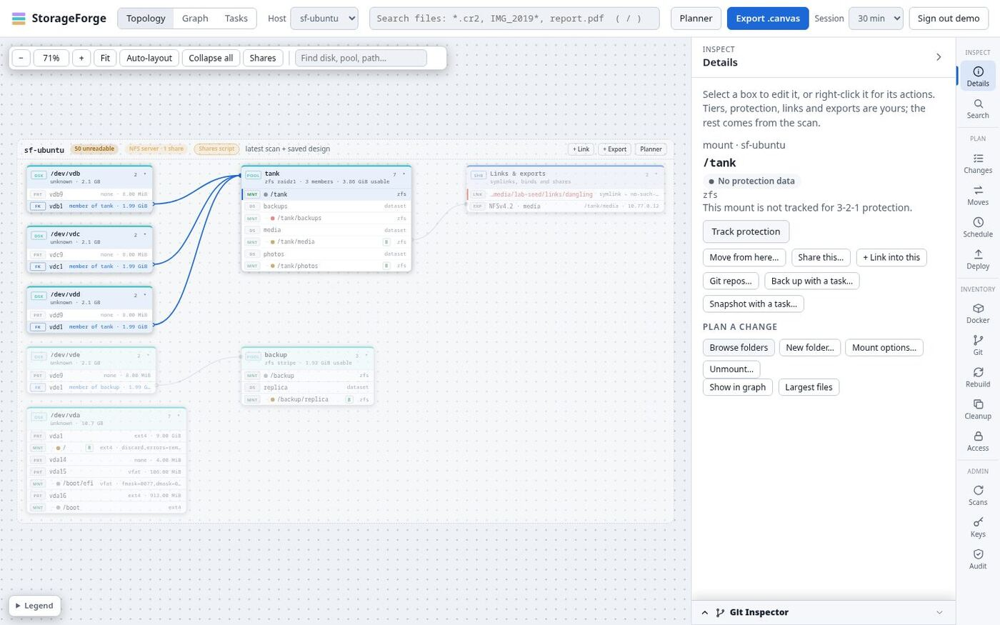
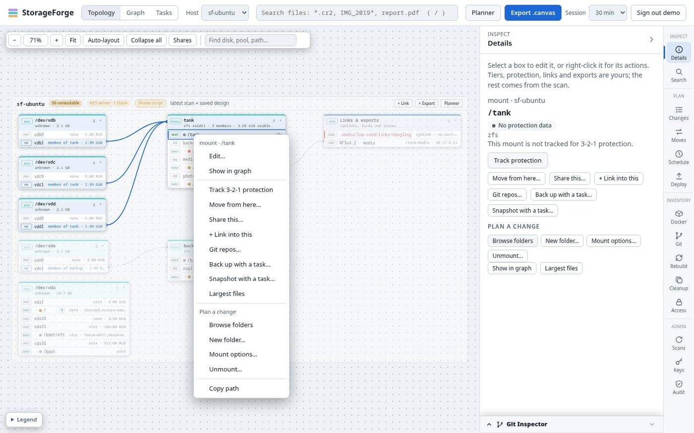
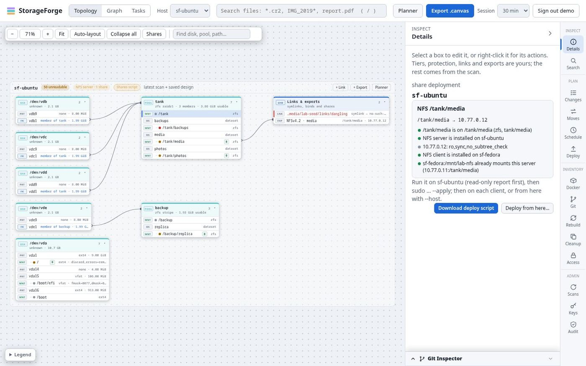
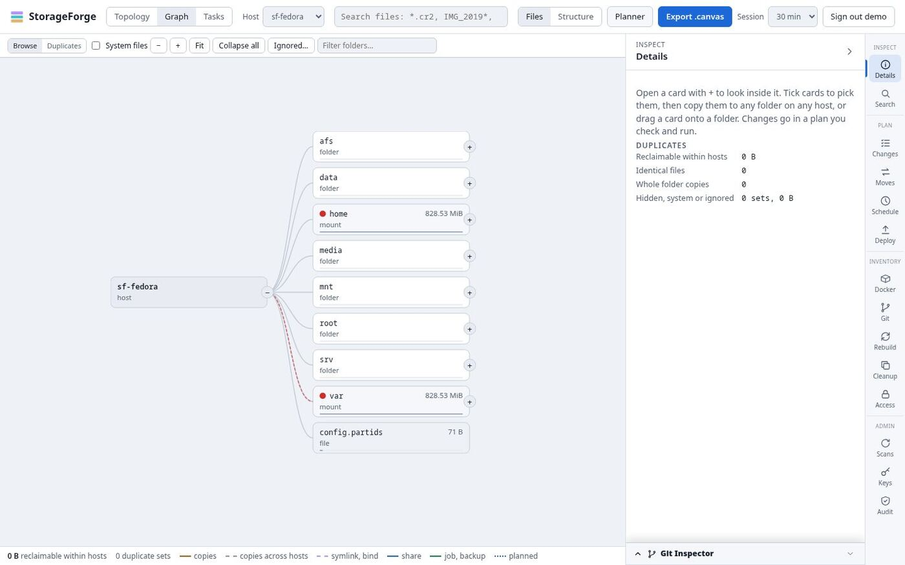
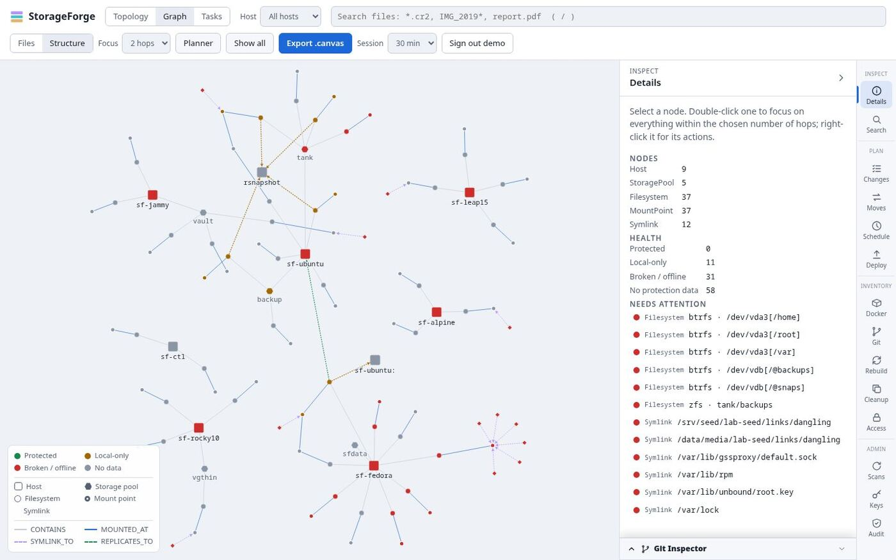
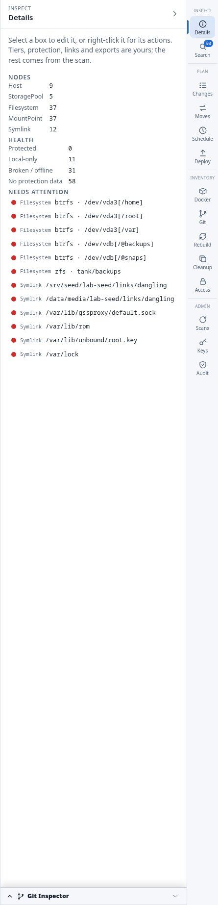

# Views

The main page has three views in the header and a rail of panels on the right. **Host** filters them all to one machine. The [Tasks view](planning.md#storage-tasks) is covered under Planning.

Full detail: [Web UI](../web-ui.md).

## Topology

An editable schema-style canvas of each host's design. A host is a frame, each disk, pool and remote is a table, and rows are its partitions, subvolumes, datasets and mount points. Lines join member partitions to pools, mount points to links and exports, and exports to the clients that mount them.

- **Moving around:** scroll to pan, Ctrl+scroll to zoom, drag a table or frame by its heading. The toolbar has **Fit**, **Auto-layout**, **Collapse all** and a box finder.
- **What you can edit:** tiers, encryption notes, 3-2-1 protection, links and exports. Hardware comes from the scan. Drag one mount point onto another to set a backup target. **Save design** stores it and rebuilds the graph.
- **Staged work:** staged subvolumes and mounts show as dashed boxes, and a banner offers **Review**.

Select a box and **Details** shows what it is and what you can do with it:

Right-click almost anything, or use the menu key or Shift+F10 on the focused box. The menu holds every change that can be staged there, so it is the quickest way to start a plan. Shift+right-click keeps the browser's menu.

**Shares** on the toolbar lists every share on the hosts in view. Selecting an export shows its clients, what each deploy will install and its script:

## Graph

The **Graph** view has two modes, **Files** and **Structure**.

### Files

A map of the folders on a host, built from the index, with lines between folders that hold copies of the same files. **Browse** opens any folder. **Duplicates** shows only folders that hold copies. Size, host and **System files** filters narrow it, and an ignore list leaves paths out.

Tick cards to compare them, and the side panel lists the files and stages **move to trash** into a [change plan](planning.md#change-plans). Space is counted per host, because a copy on another host is more likely a backup than waste. The index has no inode numbers, so hard links count as copies.

### Structure

A force-directed graph of hosts, pools, filesystems, mount points and symlinks, coloured by 3-2-1 health.

Drag the background to pan and a node to pin it. Shift-drag lets it spring back, and **Show all** releases every pin. Double-click focuses a node's neighbourhood, 1 to 3 hops as set by **Focus**.

| Colour | State | Meaning |
| :--- | :--- | :--- |
| Green | protected | Snapshots and a validated offsite copy |
| Yellow | local-only | A single site, or a stale copy |
| Red | broken | Broken link, offline target, failed pool |
| Grey | unknown | No protection data yet |

A scan can't see backup policy, so a newly scanned host is grey until its design or a deployed job says otherwise.

## Details

With nothing selected, the **Details** panel summarises the fleet: node counts, health totals and everything that needs attention. Each line selects the node it names.

## Canvas export

**Export .canvas** writes an Obsidian JSON Canvas of the graph, or of one host when the filter is set. CLI: `storageforge-index graph canvas`.

## Reports

`storageforge-index export-markdown` writes an architecture report for indexed hosts, and `report` writes one from saved payloads with no index needed. Later sections are built from the same functions the API uses, so the report and the web UI agree. There is no web button for either.

## Deep links

The main page reads `#host=<name>&tab=<panel>`, for example `/#host=nas-02&tab=changes`. The planner's **In StorageForge** links use this.
