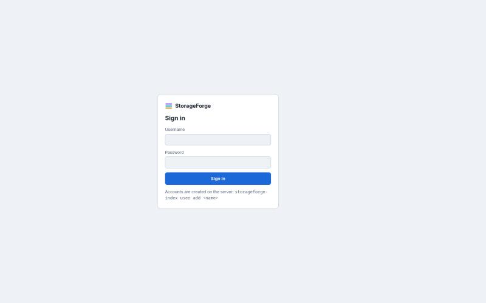

# Getting started

StorageForge runs as one container (the app) behind an nginx container (TLS). It can also run straight from Python for development.

## Requirements

**On the StorageForge machine:** Docker with Compose v2, or Python 3.10+ with the OpenSSH client (`ssh`, `ssh-agent`, `ssh-add`, `ssh-keygen`).

**On the hosts you scan:** an SSH server and the tools a Linux install already has: `find`, `findmnt`, `lsblk`, `df`. It also uses `zpool`, `sha256sum`, `git`, `docker` or `podman` when present. Nothing is installed for scanning. Deploys add a small runner, described in [Deployments](deployments.md).

## Install with Docker

From `storageforge-indexer/`:

```bash
./docker/init-secrets.sh
```

This creates `secrets/vault_secret`, `secrets/session_secret` and a self-signed certificate naming this machine's hostname and LAN addresses. Back up `secrets/vault_secret` somewhere else: without it the vault cannot be decrypted, and backups never contain it.

```bash
docker compose up -d --build
docker compose exec storageforge storageforge-index user add admin
```

The second command prompts for a password (at least 12 characters). Open `https://<this machine>:8443`, accept the certificate once (compare the fingerprint `init-secrets.sh` printed), and sign in.



The proxy listens on every interface so the LAN can reach it. To keep it on this machine only, set `STORAGEFORGE_HTTPS_BIND=127.0.0.1` in `.env`. StorageForge is not meant to face the internet.

## Add a key and scan a host

Keys live in the encrypted vault. You can do this from the **Keys** panel in the web UI, or from the CLI:

```bash
docker compose exec storageforge storageforge-index vault generate --name fleet
```

This prints the public key. Then either:

- add it to `~scan/.ssh/authorized_keys` on each host yourself, or
- use **Keys → Install on a host**, which runs `ssh-copy-id` with the host user's password once and checks key login works afterwards.

Bind the key to the hosts it may reach. A binding can name one host, a glob or a CIDR:

```bash
docker compose exec storageforge storageforge-index vault bind --key fleet --host 10.0.20.0/24 --user scan
docker compose exec storageforge storageforge-index scan --host 10.0.20.5
```

Scans also run from **Scans** in the web UI. Bound hosts are rescanned every 6 hours by default (`STORAGEFORGE_SCAN_INTERVAL`).

To import a key you already have, pipe it in so it is never written to the container's filesystem:

```bash
docker compose exec -T storageforge storageforge-index vault add --name nas --key-file - < ~/.ssh/id_ed25519
```

Or put key files in `./keys/` before starting: the entrypoint imports each one (the file name becomes the key name) from a read-only mount. The container reads them through your group, so make them group-readable (`chmod 0640 keys/*`; `docker/init-secrets.sh` already made `keys/` itself `0750`). A key it cannot read is named in the log (`docker compose logs storageforge`).

## Scanning the Docker host itself

Connections from the container to its own host arrive on the `sf0` bridge, not from the LAN. A host firewall that only allows SSH from the LAN drops them, and scans fail with "Connection timed out". With ufw:

```bash
sudo ufw allow in on sf0 to any port 22 proto tcp
```

## Try the demo

`examples/demo/demo.sh` runs everything end to end against a disposable SSH target container, in a separate compose project on its own network. It generates a vault key, binds it, scans the target with checksums, imports the `atlas` example design and prints a sign-in for `https://127.0.0.1:9443`.

```bash
examples/demo/demo.sh
```

## Without Docker

```bash
pip install .                    # or: pip install '.[postgres,yaml]'
export STORAGEFORGE_VAULT_SECRET="$(openssl rand -base64 48)"     # keep it; it unlocks the vault
storageforge-index vault init
storageforge-index user add admin
storageforge-index serve --listen 127.0.0.1 --port 8080
```

The database defaults to `~/.local/share/storageforge/index.db`. Without `STORAGEFORGE_SESSION_SECRET`, sessions end whenever the server restarts. Plain HTTP is fine on loopback; put a TLS proxy in front for anything else and set `STORAGEFORGE_COOKIE_SECURE=1` and `STORAGEFORGE_PROXY_HOPS=1`.

You can scan without the vault too, with a key file on the command line:

```bash
storageforge-index scan --host nas-02 --user backup --key ~/.ssh/nas
storageforge-index scan --local                      # this machine, no SSH
```

> `--host localhost`, `127.0.0.1` or `::1` without `--user` or `--key` also scans this machine without SSH, and ignores `--port`. Use another name or address to reach an SSH server on a loopback port. See the [audit](audit-2026-10-29.md#cli).

## Next

- [Concepts](concepts.md) explains how scans, designs, plans and deploys fit together.
- [Web UI](web-ui.md) walks through the views.
