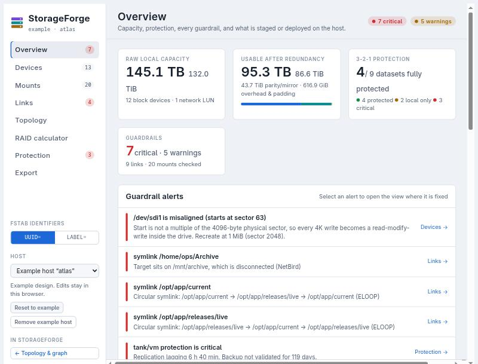
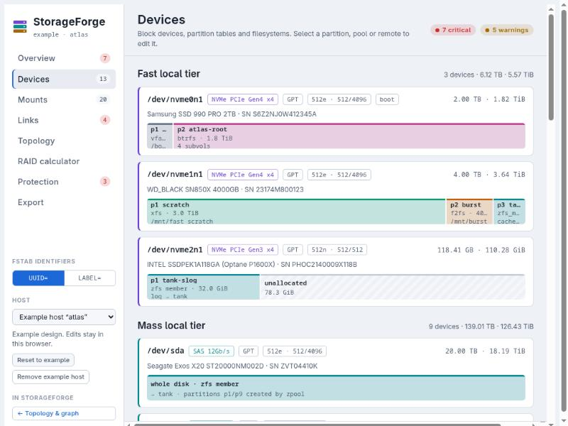
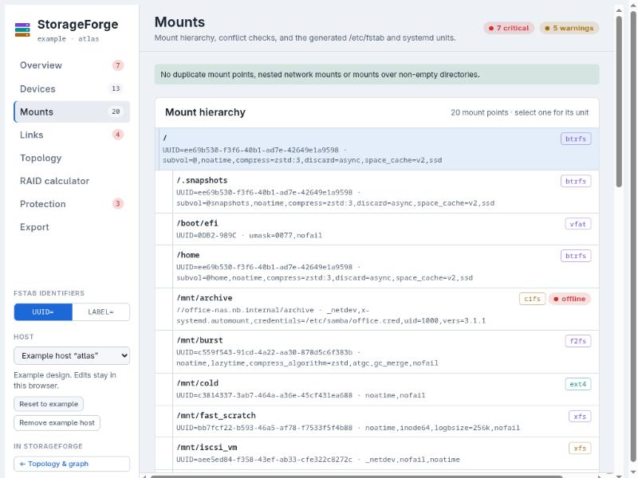
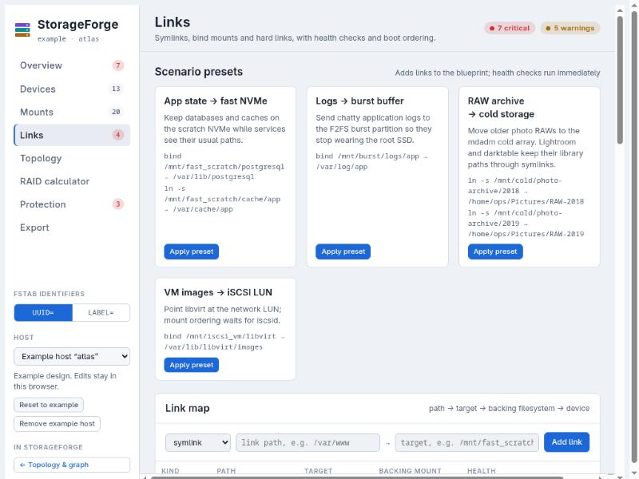
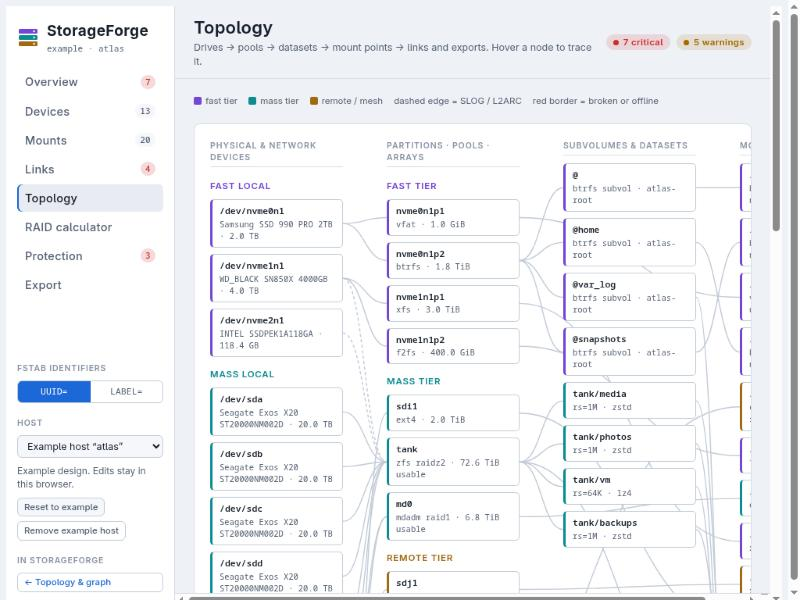
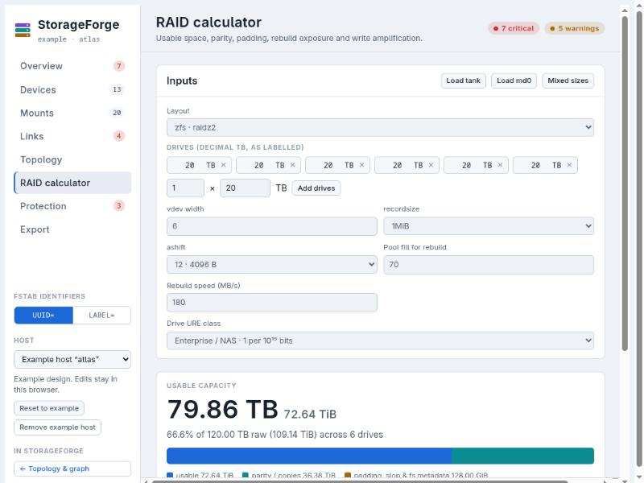
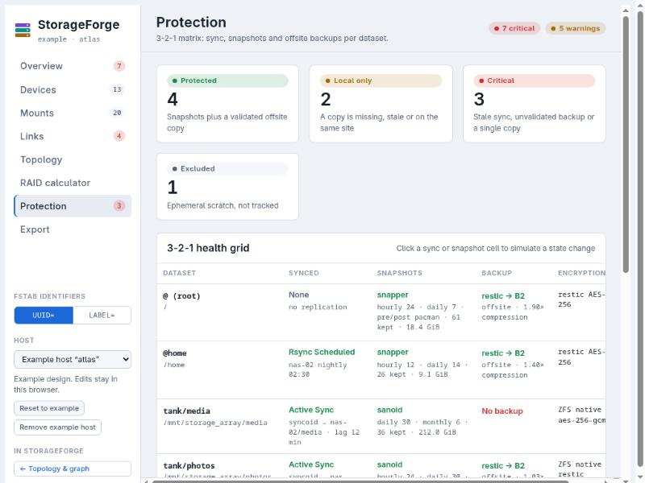
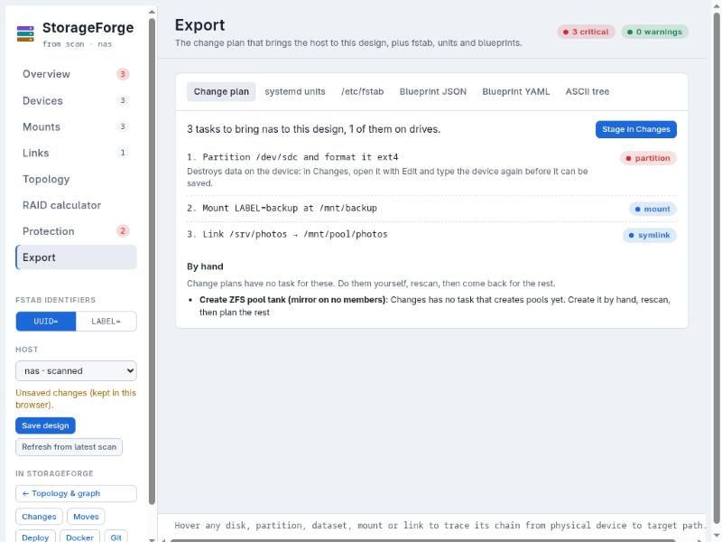

# Planner

`/planner` is the design tool for one host at a time. It edits the same `storageforge/v1` design the topology view shows, and needs the same sign-in.

## Picking a host

The **Host** menu in the rail lists every scanned host and every saved design.

- **A scanned host with no saved design** opens as a design built from its latest scan: disks, partitions, UUIDs, btrfs subvolumes (also through LUKS), mdadm, ZFS, LVM and multi-device btrfs pools, mount options, remote mounts, bind mounts and problem symlinks. Protection rows start as "None", because a scan cannot see sync, snapshot or backup policy. `/tmp`, `/var/tmp` and `/var/cache` start as ephemeral.
- **Save design** stores it as the host's blueprint and rebuilds its graph, so reports, the topology and the graph pick up your tiers, protection, exports and planned links. A host that was never scanned gets its graph from the design alone.
- **Refresh from latest scan** rebuilds the hardware from the newest scan and keeps what only you know: disk and pool tiers, encryption notes, protection rows (rows for things that disappeared stay listed), exports, manual links, and remotes the scan didn't see.
- Unsaved edits are kept per host in this browser until you save.
- **FSTAB IDENTIFIERS** switches the generated fstab between `UUID=` and `LABEL=`.

The built-in example host **atlas** is a full design to explore. Edits to it stay in the browser. **Remove example host** hides it for every user once you have real hosts; **Show example host** brings it back. The example still appears when there is nothing else to show.

Scans read each btrfs filesystem's data and metadata profiles from `/sys/fs/btrfs`, so a multi-device pool imports with its real level (for example `raid1`). Where `/sys/fs/btrfs` cannot be read, the pool imports as `single`: set the real level before trusting capacity and fault-tolerance numbers.

## Views

### Overview

Capacity (raw, usable after redundancy), 3-2-1 protection and every guardrail alert, each linking to the view where it is fixed. For a scanned host it also lists what the rest of StorageForge holds for it: staged changes, move plans, designed shares and their check results, deployed jobs and their state, drift, and folders the last scan could not read.

### Devices

Block devices grouped by tier, with bus, sector sizes, partition table and a bar per partition. Select a partition, pool or remote to edit it. Misaligned partitions are flagged.

### Mounts

The mount tree with conflict checks (duplicate mount points, nested network mounts, mounts over non-empty folders) and, per mount, the generated fstab line and systemd unit.

### Links

Symlinks, bind mounts and hard links with health checks (broken target, loops, a target on an offline mount) and boot ordering. Scenario presets add common layouts in one click.

### Topology

Drives → partitions and pools → subvolumes and datasets → mount points → links and exports, as columns. Hover a node to trace it.

### RAID calculator

Usable space, parity, padding, rebuild exposure and write amplification for ZFS, mdadm, LVM and btrfs layouts. **Load** buttons fill it from the design's pools. Its formulas are the same as `capacity.py`, so reports and the planner agree.

### Protection

The 3-2-1 grid per dataset: sync, snapshots, backup, encryption. Click a sync or snapshot cell to simulate a state change.

### Export

**Change plan** (the first tab) compares the design with the host's latest scan and lists what it would take to get there, as [change-plan tasks](plans-and-scripts.md#staged-changes): partitioning an empty disk, formatting an empty partition, labels, adding devices to a btrfs pool, converting its profile, subvolumes, mounts, mount options, NFS/SMB mounts and symlinks. The design doesn't have to be saved first. **Stage in Changes** adds the tasks to the staged plan in the **Changes** tab, where they are checked, saved, downloaded or deployed like any other.

- **Drive tasks arrive unconfirmed.** A partition, format or add-device task can't be checked or saved until you open it with **Edit** and type the device again.
- **By hand** lists what the design has but no task type covers: mdadm arrays, encrypted ZFS pools and ones with log or cache devices, bind mounts and hard links. Do those yourself, rescan, and the rest of the plan follows.
- **Only additions and edits.** Anything that would erase data the scan saw (repartitioning a disk that has partitions, reformatting a filesystem, anything on the system disk) is listed under By hand, never staged. Things on the host that the design dropped are listed under **Left alone**.
- The host must have been scanned. For the example host, or a design for a machine not yet scanned, use the other tabs.

The other tabs describe the design: systemd units, `/etc/fstab`, the blueprint as JSON or YAML, and an ASCII tree. The planner no longer writes Bash or Ansible itself; earlier versions did, outside the checks change plans get.

## Versions of a design

**Versions** (beside Save design) keeps named, timestamped copies of the design for a host, with a note and who saved it. A version can be compared with the design on screen, in sentences: what is only in the version, what is only in the current design, and what differs. **Restore** puts a version back, and first saves the design it replaces as an automatic version, so nothing is lost. Delete removes one. Each host keeps at most 50 versions and 40 MiB (2 MiB each); only automatic versions are dropped to make room, and when a host is full of hand-saved ones, delete one first. Listing and comparing need `plans.view`, and saving, restoring and deleting need `plans.edit`. Versions are in essential backups (migration 042). Restoring replaces the saved design only; it does not stage a change.

## Saving rules

`PUT /api/planner/design` accepts a design up to 2 MiB. It is rejected if any text holds a control character or one of `< > " \``, or if a device, partition, pool, dataset or subvolume name holds characters its tool would not accept. The planner page applies the same rule when it loads a design or a local draft, so nothing typed can end up as a broken script line.

The planner is served under the same CSP as the rest of the app, with one relaxation (`style-src-attr 'unsafe-inline'`) for its inline-sized bars. It uses system fonts.
