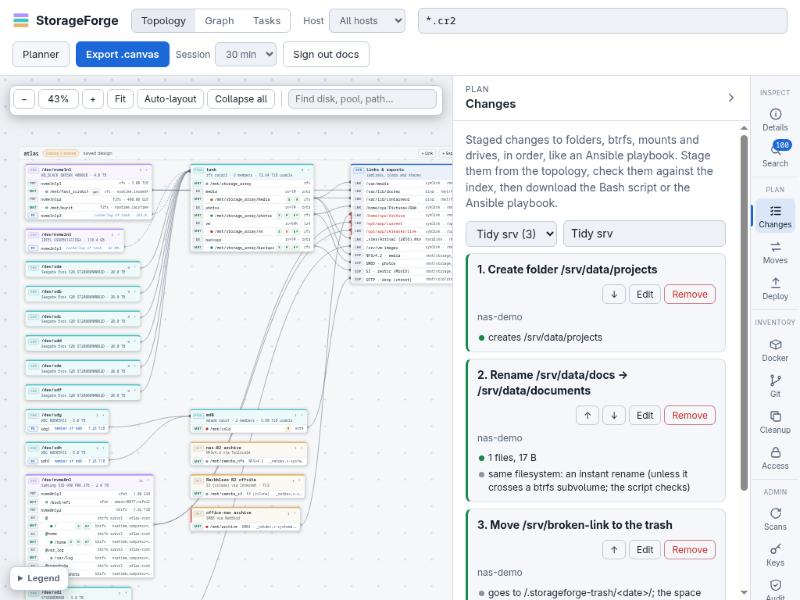
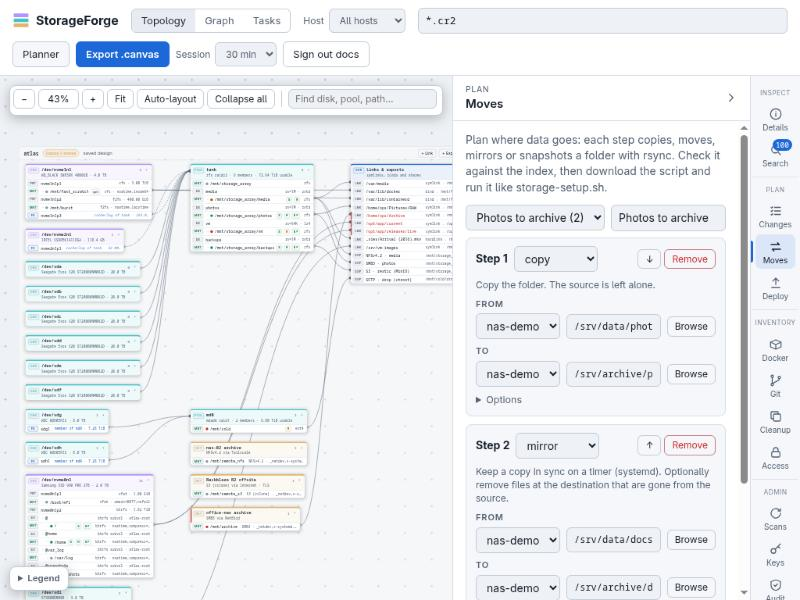
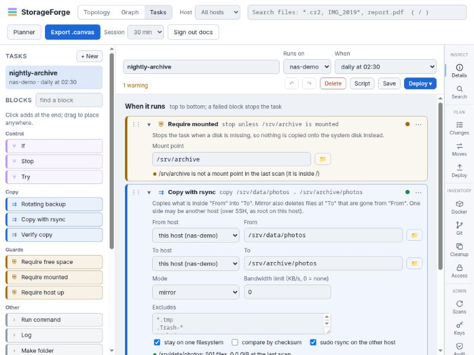

# Plans and scripts

StorageForge never changes a host while you plan. Each plan type is saved in the database, checked against the index, and turned into a Bash script. You run the script yourself or [deploy](deployments.md) it. All four types follow the rules in [Concepts](concepts.md#the-rules): report first, idempotent steps, nothing deleted, and `--host` to run elsewhere.

| Type | Scope | Where | Script | Changes things with | CLI |
| :--- | :--- | :--- | :--- | :--- | :--- |
| [Staged changes](#staged-changes) | Folders, btrfs, mounts, drives on any hosts | Topology, **Changes** | `changes-<plan>.sh`, or an Ansible playbook | `--apply` (+ `--destructive`) | `plan` |
| [Data moves](#data-moves) | Copies between folders on any hosts | **Moves** | `<plan>.sh` | `--run`, `--verify`, `--cutover`, `--install` | `moves` |
| [Shares](#nfs-and-smb-shares) | NFS and SMB exports of one server and its clients | Topology, share wizard | `shares-<host>.sh` | `--apply` | `shares` |
| [Storage tasks](#storage-tasks) | A block program on one host, by hand or on a timer | **Tasks** view | `task-<name>.sh` | `--run`, `--install`, `--uninstall` | `tasks` |

Every script prints in the same words: `ok` (already so), `missing` (would change), `conflict` (blocked) and `->` for each action taken. `--help` prints the script's header.

## Staged changes

Change plans work like an Ansible playbook for storage: an ordered list of tasks, each on one host. Stage them from the topology (every box has **Plan a change**, and **Browse folders** on a mount lists folders with their indexed sizes) or in the **Changes** panel.



| Group | Tasks |
| :--- | :--- |
| Files and folders | create folder, rename or move (same filesystem), move to trash, symlink, owner and permissions |
| btrfs | create subvolume (optionally no copy-on-write), snapshot, turn a folder into a subvolume, add, replace or remove a pool device, convert profile (balance), reclaim free space, grow to fill a device, restore a subvolume from a snapshot, turn on quotas, scrub |
| ZFS | create a pool, create a dataset with properties, snapshot, send a snapshot to another host, scrub |
| LVM | create a volume group, add a device to one, create a logical volume, grow one with its filesystem, snapshot one |
| Mounts | add a mount (fstab), change mount options, unmount |
| Drives | partition a disk (GPT, one partition), format, set the filesystem label |

`GET /api/changes/types` (or `storageforge-index plan types`) lists every task type and its fields; the UI builds its forms from it.

**Check** goes through the plan in order, so later tasks see what earlier ones create. It flags:

- a missing source, or a destination that already exists;
- a rename that crosses filesystems (use Moves);
- btrfs tasks on another filesystem;
- formatting a mounted device, a pool member or the OS disk;
- profiles that need more devices than the pool has;
- mounts over folders that already hold files;
- running containers using the path;
- tasks that undo each other.

```bash
./changes-plan.sh                               # report
sudo ./changes-plan.sh --apply                  # make the changes in order; stops at the first failure
sudo ./changes-plan.sh --apply --destructive    # also partition, format and add devices to pools
sudo ./changes-plan.sh --apply --task 3         # one task only
./changes-plan.sh --host rocks@10.42.0.3 --apply
```

fstab is backed up before each edit and restored if `findmnt --verify` rejects the result. Trash goes to `.storageforge-trash/<date>/` at the top of the filesystem or subvolume, so it stays a rename. A folder turned into a subvolume is copied with reflinks and its original goes to the trash.

Drive tasks have three locks: the device typed twice in the plan, `--destructive` on the command line, and a refusal to touch anything mounted, swapped on, or part of RAID, LVM or LUKS.

**Ansible playbook** (`changes-<plan>.yml`) writes the same tasks with standard modules (`ansible.builtin.file`, `ansible.posix.mount`, `community.general.parted` and `filesystem`, `command` for btrfs). The inventory lines from the last scans are at the top. Drive tasks run only with `-e storageforge_destructive=true`. A send to another host stops the playbook with the reason, since a playbook has no signature and no key: deploy that plan from StorageForge.

### Sending snapshots

Use the **btrfs** and **ZFS** send tasks for a one-off copy, and the **Send** blocks in a [storage task](#storage-tasks) to repeat it. Both run on the sending host and copy only the changes when given, or when they find, an earlier snapshot both sides share. The "btrfs replication" and "ZFS replication" templates snapshot, send and prune on a timer.

| | Change task | Storage task block |
| :--- | :--- | :--- |
| Which snapshot | The one you name | The newest with the prefix |
| Earlier snapshot | The one you name | The newest both sides have |
| A receive that was cut off, so never finished | Reported, you delete it | Removed and sent again |
| Old copies on the receiver | Left alone | Pruned to **Keep there** |

ZFS sends use `zfs receive -u -x mountpoint -x sharenfs -x sharesmb -o setuid=off -o devices=off -o canmount=noauto`, so nothing is mounted over a folder on the receiver, now or at its next boot, nothing is exported by the stream's own settings, and the copy honours no setuid file or device node (mount it by hand to look at it), and never `-F`, so an existing dataset is never overwritten. Raw sends keep an encrypted dataset encrypted, and the receiver does not need its key.

Keep the last snapshot you sent on the sender until the next send finishes, or the next one is a full copy.

A send to another host needs that host [enrolled](deployments.md#setting-up-deploy-access): each side is a signed run, with a key between them that can do nothing else, and no root key between the hosts. Until it is enrolled the check says `crit` with the steps, and a deploy is refused. There is no other way there, so a script you download and an Ansible playbook hold no key, and stop and say so. Each deploy brings a new key, and the [receiving host keeps its own record](security.md#sends-between-hosts). A send on one host needs none of this: leave the host empty.

Names cross hosts as plain words: a snapshot sent to another host starts with a letter, digit or `_`, and holds only those and `. : + -`. **Keep there** goes in the signed run on the receiver, so changing it takes a deploy. The sender cannot ask for fewer.

A failed receive fails the send: the sender's exit code, its output and the receiver's record all say so, with what the tool said. What it left is removed, and nothing is pruned.

LVM has no equivalent. To copy an LVM snapshot, mount it and use a Moves step.

### Firewalls, networks and hardening

These steps come from the [map](infrastructure-map.md#planning-from-it) and from Security, and work the same as any other: report first, Apply through a signed run. `storageforge-fwrules`, shown in full in the script, writes each firewall rule in whichever firewall the host runs. nftables and iptables forget their rules at a reboot unless told otherwise, so it keeps them and a unit puts them back. firewalld and ufw keep their own. A step with a rollback timer undoes itself unless StorageForge can still reach the host to stop the timer.

## Data moves

A move plan is a list of steps. Each takes one folder on a scanned host to a folder on another (or the same) host:

| Method | What happens |
| :--- | :--- |
| copy | rsync the folder across; the source is left alone |
| move | copy, `--verify`, then `--cutover` renames the source to `<name>.migrated-<date>`; on the same host a symlink is left at the old path |
| mirror | a copy kept in sync by a systemd timer (`--install`), optionally deleting files gone from the source |
| rsnapshot | rotating hard-linked snapshots on a timer, keeping hourly, daily, weekly and monthly counts |
| git | a `git clone --mirror` archive of a repository, refreshed by `--run` or a timer; `--verify` checks every branch and tag matches |



Pick folders with a browser that shows indexed sizes, or start from **Move from here…**, **Copy to another disk**, the Cleanup panel's **Move…** or the Git panel's **Archive to…**. Step options include excludes, checksum comparison, bandwidth limit, schedule, retention, and whether to use `sudo rsync` on the source. Two more come from [copying a host](host-migration.md#copying-a-host-onto-another), and can be set in a plan's JSON: `dirs_only` copies folders with their owners and modes and no files, and `keep_replaced` keeps a file the copy would overwrite as `<name>.sf-replaced-<date>`.

**Check** answers from the index: how much each step transfers and roughly how long it takes, free space on each destination mount summed across steps, planned mounts that aren't mounted yet, destinations that would land on the root filesystem, overlapping source and destination, folders the scan couldn't read, files already at the destination, and running containers using either side.

```bash
./plan.sh                  # report: sources, destination mounts, free space, SSH and sudo
./plan.sh --dry-run        # what rsync would transfer
sudo ./plan.sh --run       # copy; resumable, safe to rerun
sudo ./plan.sh --verify    # compare (add --checksum to read every byte)
sudo ./plan.sh --cutover   # finish move steps after a clean verify
sudo ./plan.sh --install   # mirror, rsnapshot and git timers
sudo ./plan.sh --run --step 2
./plan.sh --host rocks@10.42.0.3 --run
```

Each step runs on its destination host and pulls from the source over SSH with `rsync -aHAX --numeric-ids`. A step stops if its destination mount isn't mounted, so nothing lands on the root filesystem. Runs are logged to `/var/log/storageforge/`.

Only rsync's sending (read-only) side needs root on the source, so allow just that:

```bash
echo 'rocks ALL=(root) NOPASSWD: /usr/bin/rsync --server --sender *' | sudo tee /etc/sudoers.d/storageforge-rsync
```

Timers run as root without your SSH agent, so for scheduled steps root on the destination needs its own key on the source; `--install` checks this. [Deployed jobs](deployments.md#deployed-jobs) avoid that by giving each job its own key, limited to its own folder.

## NFS and SMB shares

Shares you add to a host's design can be deployed; shares a scan found are only reported. **+ Export**, or **Share this…** on a mount point, opens the share wizard:

1. **Folder:** browse the server's file system from the index. Each folder shows the disk or network mount it lives on, mounts below it, and shares already there.
2. **Access:** NFS (one rule per client or subnet, with presets, one-click subnets of scanned hosts, and `crossmnt` when filesystems are mounted inside) or SMB (users and read-only).
3. **Clients:** where each client mounts it, picked by browsing that client's own file system.
4. **Review:** what will happen, then **Save and deploy** (a read-only report first), or **Save only**.

Each step is checked as you go: system and pseudo paths, re-exporting a network mount, folders not in the index, duplicate names and paths, nested exports, filesystems inside the share, and per client a mount point that already holds a disk or share, sits inside a network mount, is a system folder, or would hide files. NFS shares must name their clients.

`sudo ./shares-<host>.sh --apply` on the server:

- installs the NFS server or Samba if missing (apt, dnf, zypper or pacman);
- writes its own `/etc/exports.d/storageforge.exports` and `/etc/samba/storageforge.conf`, and adds one include line to `smb.conf` after a backup;
- checks the config with `testparm`, labels SMB folders `samba_share_t` when SELinux is enforcing, opens firewalld or ufw for the listed clients, and starts the services;
- reports Samba accounts that still need `smbpasswd -a`.

On each client it installs the mount helper, keeps SMB credentials in a 0600 file (asking once), appends an fstab line with `_netdev,nofail,x-systemd.automount` after a backup, and mounts the share. Existing fstab lines are never changed; a different line for the same mount point is a conflict to fix by hand. `--only server` or `--only clients` limits a run.

**Shares** on the topology toolbar (or **Manage shares…** on a host's menu) lists every share on the hosts in view: its folder, who may use it, who mounts it, its state and any check problems. Edit or remove designed shares from there; removing a deployed share takes it down at the next deploy. Shares only the scan knows are read-only.

## Storage tasks

Tasks are small programs built from blocks in the **Tasks** view. They run on one host, by hand or on a systemd timer.



| Group | Blocks |
| :--- | :--- |
| Guards | Require mounted, Require free space, Require host up |
| Control | If (mounted, exists, free below, weekday, day of month, host up, command succeeds) with then/else, Try with a fallback, Stop |
| Copy | Copy with rsync (copy or mirror; one side may be another host), Rotating backup (dated hard-linked folders, keep N), Verify copy |
| Snapshots | btrfs snapshot, Prune btrfs snapshots, Send btrfs snapshots, ZFS snapshot, Prune ZFS snapshots, Send ZFS snapshots |
| Services | Docker compose stop/start/restart, systemd unit stop/start/restart |
| Other | Make folder, btrfs scrub, btrfs reclaim space, Run command, Wait, Log |

"If the task fails" blocks run after a failure. Templates cover nightly mirrors, btrfs and ZFS snapshot rotations, rotating backups, stop-snapshot-start and a weekend scrub. Schedules are by hand, hourly, daily at 02:30, every 6 hours, Sundays at 03:00, monthly, or any systemd calendar time.

Every block is checked against the index while you edit: paths, btrfs and ZFS targets, overlapping copies and free space at the destination. A copy onto a data disk with no guard is flagged (if that disk is missing, the copy fills the system disk), as is a mirror whose source disk could be unmounted (it would empty the copy). Both come with a one-click **Add Require mounted** fix.

```bash
./task-nightly-archive.sh               # read-only: checks the guards, prints each command it would run
sudo ./task-nightly-archive.sh --run
sudo ./task-nightly-archive.sh --install     # /usr/local/lib/storageforge/tasks + sf-task-<name>.service (+ .timer)
sudo ./task-nightly-archive.sh --uninstall
```

Runs take a lock, so they never overlap, and leave `/var/lib/storageforge/tasks/<name>.last`. **Deploy** does the same from the web UI: Dry run, Install, Run now or Uninstall. A task moved to another host is uninstalled from the old one, and a task installed on a host cannot be deleted until it is uninstalled.

## Unified task scheduler

The unified scheduler runs any task StorageForge can do on target client hosts on a cron schedule, fired by a systemd timer, or by cron where the host has no systemd, and checked on the server. Hosts need bash and the usual tools, not Python. With no flags the install script only reports:

- **Supported operations:** Storage tasks (`task`), staged change plans (`change`), data move plans (`move`), NFS/SMB share configurations (`shares`), or arbitrary shell commands (`command`, which needs the `hosts.command` permission). What a schedule runs must be meant for its host. Scans run from the server: set the host's own scan interval.
- **Scheduling & execution control:** Standard 5-field cron expressions, timezone awareness, allowed time windows (`HH:MM-HH:MM`), concurrency policies (`skip`, `queue`, `replace`), execution timeouts, random jitter, nice/ionice scheduling priorities, environment variables (not ones that change what runs, such as `PATH` or `LD_PRELOAD`), a user to run a command as, and retries with backoff. With cron, the runner wakes every minute and applies the schedule's expression and timezone. Pausing updates the host; the Deploy tab shows it as pending if the host can't be reached.
- **Runner:** `/usr/local/lib/storageforge/scheduler/run-<id>.sh`, one bash script per schedule. It takes the lock, runs the task, records `/var/lib/storageforge/scheduler/<id>/runs.jsonl` (readable, no output) and `last.out` (root only), and posts bearer-authenticated reports to `/api/scheduler/report` if a report URL is set (Deploy tab). Without one, or with a script downloaded by hand, which carries no token, runs arrive with the next scan.
- **What a run's status means:** `reported`: the host says it finished, and nothing has checked. `verified`: mount, free space and path rules passed against a scan newer than the run; the next scan of the host makes this check. `verify_failed`: an output pattern or one of those rules failed. `failed`: the task's exit code was not 0. Policies `report_only` and `none` stop at `reported`.
- **Management:** Configured via the Web UI **Schedule** panel, REST API (`/api/scheduler/*`), CLI (`storageforge-index schedule`), and deployed over SSH with signed deploy access. Missing reports are automatically picked up during subsequent host scans.

## From a planner design

The [planner's Export view](planner.md#export) turns a design into change-plan tasks (`POST /api/planner/changes`) and stages them here, so a design reaches a host through the same checks, report-first script and deploy as any other change plan. Drive tasks staged this way need the device typed again before the plan can be saved. Pools, ZFS datasets, mdadm and LVM have no task type yet and are listed as "by hand".
