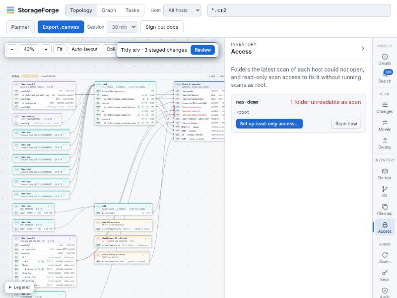

# Scanning and search

## What a scan does

A scan connects once, with one multiplexed SSH session (`ControlMaster`), and runs only read-only commands. Every command goes through `sh -c`, so fish or csh login shells don't matter.

```text
 target host (no agent)                          StorageForge
 ──────────────────────                          ────────────
 ssh ControlMaster (one TCP session, multiplexed)
   ├─ inventory: hostname, machine-id, os-release, lsblk -J, findmnt -J, df, zpool status, /sys/fs/btrfs,
   │             package manager, installed NFS, SMB, rsync and rsnapshot programs
   ├─ find /       -xdev -prune(other mounts, excludes) -printf NUL-records ─► reader 1 ─┐ 20k-row batches
   ├─ find /home   …                                                         ─► reader 2 ─┤ bounded queues
   └─ find /mnt/x  …                                                         ─► reader N ─┘ (back-pressure)
                                                                                            │ routed by mount
                                                      writer pool ◄─────────────────────────┘
                                                      SQLite: 1 writer · PostgreSQL: up to 8
                                                        stage → diff against the index → apply + FTS + change log
                                                        → commit (one transaction per mount)
   ├─ optional: sha256sum of size-collision candidates (--checksum)
   ├─ git: one call reading every repository found
   ├─ docker/podman: containers, volumes, compose files
   └─ deployed files: checksums, StorageForge fstab lines and job timers (for drift)
```

After the walk, the host's graph is rebuilt from the index plus its saved design.

### Which mounts are walked

| Mount | Default |
| :--- | :--- |
| Local filesystems | walked, one `find` per mount, up to `--parallel` (4) at a time |
| `proc`, `sysfs`, `devtmpfs`, `cgroup*`, `overlay`, `squashfs`, `autofs` and similar | skipped; `/proc`, `/sys`, `/dev` and `/run` are pruned by path too |
| `tmpfs` | skipped unless `--include-tmpfs` |
| NFS, SMB, rclone, sshfs | skipped unless `--include-network` (index them on their own host); automount points are never triggered |
| Bind mounts | a mount sharing a `maj:min` whose root nests inside a planned mount is recorded as `bind-alias` and not walked twice |
| Anything else | `--include-fstype overlay` (or `STORAGEFORGE_INCLUDE_FSTYPES` for the server) walks a normally skipped type |

On btrfs a walk also enters subvolumes nested inside the mount, which `-xdev` alone would lose. It skips read-only ones (snapshots), ones with their own mount (those get their own walk) and Docker, Podman and Timeshift's subvolume trees. A writable snapshot elsewhere can't be told apart and is indexed: exclude it by path.

`.git` contents, `node_modules`, `.Trash*`, `__pycache__`, `.snapshots` and `.zfs` are pruned by name. Add your own with `--exclude-name` and `--exclude-path`, or drop the defaults with `--no-default-excludes`.

### Guardrails

| Risk | How it is handled |
| :--- | :--- |
| Symlink loops | `find -P` never follows symlinks; loops are recorded as links and flagged in reports (ELOOP) |
| Partial or failed walks | SSH exit 255, a truncated record stream, or `find` exiting 1 with no output aborts that mount's diff, so nothing is deleted |
| Mass deletion | If more than `--max-delete-ratio` (default 50%) of a mount's 1,000+ entries vanish, the diff is refused and the index is left as it was |
| Subtree scans | `--path /srv/data` diffs only that subtree; deletions are scoped to it |
| Load on the target | `find` and `sha256sum` run under `nice -n 10` and `ionice -c3` when available (`--no-nice` turns it off) |
| A host claiming another's name | A host is pinned to the SSH host keys verified at its address. A different machine reporting an indexed name is refused and audited; the real host's data is untouched. After reinstalling a host: `storageforge-index hosts rekey <name>`, then scan it |

### Incremental sync

Rows are keyed by `(dir_id, filename)`; a `dir_id` is one folder on one mount. After a walk is staged, three set operations run in one transaction:

1. **Deleted:** indexed rows in scope that the walk didn't see. They are logged to `file_changes`, removed from FTS and deleted.
2. **Modified:** same key, different size, mtime, mode, owner, symlink target or type. The checksum is cleared when content may have changed.
3. **Added:** new keys, with `first_seen_scan_id` set.

Added entries are logged only after a mount's first scan, so a first index doesn't write a million-row change log. A later scan adding more than 50,000 entries to one mount counts them without listing them. Directory mtime changes update the row without being logged. Empty folders are removed from `directories`.

`storageforge-index changes --host H` lists what the last scan added, modified and deleted.

### Checksums and duplicates

`scan --checksum` hashes only files whose size collides with another file (at least `--checksum-min-size`, 1 MiB). `dupes` then lists identical files. The **Cleanup** panel and `folders` find likely duplicate *folders* from the index alone, by matching file names, sizes and subfolder layout; renamed copies still match.

## Scheduling

The server rescans every host that has a `scan` binding when its last scan job is older than `STORAGEFORGE_SCAN_INTERVAL` (default `6h` in compose), checking every 10 minutes. A restart does not trigger a burst of scans, and a failing host is retried once per interval. A host is always queued under its indexed hostname, whether it was named by IP, alias or hostname, and duplicate requests collapse into the queued job. A host can have its own interval and quiet hours (the host's menu in the topology, or `PUT /api/hosts/<name>/schedule`); it then scans on those even when no global interval is set. Up to `STORAGEFORGE_SCAN_WORKERS` hosts (default 4) scan at once, and further jobs wait for a free worker. With SQLite they walk side by side but apply their results to the index one at a time.

## Unreadable folders and read-only access

Scans run as an ordinary user, so `find` cannot open folders such as `/root`, `/etc/ssl/private` or another user's home. Each scan records the folders it could not read. The **Access** panel lists them per host, and topology host headings show an "N unreadable" badge.



Read-only scan access fixes this without scanning as root. It gives the scan user private copies of `find` and `sha256sum` that carry `CAP_DAC_READ_SEARCH`, the approach restic documents for backup users. The copies live in `/usr/local/lib/storageforge`, owned by root and executable only by the `storageforge-scan` group. They can list and checksum every file; they cannot write, change ownership or run anything as root, and programs they start do not inherit the capability. Scans use them when present and fall back to the plain tools.

Three ways to set it up:

- **Access → Set up read-only access.** StorageForge runs the script once over SSH with sudo, using either the scan user's sudo password (connecting with its vault key) or an admin account's password. The password goes only to that one session.
- **By hand:** `storageforge-index access script --host nas-02 | ssh admin@nas-02 sudo sh`
- **Remove it:** the same, with `--remove`.

The script needs `setcap` (`libcap2-bin` on Debian, `libcap` on RHEL). Inside Docker or LXC the capability must be in the container's bounding set; if it is not, the script says so and leaves nothing behind.

## Git repositories

Scans skip what is inside `.git` but record the `.git` entry itself, which marks a working copy. Bare repositories are folders holding `HEAD`, `config`, `objects/` and `refs/`. After the walk, one SSH call asks the host's git about each repository, read-only, with a 20 s timeout each: branch, last and first commit, branch and tag counts, remotes, uncommitted changes, and ahead/behind its upstream.

Repositories with the same first commit hold the same history, so copies are matched whatever they are called. The **Git** panel gives each one a state:

| State | Meaning |
| :--- | :--- |
| uncommitted | The working copy has uncommitted changes |
| unpushed | It has commits its upstream doesn't have |
| behind | Another copy has newer commits |
| single copy | No other scanned machine has this history |
| copied | Another scanned machine has this history |
| archived | A bare copy exists on another machine |

**Archive to…** adds a `git` step to a move plan (see [Data moves](plans-and-scripts.md#data-moves)).

## Docker and compose stacks

After the walk, each scan asks the host's engine what is there. It tries Docker, then Podman, directly or through `sudo -n`. It records every container's name, image, state, compose labels and mounts; every volume and its size; and the engine's data directory. It then reads the compose files the index found and keeps only services, images, container names and volume definitions. Environment sections, `.env` files and passwords in volume options are never stored.

| State | Meaning |
| :--- | :--- |
| running | Every container in the stack is running |
| partly running | Some of its containers are running |
| stopped | Its containers exist but none is running |
| stored | A compose file on disk that nothing was deployed from |

Managers that run in a container (Dockhand, Portainer, Komodo, Dockge) record stack folders as they see them inside their own container. Those paths are translated to host paths through the manager's mounts.

Mount boxes in the topology show how many containers use them, and the Moves and Changes checks warn when a step touches a folder a running container uses, naming the stacks to stop first. Task checks warn too, naming the containers. On the CLI: `storageforge-index docker [--host H] [--path P]`.

## Search

Search runs across every indexed host from the header box, the **Search** panel, `GET /api/search` or `storageforge-index search`. Patterns are shell globs, matched case-insensitively.

```bash
storageforge-index search "*.cr2" --host node-01 --size-gt 100MB
storageforge-index search "IMG_2019*" --under /mnt/storage_array/photos --sort size --desc
storageforge-index search "*invoice*2024*" --type f --newer-than 90d --format json
```

Each pattern takes the cheapest index that can answer it:

| Pattern | SQLite | PostgreSQL |
| :--- | :--- | :--- |
| `*.cr2` | `extension = 'cr2'` (B-tree, with size from the same index) | same |
| `report.pdf` | `filename = … COLLATE NOCASE` | `lower(filename) = lower(…)` |
| `IMG_2019*` | `filename LIKE 'IMG_2019%'` (B-tree prefix range) | `filename ~* '^IMG_2019.*$'` (trigram GIN) |
| `*raw*2019*` | FTS5 trigram for candidates, then exact `GLOB` | `filename ~* …` (trigram GIN) |
| `--under /mnt/x` | `directories.path` B-tree range | `directories.path LIKE '/mnt/x/%'` (`text_pattern_ops`) |
| `--path-contains x` | scans `directories.path` (one row per folder) | trigram GIN |

Sizes accept `100MB` (decimal), `100MiB` or `100M` (binary, as `df` and `find` print them). Ages accept `90m`, `36h`, `7d`, `2w` and `1y`. The web search returns at most 500 results.

## Measured performance

From a local scan (no SSH hop) of `/usr` with a warm page cache: 1,172,684 entries, 23.3 GiB, SQLite 3.54, Python 3.14, NVMe.

| Step | Time |
| :--- | ---: |
| Walk and parse | 5.2 s (225k entries/s) |
| First index, total | 18.0 s |
| Rescan with no changes | 8.3 s |
| `search "*.so"` (7,604 hits) | 26 ms |
| `search "*python3*config*"` (trigram) | 3 ms |
| `search --path-contains …` (no match) | 78 ms |
| Index size | 459 MiB (≈ 410 bytes per entry) |

On an index of 11.9 million entries, storing each folder once (schema 12) took the database from 7.7 GB to 3.3 GB, `search --under /mnt` from 23 s to 27 ms, and an `IMG_2019*` search from 330 ms to 18 ms. Over SSH, throughput is usually bound by the remote disk walk and the link.
