# Web UI

For a guided tour of every feature, see the [feature guide](features/README.md).

The main page (`/`) has five views in the header (**Topology**, **Graph**, **Tasks**, **Map** and **Scan**) and a rail of 18 panels on the right. Every page except `/login` needs a session; an open page clears itself and returns to the sign-in page when the session ends.

The header also holds the host filter, file search, the security chip, links to the [Planner](planner.md) and to [Manage](#other-pages), **Export .canvas** (in Topology and Graph, the two views it exports), the session length menu and **Sign out**. The chip says in a line where the [security posture](ransomware-defense.md) stands (*Security: nothing wrong found*, *needs a look*, *incident* or *not known*), with the reason under it, and a click opens the **Security** panel. Accounts that may not view security do not see it.

## Topology

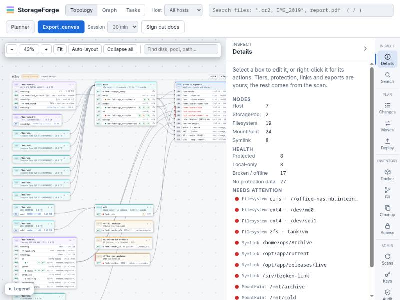

The topology is a schema-designer canvas built from each host's design. Each host is a frame. Each disk, pool and remote is a table whose rows are its partitions, subvolumes, datasets and mount points. Lines join rows across tables: a member partition to its pool, a mount point to the links and exports inside it, an export to the client mounting it.

- Scroll to pan, Ctrl+scroll to zoom, drag a table or host frame by its heading.
- **Fit**, **Auto-layout** (forgets saved positions) and **Collapse all** are in the toolbar, with a box finder.
- Table positions are saved with the design.
- Staged subvolumes and mounts appear as dashed boxes; other staged changes mark the box they touch. A banner offers **Review** when changes are staged.

Select a box to edit what you own: device and pool tiers, encryption notes, 3-2-1 protection on a mount point (snapshots, sync, backup target, offsite), links and exports. Hardware and layout come from the scan. To set a backup target, drag one mount point onto another, on the same host or a different one. **Save design** stores the design and rebuilds the graph.

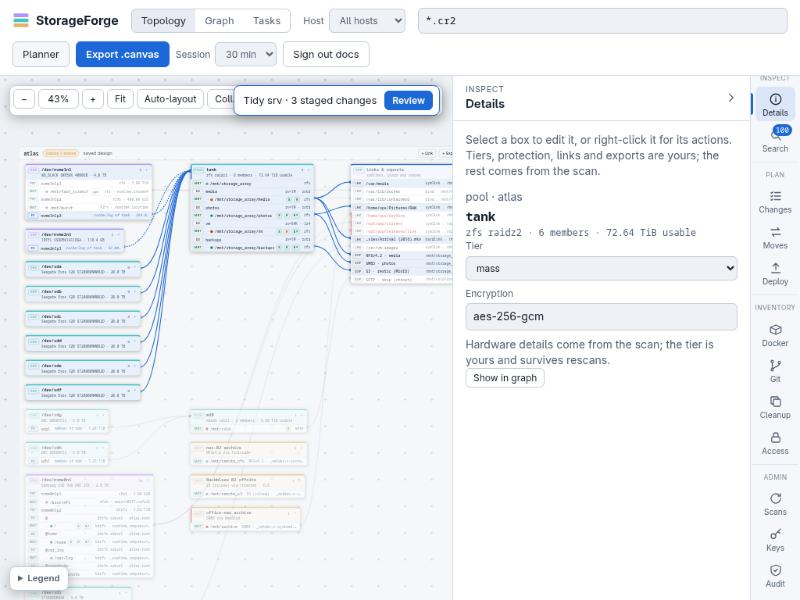

### Context menus

Right-click almost anything. The menu key and Shift+F10 open the menu on the focused box; Shift+right-click keeps the browser's own menu.

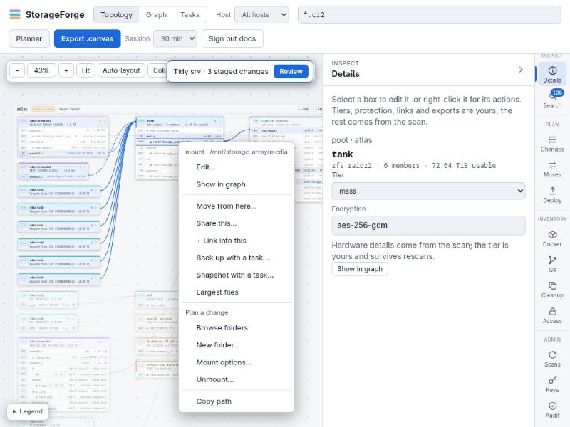

| Where | Menu |
| :--- | :--- |
| Topology box | edit, show in graph, tier, protection, move from here, share this, link into this, back up or snapshot with a task, largest files, browse folders, every change that can be staged there, the changes already staged on it, copy path, device or UUID |
| Host heading | scan now, add a link or export, deploy shares, review staged changes, open in the planner |
| Graph node | details, focus, center, unpin, edit in the topology, browse folders, largest files, move from here |
| Folder in the browser | open, largest files, rename, trash, permissions, link to it, turn into a subvolume, snapshot, copy to another disk, copy path |
| Search result | show its folder, largest files there, rename, trash, permissions, copy its folder to another disk, copy path |
| Staged change, Moves step | edit, reorder, duplicate, remove (and swap source and destination for a step) |

## Graph

The view has two modes. **Files** is a map of a host's folders from the index, with lines between folders holding copies: **Browse** or **Duplicates**, size, host and **System files** filters, and an ignore list. See [the file map](features/views.md#files). **Structure** is described below.

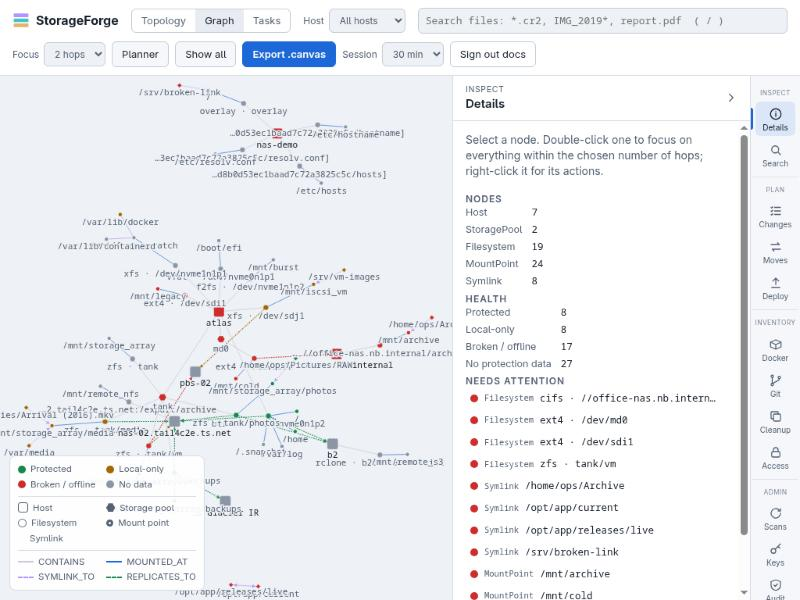

**Structure** is a force-directed view of the same data: hosts, pools, filesystems, mount points and symlinks, coloured by 3-2-1 health (see [Concepts](concepts.md#health-colours)).

- Drag the background to pan, scroll to zoom, drag a node to pin it where you drop it. Shift-drag lets it spring back; **Show all** releases every pinned node.
- Click a node for details; double-click to focus on its neighbourhood (1–3 hops, set by **Focus**).
- **Export .canvas** writes an Obsidian JSON Canvas of the graph, or of one host when the host filter is set.

| Node | Example id | Edges |
| :--- | :--- | :--- |
| Host | `host:atlas` | `CONTAINS` pools and standalone filesystems |
| StoragePool | `pool:atlas:tank` | `CONTAINS` datasets and arrays' filesystems |
| Filesystem | `fs:atlas:tank/media` | `MOUNTED_AT` mount points, `REPLICATES_TO` sync and backup targets |
| MountPoint | `mnt:atlas:/mnt/storage_array/media` | `MOUNTED_AT` bind mounts |
| Symlink | `link:atlas:/var/media` | `SYMLINK_TO` the mount holding its target, or another link |

## Tasks

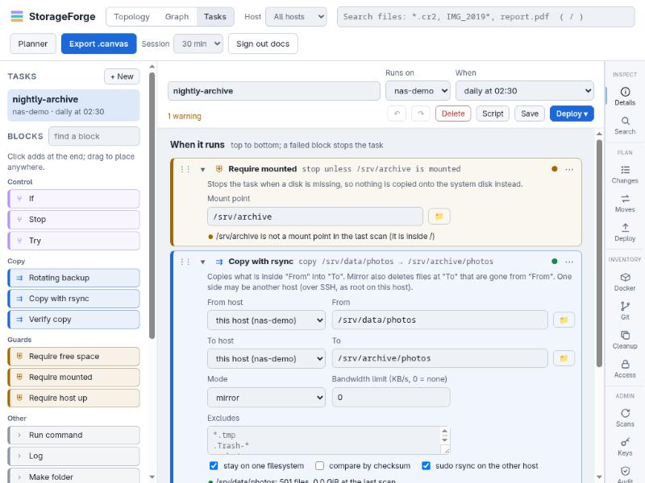

The block editor for [storage tasks](plans-and-scripts.md#storage-tasks). The palette on the left holds the blocks; click one to add it at the end or into the selected slot, or drag it into place. Each block shows its fields and is checked against the index while you edit; collapse it to a one-line sentence. Ctrl+Z undoes. **Script** shows the generated `task-<name>.sh`, and **Deploy** installs or runs it on the host.

## Map

What hosts report, drawn as an infrastructure map: each host a frame holding its interfaces, listeners and workloads, joined through subnets and placeholders. Dashed means inferred; the colour of a listener is who can reach it, per configuration. It has its own panel beside it for the selected node, a path query, a what-if and saved designs, so **Details** in the rail is not used here.

- **Look at** picks a preset (**Network**, **Flow**, **Workloads**, **Storage only**, **Security** or **Custom**), and the checkboxes under **Layers** (Storage, Network, Services, Firewall, Workloads, Access, Placed by hand) stack layers on their own. Picking a layer by hand makes the preset **Custom**.
- Group by host, subnet or runtime; filter by name, address or port; show this-machine-only ports, container networks and devices nearby; show only what others can reach.
- **What changed** lists the differences between readings, and its slider goes back to an earlier one. Storage is not kept, so going back shows the other layers as they stood.
- A list longer than the page shows says how many it leaves out (*+3 more*), and the same button shows the rest.
- Exports: JSON, Mermaid, DOT, SVG, draw.io, Obsidian canvas, PNG as drawn, and PDF through the browser's print.

The map's layers, the paths through routers and the security mode are described in [Infrastructure map](infrastructure-map.md#on-the-map). Firewall rules and exposure need `security.view`; the map itself needs `map.view`.

## Scan

What the opt-in network scanner found. It is off until someone turns it on and names private networks (a /20 at most), and it is the one thing in StorageForge that sends packets to find out what exists. Results are grouped by the range that was scanned, in the order the ranges were named, with anything outside them last and a range that found nothing saying so. A machine StorageForge manages links to its own pages, anything else is *not managed* with **Add as a device**, and a host or port that is new since the scan before is marked, with what has gone listed at the end. See [the network scanner](network-devices.md#the-network-scanner). **Details** in the rail is not used here either.

## Panels

The rail on the right opens panels in the inspector: 18 of them in five groups. The first panel, **Details**, describes the selection or summarises health across every host. It belongs to Topology and Graph: in Tasks, Map and Scan it says where to go instead.

### Inspect

| Panel | What it does |
| :--- | :--- |
| **Details** | The selected box or node, or node counts, health totals and everything that needs attention |
| **Search** | Results of the header search (`/` focuses it). Selecting one focuses its mount. See [search patterns](scanning-and-search.md#search). |

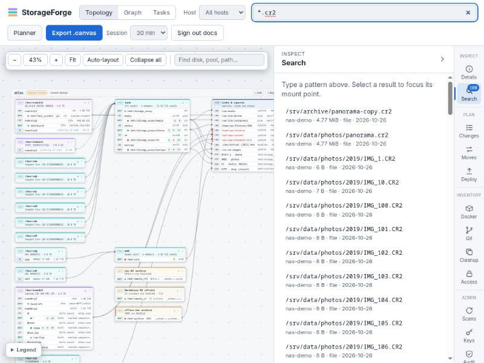

### Plan

| Panel | What it does |
| :--- | :--- |
| **Changes** | [Staged change plans](plans-and-scripts.md#staged-changes): review, reorder, **Check**, **Bash script**, **Ansible playbook**, **Deploy** |
| **Moves** | [Move plans](plans-and-scripts.md#data-moves): steps, **Check**, **Download script**, **Deploy** |
| **Schedule** | [Unified task scheduler](plans-and-scripts.md#unified-task-scheduler): cron jobs on client hosts with comprehensive server-side verification, SSH deploy, on-demand runs and verification inspector |
| **Deploy** | [Deploy access](deployments.md) per host, deployed jobs and shares, drift, recent deploys, reporting and alert settings |

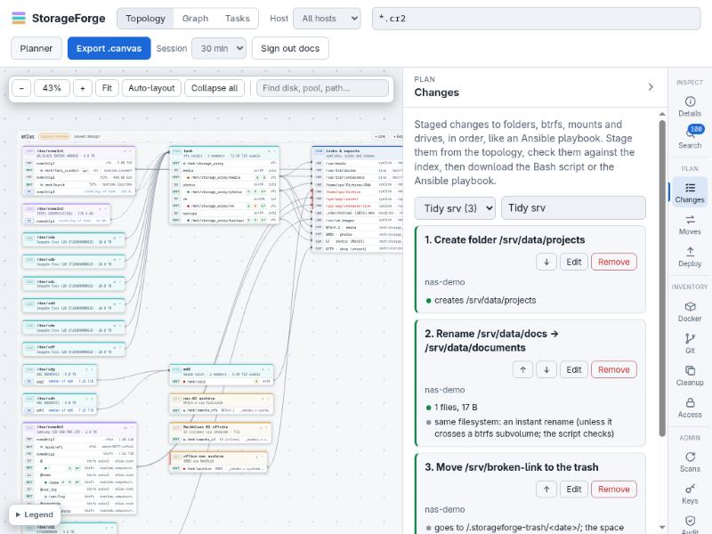

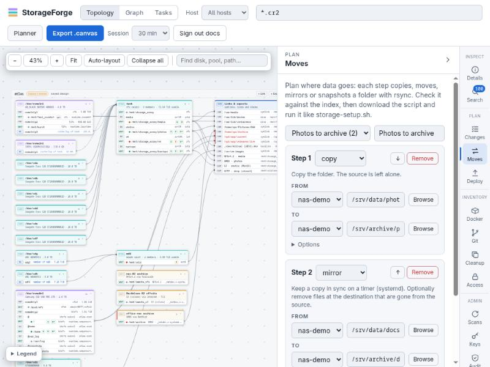

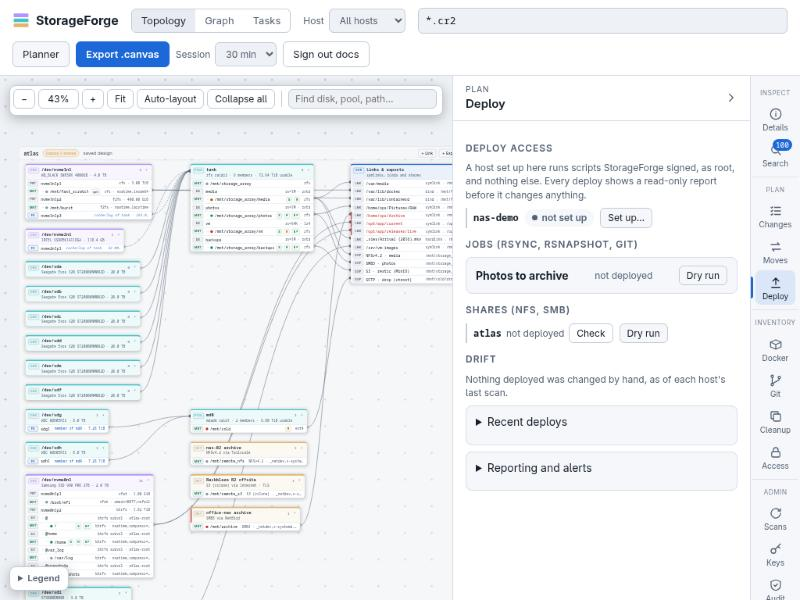

### Inventory

| Panel | What it does |
| :--- | :--- |
| **Docker** | Each host's [compose stacks](scanning-and-search.md#docker-and-compose-stacks), their containers and the folders and volumes they use; unused volumes; containers that mount the Docker socket |
| **Git** | [Repositories](scanning-and-search.md#git-repositories) the scans found, matched across hosts by history, with **Archive to…**, bulk archiving of selected repositories, and a per-host hide list |
| **Rebuild** | Each host's saved configuration: mounts, subvolumes, shares, accounts, symlinks and config files, with what changed in each version. Downloads the reinstall script or a bundle. See [rebuilding a host](disaster-recovery.md#rebuild-a-host-after-reinstalling-it). |
| **Infra** | Workloads, exposure, network and firewall of each host, as they were last read: containers, VMs and instances; what listens and who can reach it; interfaces and routes; firewall rules. **Measure now**, for accounts that may manage security, reads a host again. Needs `security.view` for exposure and firewall, `map.view` for network. See [Infrastructure map](infrastructure-map.md) |
| **Cleanup** | Duplicate folders (same names, sizes and layout) and cold data (newest file older than a cutoff), each with **Move…** |
| **Malware** | [ClamAV](scanning-and-search.md#clamav) on the hosts you deployed it to: what it detected, and **Quarantine** |
| **Access** | Folders the last scan could not read, and [read-only scan access](scanning-and-search.md#unreadable-folders-and-read-only-access) to fix it |

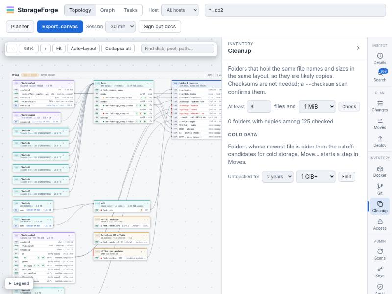

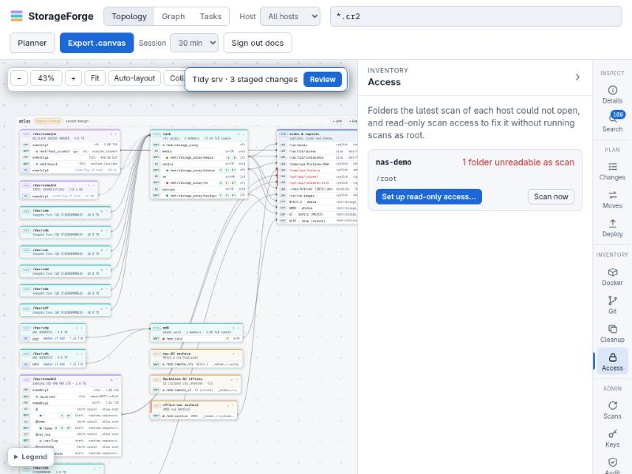

### Security

| Panel | What it does |
| :--- | :--- |
| **Security** | [Ransomware defense](ransomware-defense.md): the posture of every host, WORM retention holds, decoys, behaviour, integrity, fencing, playbooks, compliance and the rest, in sixteen sub-panels under one page. See [its panels](ransomware-defense.md#panels) |

### Admin

| Panel | What it does |
| :--- | :--- |
| **Scans** | Queue a scan of a bound host, or **Scan all hosts**, and follow recent scan jobs |
| **Keys** | Generate a key in the vault, install it on a host with its password once, list keys and bindings, **Scan now** per binding |
| **Logs** | What each host's journal said, as the last scan collected it: filter by host, level, unit and text, **Load more**, and export as a file. Nothing streams: a line arrives with the scan that reads it, and a host that could not be read says why. Times are UTC. Also [`storageforge-index hostlogs`](cli-reference.md) |
| **Audit** | The newest audit entries and **Verify chain**. Also your own password, backups, and for admins [accounts, invite links and roles](features/administration.md#accounts-and-sign-in). |

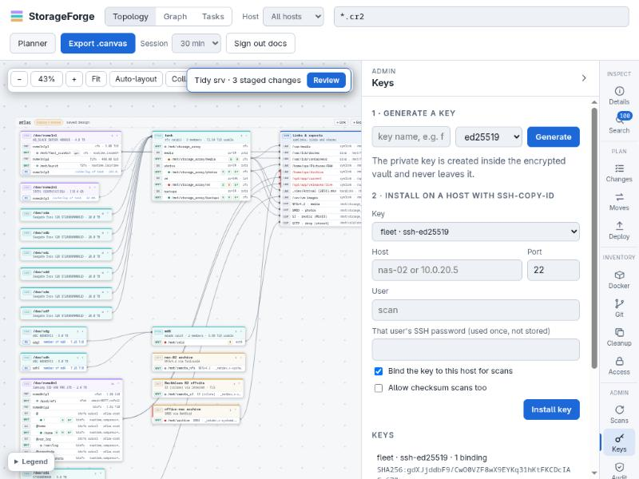

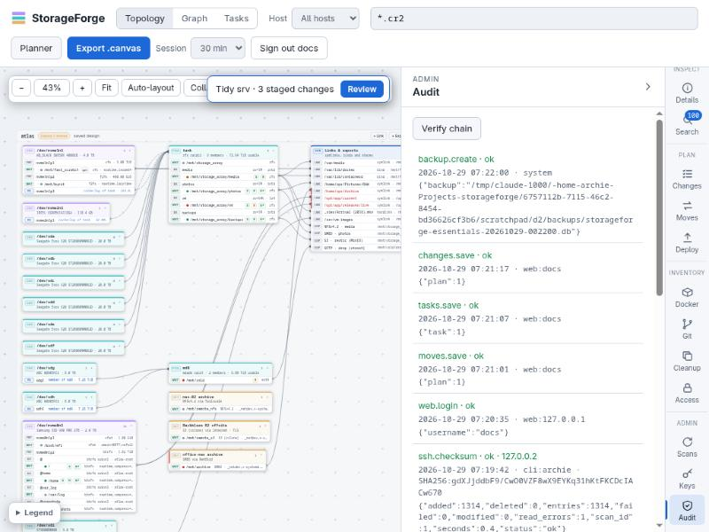

## Other pages

| Page | What it is |
| :--- | :--- |
| `/planner` | The [storage design tool](planner.md): devices, mounts, links, RAID, protection and export. **Planner** in the header |
| `/manage` | The [management planner](network-devices.md#the-management-planner), **Manage** in the header. **Fleet** is every host and device and how it stands; **Devices** are routers, switches and firewalls; **Compose** writes the one network language, shows what each target makes of it, and **Stage in Changes** turns a Linux host's rules into steps there, or **Check** reports on a device before **Apply**; **Changes** is what was reported, applied, confirmed and rolled back; **Traffic** is interface counters over time, with a way to the Scan view |
| `/search` | File search on a page of its own, with a host picker |
| `/login`, `/enroll` | Sign-in, and the page an invite or reset link opens |

The planner, `/manage` and `/search` show the same security chip as the main page, with the links between the pages and **Sign out**: in the planner's page header and rail, in `/manage`'s rail and in the search page's header.

## Keyboard

| Key | What it does |
| :--- | :--- |
| `/` | Focus the file search. Not while typing in a field, not with a dialog open, and not with Ctrl, Alt or Meta held, so a path or a password with a slash in it arrives whole |
| `\` | Show or hide the rail's panel, under the same rules |
| Esc | Clear the graph focus or the file map's selection, unless a field or dialog has the key. In a dialog it closes the dialog; the share wizard asks first when something was changed |
| Menu, Shift+F10 | Open the context menu on the focused box or block, except in a text field, which keeps the browser's own |
| Ctrl or Cmd+Z, with Shift to redo | Undo in the Tasks editor |
| `+` `=` `-` `0` `f` | On the topology canvas: zoom in, zoom out, back to 100%, fit. Enter or Space selects a focused row, Esc clears the selection |
| Arrows, Home, End, Esc | In an open context menu |
| Left and Right arrows | On the panel's resize grip |

## Git Inspector

**▾ Inspect** on a repository in the **Git** panel opens a drawer along the bottom of the page with **Status**, **Sync**, **Commits** and **Changelog** tabs. See [Git](features/discovery.md#git).

## Deep links

The main page reads `#host=<name>&tab=<panel>`, for example `/#host=nas-02&tab=changes`. The planner's **In StorageForge** links use this to open a host's Changes, Moves, Deploy, Docker, Git, Cleanup or Access panel. `<panel>` is one of `details`, `search`, `changes`, `moves`, `schedule`, `deploy`, `docker`, `infra`, `git`, `rebuild`, `copies` (Cleanup), `malware`, `access`, `security`, `jobs` (Scans), `keys`, `hostlogs` (Logs) or `audit`.

`#view=map` opens the map, with `layers=`, `mode=` and `filter=` to set what it shows, for example `/#view=map&layers=network,firewall&mode=security`. `#view=scan` opens the Scan view, which is where `/manage` sends you.

## Passwords for host commands

Anything that runs a command on a host from the web UI (key install, scan access, deploy access, deploys, job runs and cutovers, restores) and changing your session length asks for your password again unless you typed it in the last 5 minutes. Read-only job actions (dry run, log, list snapshots) do not. The question is the same dialog on every page: on the planner and `/manage` it opens in place, and the change goes on once the password is right. A command to a host that has not been seen before first shows its SSH key to compare with the machine's own, and nothing is sent until you say they match.
