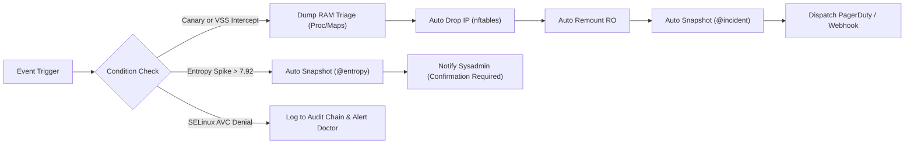

# Ransomware Defense & Host Security: Complete System Architecture, Admin Panels, Custom Views, & Global Compliance Roadmap

> [!IMPORTANT]
> **This is a plan, and it promises more than exists.** What is really built, what it protects against and what is not built is in [Ransomware defense](docs/ransomware-defense.md). The first attempt at this roadmap faked it: see the [audit](docs/audit-2026-11-02-ransomware-defense.md).
>
> **Corrections.** Building it showed that some of what follows cannot work as written, so do not implement it as described:
>
> - **The VSS shadow trap (Layer 2) is not possible.** `vssadmin delete shadows` acts on the Windows client's own shadow copies through its local VSS service. Nothing crosses SMB, so Samba never sees it, and `vfs_shadow_copy2` only exposes snapshots read-only. There is no RPC to intercept. Decoys and change detection are what catch these clients.
> - **"Immutable" and "kernel-level WORM" overstate it.** Root can `zfs release` a hold and make a btrfs snapshot writable. These guard against mistakes, scripts and stolen web logins, not against root on the host. Only a copy on another machine is out of its reach.
> - **Cryptographic shred (Layer 7) does not work on ZFS or btrfs.** They are copy-on-write: overwriting writes new blocks, and the old ones stay, in snapshots too. It also breaks the rule that nothing is deleted. It is not built.
> - **Memory triage will rarely recover keys (Layer 8).** When a workstation encrypts a share, the keys are in memory on the workstation, not in the server's smbd. Triage saves connections, processes and, where it can, a core dump of a local process. That is useful evidence, not a decryption route.
> - **Entropy bands (Layer 5) are wrong.** On a 4 KiB sample, compressed data reads about 7.9 or higher, the same as ciphertext, not "7.2 to 7.6". Entropy alone cannot tell them apart, so a known file header has to clear a file.
> - **Snapshot before freezing (Layer 8).** A btrfs snapshot cannot be taken of a read-only filesystem, so the order is triage, drop, snapshot, freeze.
> - **Sub-500 ms and "microsecond" figures are not measured.** **Test it** in the Decoys panel gives the real figure for a host.
> - **A compliance "score" and "certificate" must not claim more than a reading.** A check passing is not a control met, and only an auditor can attest. There is no certificate.

A comprehensive engineering roadmap and UI/UX specification to equip StorageForge with multi-layered ransomware defense, native Linux host security engines (SELinux, AppArmor, auditd, Falco, AIDE, Lynis, and firewalls), automated containment, rapid immutable recovery, dedicated administrative control panels with expanded customization views, **automated multi-distro package provisioning**, **turnkey init scripts mapped to global compliance standards (CIS, NIST SP 800-53, HIPAA, PCI-DSS, SOC 2, ISO 27001, CMMC)**, and **hardened enterprise defenses (Anti-NTP clock guards, Single/Multi-Admin adaptive quorum, VSS shadow traps, and volatile forensic triage)**.

---

## 1. Executive Summary & Design Philosophy

### 1.1 The Threat Reality
Storage is the ultimate battleground for modern ransomware attacks. Threat actors operate with sophisticated playbooks:
1. **Initial Lateral Movement & Privilege Escalation:** Exploiting unhardened host services, unconfined daemons, or stolen SSH keys to gain root/operator privileges.
2. **Network Share Traversal:** Abusing authenticated SMB and NFS client sessions to silently traverse shares, renaming and encrypting multi-terabyte data stores.
3. **Recovery Destruction:** Deliberately attempting to destroy volume managers, purge snapshots (`zfs destroy`, `btrfs subvolume delete`), manipulate system clocks to prematurely expire retention holds, wipe backup histories, or disable auditing.

Traditional antivirus sweeps (e.g. naive ClamAV full-disk scans over multi-terabyte pools) fail catastrophically: they induce massive I/O bottlenecks, degrade storage performance, cannot detect zero-day encryption behaviors, and offer zero containment when an active attack is underway.

### 1.2 The Operator-First Philosophy (Amplification, Not Replacement)
> [!IMPORTANT]
> **StorageForge is deliberately engineered NOT as an opaque, black-box AI replacement for experienced systems administrators and storage architects, but as a high-leverage force multiplier.**

Systems administration and disaster recovery are high-stakes domains where automated "magic" without operator transparency breeds distrust or catastrophic outages. StorageForge adheres to four core operational tenets:
1. **Total Visibility & Inspection:** Every action is inspectable. Generated scripts (bash, ansible, audit rules, firewall sets) are visible in plain text with complete syntax highlighting, diffs, and downloadable artifacts before execution.
2. **Operator Authority & Guardrails:** Automations act as intelligent early-warning tripwires, safety nets, and rapid-response levers. The administrator always maintains supervisory authority, with granular control to dry-run, customize, override, or disarm any automated brake.
3. **No Deadlocks in Solo-Admin Fleets:** Enterprise safeguards like "Multi-Party Quorum / Four-Eyes Principle" adapt intelligently: large enterprise teams get dual-custody authorization, while solo sysadmins get timelocked cool-off windows and physical offline break-glass keys rather than paralyzing deadlocks.
4. **Kernel-Native Defense-in-Depth:** Rather than running fragile proprietary userspace agents, StorageForge leverages the native security primitives already built into Linux (ZFS holds, Btrfs subvolumes, `auditd`, `nftables`, `SELinux`, `AppArmor`, and eBPF), managed agentlessly over SSH with signed payloads (`/usr/local/sbin/storageforge-run`).

```text
┌────────────────────────────────────────────────────────────────────────────────────────────────────────┐
│                                   STORAGEFORGE SECURITY PLATFORM ARCHITECTURE                           │
├────────────────────────────────────────────────────────────────────────────────────────────────────────┤
│  ADMIN CONTROL PANELS & CUSTOM VIEWS (Web UI & SOC Command Center)                                     │
│  ├── SOC Threat Center  ├── WORM & Snapshots ├── Canary Decoys      ├── Mandatory Access Control (MAC) │
│  ├── Storage Firewall   ├── Behavioral eBPF  ├── Host FIM & Hardening├── Differential Malware & YARA   │
│  ├── Compliance Center  ├── Distro Packages  ├── Quorum & Timelocks ├── Blast-Radius & Clean-Room     │
│  └── Custom Dashboards  └── Waiver Manager   └── Sensitivity Curves └── Audit Certifiers               │
├────────────────────────────────────────────────────────────────────────────────────────────────────────┤
│  CENTRAL CONTROLLER & REPOSITORY INDEX (FastAPI / SQLite / PostgreSQL / Hash-Chained Audit Log)        │
│  ├── Retention Manager   ├── Auditd Tripwire Engine ├── MAC Engine (SELinux/AppArmor)                  │
│  ├── Firewall Controller ├── Falco / Entropy Engine ├── FIM & Lynis Parser  ├── Diff ClamAV / YARA    │
│  ├── Package Auto-Deploy ├── Compliance Init Engine ├── Adaptive Quorum     ├── Blast-Radius Engine    │
│  └── Playbook Dispatcher ├── VSS Decoy Interceptor  └── Clock Guard (NTS)   ├── Signed Deploy Runner   │
├───────────────────────────────────┬─────────────────────────────────┬──────────────────────────────────┤
│ SSH (Agentless Read-Only Scans)   │ Signed Payloads (Deploy Runner) │ Live Event Telemetry (audit/eBPF)│
│                                   ▼                                 ▼                                  ▼
│ ┌────────────────────────────────────────────────────────────────────────────────────────────────────┐ │
│ │                                             TARGET HOST                                            │ │
│ │  ┌──────────────────────────────────────────────────────────────────────────────────────────────┐  │ │
│ │  │ 0. Auto-Provisioning: dnf/apt/zypper/pacman multi-distro package installer + airgap bundles    │  │ │
│ │  ├──────────────────────────────────────────────────────────────────────────────────────────────┤  │ │
│ │  │ 1. Compliance Baseline: sf-init-compliance.sh (CIS L1/L2, NIST 800-53, HIPAA, PCI-DSS, SOC 2) │  │ │
│ │  ├──────────────────────────────────────────────────────────────────────────────────────────────┤  │ │
│ │  │ 2. Monotonic Clock Guard: NTS multi-peer verification + Chrony drift & time-jump tripwire    │  │ │
│ │  ├──────────────────────────────────────────────────────────────────────────────────────────────┤  │ │
│ │  │ 3. Network Perimeter & Fencing: nftables / firewalld / ufw / client CIDR fencing             │  │ │
│ │  ├──────────────────────────────────────────────────────────────────────────────────────────────┤  │ │
│ │  │ 4. Mandatory Access Control: SELinux (fcontext, booleans, AVCs) & AppArmor (profiles)        │  │ │
│ │  ├──────────────────────────────────────────────────────────────────────────────────────────────┤  │ │
│ │  │ 5. Tripwires: Canaries + Samba VSS shadow traps + auditd rules (-w canary -p wa)             │  │ │
│ │  ├──────────────────────────────────────────────────────────────────────────────────────────────┤  │ │
│ │  │ 6. Runtime Behavioral eBPF: Falco mass-rename, chattr tampering & Shannon entropy checks      │  │ │
│ │  ├──────────────────────────────────────────────────────────────────────────────────────────────┤  │ │
│ │  │ 7. Host Integrity & Compliance: AIDE cryptographic FIM + Lynis automated CIS hardening audits │  │ │
│ │  ├──────────────────────────────────────────────────────────────────────────────────────────────┤  │ │
│ │  │ 8. Automated Emergency Brake: Volatile triage RAM dump -> Drop client IP -> Remount RO -> snap│  │ │
│ │  ├──────────────────────────────────────────────────────────────────────────────────────────────┤  │ │
│ │  │ 9. Storage Immutability: ZFS hold retention locks, Btrfs read-only subvolumes, chattr +i      │  │ │
│ │  └──────────────────────────────────────────────────────────────────────────────────────────────┘  │ │
│ └────────────────────────────────────────────────────────────────────────────────────────────────────┘ │
└────────────────────────────────────────────────────────────────────────────────────────────────────────┘
```

---

## 2. Global UI/UX & Administrative Framework

To make ransomware defense operationally intuitive without sacrificing granular control, StorageForge introduces a dedicated **Security Rail** in the Web UI, paired with real-time incident notifications, canvas integrations, and sysadmin customization editors.

### 2.1 Navigation & Layout Integration
The Web UI navigation expands with a dedicated **Security** section on the right rail alongside **Inspect**, **Plan**, **Inventory**, and **Admin**:

```text
Inspect          Plan             Inventory        Security (New)          Admin
├── Details      ├── Changes      ├── Docker       ├── SOC Center (Cmd)    ├── Scans
└── Search       ├── Moves        ├── Git          ├── WORM & Locks        ├── Keys
                 ├── Schedule     ├── Rebuild      ├── Canaries & VSS      └── Audit
                 └── Deploy       ├── Cleanup      ├── MAC & Identity
                                  └── Access       ├── Firewall
                                                   ├── Behavior & eBPF
                                                   ├── Host Integrity
                                                   ├── Malware & YARA
                                                   └── Compliance & Init
```

* **Header Threat Status Banner:** A persistent, high-visibility operational banner at the top of every view:
  * 🟢 **SECURE:** All hosts hardened, canaries active, immutable retention verified on all primary mounts, compliance drift $< 1\%$.
  * 🟡 **WARNING:** High file modification velocity detected, unconfined storage daemon, compliance drift, or Lynis score $< 70$.
  * 🔴 **CRITICAL INCIDENT:** Active tripwire tripped, Falco mass-rename caught, or client quarantined. Includes 1-click jump to the SOC Command Center.
* **Canvas Badging (Topology & Graph):**
  * Mount points and pool nodes display an **"Immutable Lock"** badge with expiration countdown.
  * Active canaries and VSS shadow decoys appear as distinctive target icons on share nodes.
  * Confined daemons display MAC status badges (SELinux Shield / AppArmor Armor).
  * Fenced/quarantined network links are highlighted with an amber/red pulse.
* **Deep Linking Format:** Direct hash routing for SOC workflows:
  * `/#host=nas-01&tab=security&panel=soc`
  * `/#host=nas-01&tab=security&panel=worm&pool=tank`
  * `/#host=nas-01&tab=security&panel=canaries`
  * `/#host=nas-01&tab=security&panel=mac&subtab=identity`
  * `/#host=nas-01&tab=security&panel=mac&subtab=avc`
  * `/#host=nas-01&tab=security&panel=firewall&subtab=quarantine`
  * `/#host=nas-01&tab=security&panel=behavior&subtab=entropy`
  * `/#host=nas-01&tab=security&panel=integrity&subtab=lynis`
  * `/#host=nas-01&tab=security&panel=malware&subtab=quarantine`
  * `/#host=nas-01&tab=security&panel=compliance&standard=cis-l2`

### 2.2 Sysadmin Customization Model
Every sysadmin operates with distinct environment constraints (e.g. archival media storage vs high-churn database servers). StorageForge provides six pillars of customization:
1. **Custom Security Dashboards & Widget Grids:** Sysadmins can build personalized dashboard views with draggable, resizable telemetry tiles (e.g. canary status, top blocked IPs, entropy outliers, AVC feed, Lynis posture, compliance score).
2. **Custom Baseline & Threshold Tuners:** Interactive sensitivity sliders for entropy calculations, modification velocities, and alert thresholds per dataset.
3. **Custom Rule & Persona Editors:** Syntax-highlighted in-browser editors for Falco eBPF rules, YARA malware signatures, and Canary decoy generators.
4. **Adaptive Quorum & Timelock Tuners:** Configurable cool-off delay windows (24h/48h/72h) and Break-Glass offline emergency key generation for solo operators.
5. **Custom Compliance Baseline Customizer:** Tailor global compliance standards by adding organization-specific waivers, customized sysctl lists, or custom AIDE watchpaths.
6. **Custom Incident Playbook Matrix:** Visual trigger-to-action builder ("If *Canary X* trips on *Share Y*, then *Dump RAM Triage* AND *Drop IP via nftables* AND *Freeze RO* AND *Snapshot with Hold* AND *Notify Slack*").

---

## 3. Detailed Admin Panels & Sysadmin Custom Views (By Component)

---

### Layer 1: Immutable Snapshots, Anti-NTP Clock Guards, & Adaptive Quorum

#### 1. Technical Engine & Capabilities
* **ZFS Hold Enforcement:** Applies `zfs hold sf-retention-<epoch> <dataset@snap>` during snapshot creation. Prevents `zfs destroy` at the kernel level until release.
* **Btrfs Read-Only & Subvolume Locks:** Strictly mounts snapshots with `-o ro`, applies directory immutable flags (`chattr +i`), and enforces remote backup receive staging.
* **Safe Delegation Matrix:** Validates that backup/scan users hold only `snapshot,send,hold` permissions, never `destroy,release`.
* **Legal Hold System:** Allows sysadmins to pin critical snapshots indefinitely during active investigations.
* **Anti-NTP Clock Poisoning Guard:**
  * Attackers often forge NTP packets or run `timedatectl set-time` forward by 30 days to force WORM time-locks to expire.
  * StorageForge implements **Monotonic Clock Verification**: cross-checks system time across multiple authenticated NTS (Network Time Security) servers and hardware RTC drift.
  * **Time-Jump Tripwire:** A sudden time leap forward ($>60\text{s}$) immediately suspends all hold release operations, locks retention policies into an indefinite emergency freeze, and dispatches an emergency alarm.
* **Adaptive Quorum Engine (Dual-Admin vs Single-Admin Guarded Mode):**
  * **Multi-Admin Fleet ($\ge 2$ Admins):** Dual-custody quorum enforced. Releasing a hold prior to natural expiration requires initiation by Admin A and cryptographic signature approval from Admin B.
  * **Single-Admin Fleet (Solo Operator):** Automatically engages **Single-Operator Guarded Mode**:
    1. *Mandatory 24h–48h Cool-Off Delay Window:* Destructive action is staged and queued. Immediate execution is blocked.
    2. *Out-of-Band Broadcast:* Emergency alerts fire via SMS, PagerDuty, and email with a 1-click `[ ABORT & REVOKE ]` link if the account was compromised.
    3. *Physical Offline Break-Glass Key:* During site setup, a 64-character offline recovery secret is printed on a physical sheet for safe-box storage. Entering this key bypasses the cool-off delay for legitimate disasters.
    4. *Hardware Step-Up:* Mandatory FIDO2 / WebAuthn physical token touch or local TTY/IPMI console verification.

#### 2. Admin Panel: "WORM Retention & Snapshot Vault"
The primary administrative console for managing immutable retention policies, active holds, clock health, and quorum approvals.

```text
┌────────────────────────────────────────────────────────────────────────────────────────┐
│  WORM RETENTION & SNAPSHOT VAULT                                      [ + New Hold ]  │
├────────────────────────────────────────────────────────────────────────────────────────┤
│  Host: [ nas-01 (Rocky 9) ▼ ]   Pool: [ tank (ZFS) ▼ ]   Dataset: [ tank/data/shares ▼] │
├────────────────────────────────────────────────────────────────────────────────────────┤
│  RETENTION & CLOCK INTEGRITY                                                           │
│  Active Holds: 42 snapshots      Expiring <24h: 3 snapshots     Legal Holds: 2 pinned │
│  WORM Enforcement: ZFS Kernel Hold (Active)    Clock Guard: 🟢 NTS Monotonic (Drift 2ms)│
│  Quorum Mode: 👤 Single-Operator Guarded (24h Delay Active / Break-Glass Armed)        │
├────────────────────────────────────────────────────────────────────────────────────────┤
│  SNAPSHOT RETENTION REPOSITORY                                                         │
│  [ Filter: All Holds ▼ ]  [ Search Snapshot Name...                                  ] │
│  ┌─────────────────────────────┬───────────┬──────────────┬──────────────┬───────────┐ │
│  │ Snapshot                    │ Hold Tag  │ Created      │ Expires      │ Status    │ │
│  ├─────────────────────────────┼───────────┼──────────────┼──────────────┼───────────┤ │
│  │ tank/shares@daily-20261101  │ sf-worm-7d│ Nov 01 00:00 │ Nov 08 00:00 │ 🔒 Locked │ │
│  │ tank/shares@daily-20261025  │ sf-worm-7d│ Oct 25 00:00 │ Nov 01 00:00 │ ⏳ Expired│ │
│  │ tank/shares@incident-202610 │ sf-legal  │ Oct 28 14:15 │ Permanent    │ 📌 Pinned │ │
│  └─────────────────────────────┴───────────┴──────────────┴──────────────┴───────────┘ │
├────────────────────────────────────────────────────────────────────────────────────────┤
│  PENDING TIMELOCK ACTIONS (COOL-OFF BUFFER)                                            │
│  • Release Hold: tank/shares@daily-20261020 | Requested by: admin (14h remaining)      │
│    [ 🛑 ABORT & REVOKE IMMEDIATELY ]   [ 🔑 Enter Offline Break-Glass Key (Bypass) ]   │
├────────────────────────────────────────────────────────────────────────────────────────┤
│  ACTIONS: [ 🔒 Apply Hold ]  [ 🔓 Request Release ]  [ ❄️ Emergency Legal Freeze ]     │
└────────────────────────────────────────────────────────────────────────────────────────┘
```

* **Interactive Elements & Workflows:**
  * **Retention Table:** View dataset path, snapshot name, hold tag, creation epoch, and countdown to expiration.
  * **Interactive Expiration Heatmap:** Calendar visualization displaying snapshot age distributions and future expiration cliffs.
  * **Delegation Safety Check:** Scans `zfs allow` permissions; alerts if the unprivileged SSH scan user has `destroy` or `release` rights.
  * **1-Click Rollback Preview:** Compares current live filesystem state against an immutable snapshot, generates a visual diff, and prepares a signed rollback plan.
  * **Guarded Actions:** Releasing a hold prior to its expiration requires admin password re-entry and creates a signed audit event.
  * **NTS Clock Guard Health:** Shows synchronization status with trusted external atomic/NTS servers and drift telemetry.

#### 3. Expanded Sysadmin Custom Views & Customization
* **Custom Retention Tier Policy Designer:**
  * Define automated retention rules by dataset tag or path pattern:
    * E.g., `tag:prod` $\rightarrow$ 30-day kernel WORM hold; `tag:compliance` $\rightarrow$ 365-day legal hold; `tag:scratch` $\rightarrow$ no hold.
  * Set grace periods and minimum offsite airgap retention requirements.
* **Custom Timelock & Quorum Configurator:**
  * Configure cool-off delay duration (12h to 72h) for single-admin mode; configure secondary notification webhooks and SMS endpoints.
* **Custom Legal Hold & Freeze Mode:**
  * Sysadmins can trigger an instant freeze on a pool or dataset. During a freeze, all automated retention purges are suspended, preserving forensic history regardless of scheduled expiration.
* **Custom Immutability Compliance Auditor:**
  * Custom reporting view that exports cryptographically verifiable PDF/JSON compliance certificates proving that retention locks were active across specific date ranges for regulatory audits (SOC2, HIPAA, ISO 27001).

---

### Layer 2: Early Warning Canaries, VSS Decoys, & Auditd Watchers

#### 1. Technical Engine & Capabilities
* **Strategic Decoy Placement:** Automatically deploys synthetic, convincing decoy files (`_AAAPasswords.docx`, `!Financial_2026.xlsx`, `00_Index.pdf`) positioned at the beginning of directory traversals.
* **Samba Shadow Copy (VSS) Trap (`vfs_shadow_copy2`):**
  * Windows ransomware invariably executes commands like `vssadmin.exe delete shadows /all /quiet` or `wmic shadowcopy delete` before encrypting files.
  * StorageForge exposes ZFS/Btrfs snapshots via Samba's `vfs_shadow_copy2` module as read-only Previous Versions.
  * **VSS Deletion Interceptor:** Intercepts unauthorized Windows RPC shadow-deletion requests over SMB and trips the emergency brake **before any files on the filesystem are touched**.
* **Kernel-Level Audit Rules:** Generates persistent `/etc/audit/rules.d/storageforge-canary.rules` watching canaries with `-p wa` (write/attribute change).
* **Config File Watchdogs:** Watches `/etc/fstab`, `/etc/samba/smb.conf`, `/etc/exports`, and `/usr/local/sbin/storageforge-run`.
* **Automated Emergency Brake:** Microsecond trigger via `audispd` hook or inotify: captures volatile RAM triage, severs client connection, drops client IP in firewall, remounts filesystem read-only, takes immediate snapshot.

#### 2. Admin Panel: "Canaries & Tripwires Console"
The command center for monitoring tripwire health, reviewing decoy baselines, managing VSS traps, and auditing kernel watch rules.

```text
┌────────────────────────────────────────────────────────────────────────────────────────┐
│  CANARIES & TRIPWIRES CONSOLE                                   [ + Deploy Canaries ]  │
├────────────────────────────────────────────────────────────────────────────────────────┤
│  CANARY & VSS DECOY FLEET STATUS                                                       │
│  Active Canaries: 184 files    Protected Shares: 16 SMB / 8 NFS   Tripwire State: ARMED│
│  Samba VSS Shadow Traps: 16 shares protected (vfs_shadow_copy2 RPC Interceptor: ACTIVE)│
│  Auditd Watchers: 24 active rules    audispd Event Hook: Active & Latency: 1.2ms       │
├────────────────────────────────────────────────────────────────────────────────────────┤
│  TRIPWIRE INVENTORY & VSS STATUS                                                       │
│  [ Filter: All Shares ▼ ]  [ Host: atlas ▼ ]  [ Status: Normal ▼ ]                     │
│  ┌──────────────────────────────┬──────────────┬─────────────┬───────────┬───────────┐ │
│  │ Decoy Path / Trap            │ Target Share │ Trap Type   │ Last Test │ Status    │ │
│  ├─────────────────────────────┼──────────────┼─────────────┼───────────┼───────────┤ │
│  │ /srv/shares/hr/_AAAPass.docx │ //atlas/hr   │ File Canary │ 2 hrs ago │ 🟢 Untouch│ │
│  │ VSS RPC: vssadmin Intercept  │ //atlas/fin  │ VSS Decoy   │ 1 day ago │ 🛡️ Armed  │ │
│  │ /srv/nfs/dev/00_readme.pdf   │ nfs:dev      │ File Canary │ 2 hrs ago │ 🟢 Untouch│ │
│  └─────────────────────────────┴──────────────┴─────────────┴───────────┴───────────┘ │
├────────────────────────────────────────────────────────────────────────────────────────┤
│  RECENT TRIPWIRE EVENTS & AUDIT LOG                                                    │
│  2026-11-01 23:14:02 | Host: atlas | Key: sf_vss_trap | Client: 10.0.1.42 (WORKSTATION)│
│  Event: Intercepted 'vssadmin delete shadows' RPC -> [ ⚠️ Emergency Brake Executed ]  │
├────────────────────────────────────────────────────────────────────────────────────────┤
│  ACTIONS: [ 🧪 Simulate Canary Trip ]  [ 🔄 Refresh Decoy Hashes ]  [ ⚠️ Disarm Brake ] │
└────────────────────────────────────────────────────────────────────────────────────────┘
```

* **Interactive Elements & Workflows:**
  * **1-Click Canary Deployer:** Automatically analyzes all indexed Samba and NFS shares, generating optimized canary decoys tailored to directory contents.
  * **Auditd Ruleset Inspector:** Displays live `/etc/audit/audit.rules` on the host, highlights active `-k sf_canary_tripped` keys, and flags syntax errors.
  * **Tripwire Simulation Gauntlet:** Allows sysadmins to perform a dry-run test (non-destructive write to a test canary) to measure reaction latency from kernel syscall to alert dispatch.
  * **Emergency Brake Arm/Disarm:** Toggle to safely disarm the automated emergency brake during scheduled maintenance or bulk share restructuring.

#### 3. Expanded Sysadmin Custom Views & Customization
* **Custom Canary Persona & Decoy Generator:**
  * Customize decoy naming conventions to match corporate naming standards (e.g. `{Dept}_Confidential_Salaries_{Year}.xlsx` or `sysadmin_backup_keys.kdbx`).
  * Custom payload synthesizer: embeds believable metadata, headers, and randomized binary streams so sophisticated ransomware cannot distinguish canaries via static file size or null bytes.
* **Custom VSS Policy Tuner:**
  * Configure how Samba responds to shadow copy deletion calls: instant client drop, silent fake success (honey-token delay), or immediate full-share freeze.
* **Custom Watch Profile Builder (Kernel Auditd vs Inotify vs Fanotify):**
  * Select watcher backend per share:
    * *High-Security Archival Shares:* `auditd` kernel rules with `-p wa` (captures PID, UID, SELinux context, and syscall sequence).
    * *High-Throughput Ephemeral Shares:* `fanotify` or userspace `inotify` watcher to minimize kernel audit ring buffer overhead.
* **Custom Decoy Distribution Strategy:**
  * Configure distribution depth: root-only, every top-level folder, random subdirectory seeding, or nested within all folders containing files modified within the last 30 days.

---

### Layer 3: Mandatory Access Control (MAC) & Identity Anomaly Detection

#### 1. Technical Engine & Capabilities
* **SELinux Fleet Discovery:** Indexes mode (`enforcing`, `permissive`, `disabled`), active policy (`targeted`, `mls`), and storage booleans (`samba_export_all_rw`, `nfs_export_all_rw`, `virt_use_nfs`, etc.).
* **Persistent Context Management:** Generates declarative `semanage fcontext` rules rather than fragile `chcon` commands; executes `restorecon -Rv` on drifted shares.
* **Storage AVC Denial Correlation:** Analyzes `audit.log` via `ausearch -m avc -ts recent` for storage-related daemons (`smbd`, `nfsd`, `container_t`); maps denied target contexts to StorageForge mount paths.
* **AppArmor Profile Confinement:** Indexes profile enforcement across storage daemons; enforces confinement paths ensuring daemons cannot access paths outside declared pools.
* **Identity & SMB/NFS Credential Anomaly Detection:**
  * Analyzes Samba connection sessions and RPC telemetry to detect stolen Active Directory / Kerberos credentials:
    1. *Mass Share Enumeration:* Rapid sequential binding to $>10$ departmental shares within 30 seconds.
    2. *Impossible Travel / Concurrent Logins:* Same user credential authenticating from two distinct subnets simultaneously.
    3. *Off-Hours High-Velocity Reads:* Anomalous batch read patterns outside normal business hours.

#### 2. Admin Panel: "Mandatory Access Control (MAC) & Identity Hub"
The central pane for auditing, configuring, and remediating SELinux and AppArmor host protections, and monitoring credential anomalies.

```text
┌────────────────────────────────────────────────────────────────────────────────────────┐
│  MANDATORY ACCESS CONTROL (MAC) & IDENTITY HUB                     [ 🔄 Re-scan MAC ] │
├────────────────────────────────────────────────────────────────────────────────────────┤
│  HOST MAC & IDENTITY STATUS                                                            │
│  Host: [ storage-node-02 (AlmaLinux 9) ▼ ]                                             │
│  MAC Technology: SELinux (Targeted)     Mode: 🛡️ Enforcing     Drift: 2 paths unaligned │
│  Active SMB Sessions: 34 clients        Credential Anomalies: 1 flagged (Suspicious)   │
├────────────────────────────────────────────────────────────────────────────────────────┤
│  CREDENTIAL ANOMALY & TRAVERSAL ALERTS                                                 │
│  ┌──────────────┬─────────────┬──────────────┬───────────────────────────┬───────────┐ │
│  │ Timestamp    │ User / Acct │ Client IP    │ Detected Behavior         │ Action    │ │
│  ├──────────────┼─────────────┼──────────────┼───────────────────────────┼───────────┤ │
│  │ 02:14:02 UTC │ j.smith     │ 192.168.1.99 │ Mass Enumeration (14 sh.) │ [ Block ] │ │
│  │ Yesterday    │ service_adm │ 10.0.50.12   │ Off-hours bulk read (40GB)│ [ Inspect]│ │
│  └──────────────┴─────────────┴──────────────┴───────────────────────────┴───────────┘ │
├────────────────────────────────────────────────────────────────────────────────────────┤
│  STORAGE BOOLEAN SWITCHBOARD                                                           │
│  ┌──────────────────────────────┬─────────┬──────────┬───────────────────────────────┐ │
│  │ Boolean Name                 │ Current │ Expected │ Action                        │ │
│  ├──────────────────────────────┼─────────┼──────────┼───────────────────────────────┤ │
│  │ samba_export_all_rw          │ off     │ off      │ 🟢 Compliant (Restricted)     │ │
│  │ samba_enable_home_dirs       │ off     │ off      │ 🟢 Compliant                  │ │
│  │ nfs_export_all_rw            │ on      │ off      │ ⚠️ Permissive (Tighten)       │ │
│  │ container_manage_cgroup      │ off     │ on       │ ⚠️ Staged in Change Plan      │ │
│  └─────────────────────────────┴─────────┴──────────┴───────────────────────────────┘ │
├────────────────────────────────────────────────────────────────────────────────────────┤
│  LIVE STORAGE AVC DENIAL INSPECTOR                                                     │
│  [ Filter: smbd, nfsd, podman ▼ ]   [ Time Window: Last 24 Hours ▼ ]                   │
│  ┌──────────────────┬────────┬───────────┬─────────────────────────────┬─────────────┐ │
│  │ Timestamp        │ Daemon │ Syscall   │ Target Path / Context       │ Doctor Fix  │ │
│  ├──────────────────┼────────┼───────────┼─────────────────────────────┼─────────────┤ │
│  │ 2026-11-02 01:12 │ smbd   │ open/read │ /srv/data (var_t)           │ [ Remediate]│ │
│  │ 2026-11-01 22:45 │ nfsd   │ write     │ /srv/nfs/dev (default_t)    │ [ Remediate]│ │
│  └──────────────────┴────────┴───────────┴─────────────────────────────┴─────────────┘ │
├────────────────────────────────────────────────────────────────────────────────────────┤
│  ACTIONS: [ 🛠️ Generate Relabel Plan ]  [ 🔒 Enforce All Profiles ]  [ 📋 Copy Policy ] │
└────────────────────────────────────────────────────────────────────────────────────────┘
```

* **Interactive Elements & Workflows:**
  * **Boolean Switchboard:** Quick-audit matrix comparing active booleans against StorageForge's recommended security baselines. Sysadmins can toggle booleans into a staged Change Plan.
  * **Persistent File Context Tree:** Interactive browser showing mount points, expected context (`samba_share_t`, `nfs_t`, `container_file_t`), live context, and whether `semanage fcontext` is registered.
  * **1-Click Doctor Remediation:** Clicking `[ Remediate ]` on an AVC denial automatically opens a dialog that generates the exact `semanage fcontext -a -t <type> "<path>(/.*)?"` and `restorecon -Rv <path>` signed script.
  * **AppArmor Confinement Switcher:** For Debian/Ubuntu hosts, view active profiles (`usr.sbin.smbd`, `docker-default`), view complain vs enforce mode, and see denied path events.

#### 3. Expanded Sysadmin Custom Views & Customization
* **Custom Storage Context Mapping Matrix:**
  * Define corporate-wide path-to-context rules (e.g. `/data/dept_*` $\rightarrow$ `samba_share_t`; `/data/containers/*` $\rightarrow$ `container_file_t`).
  * Automatically scans for parent directory permission and context traversal bottlenecks that cause silent service failures.
* **Custom Credential Velocity & Traversal Thresholds:**
  * Customize sensitivity: set maximum allowable share mounts per minute per client before automated rate-limiting or alerting kicks in.
* **Custom AVC Noise Filter & Exception Manager:**
  * Filter out repetitive benign AVC denials (e.g., systemd probes or unconfined desktop indexing services) while highlighting lateral movement attempts (e.g., Samba attempting to read `/etc/shadow` or `/root/.ssh`).
* **Custom AppArmor Confinement Sandbox Profiler:**
  * Interactive profile editor allowing sysadmins to visually add path allowlists (`/srv/pool/dataset/** rwk,`) and verify that lateral breakout paths (`/etc/**`, `/root/**`) are strictly denied.

---

### Layer 4: Storage Firewall & Network Fencing Engine

#### 1. Technical Engine & Capabilities
* **Multi-Backend Abstraction:** Auto-detects and orchestrates modern `nftables`, RHEL `firewalld`, Ubuntu/Debian `ufw`, and legacy `iptables`.
* **Share-Level CIDR Fencing:** Automatically ties NFS and SMB network ports strictly to declared client subnets in the host design.
* **Sub-Second Dynamic Attacker Isolation:** Dedicated firewall set (`sf_quarantine`) that drops offending client IPs within 500ms of a triggered canary or Falco alert.
* **Emergency Host Airgap Mode:** One-click total network isolation that severs all ingress/egress except for the management SSH tunnel from the StorageForge central controller.

#### 2. Admin Panel: "Storage Firewall & Network Fencing Panel"
The control panel for network boundaries, share client allowlists, and active attacker quarantines.

```text
┌────────────────────────────────────────────────────────────────────────────────────────┐
│  STORAGE FIREWALL & NETWORK FENCING                               [ + Add Subnet Rule ]│
├────────────────────────────────────────────────────────────────────────────────────────┤
│  FIREWALL ENGINE OVERVIEW                                                              │
│  Host: [ nas-01 (Rocky 9) ▼ ]   Backend: 🛡️ nftables (Active)   Airgap State: NORMAL   │
│  Storage Ports: SMB (445, 139), NFS (2049), iSCSI (3260) -> Fenced strictly to CIDRs   │
├────────────────────────────────────────────────────────────────────────────────────────┤
│  ACTIVE ATTACKER QUARANTINE POOL (sf_quarantine)                                       │
│  ┌───────────────┬────────────────────────┬─────────────┬─────────────┬──────────────┐ │
│  │ Quarantined IP│ Reason                 │ Tripped At  │ Expires In  │ Action       │ │
│  ├───────────────┼────────────────────────┼─────────────┼─────────────┼──────────────┤ │
│  │ 192.168.1.184 │ Canary Tripped (hr)    │ 12 min ago  │ 48 min      │ [ Release ]  │ │
│  │ 10.0.50.92    │ Falco: Mass Rename     │ 1 hr ago    │ Permanent   │ [ Lift Ban ] │ │
│  └───────────────┴────────────────────────┴─────────────┴─────────────┴──────────────┘ │
├────────────────────────────────────────────────────────────────────────────────────────┤
│  SHARE-LEVEL CLIENT ACCESS MATRIX                                                      │
│  ┌──────────────────┬──────────────┬────────────────────────┬────────────────────────┐ │
│  │ Share / Export   │ Protocol     │ Authorized Client CIDR │ Live Connections       │ │
│  ├──────────────────┼──────────────┼────────────────────────┼────────────────────────┤ │
│  │ //nas-01/finance │ SMB          │ 10.0.20.0/24 (Finance) │ 4 clients (All OK)     │ │
│  │ //nas-01/backup  │ NFS          │ 10.0.99.10/32 (Backup) │ 1 client (All OK)      │ │
│  │ //nas-01/media   │ SMB          │ 192.168.1.0/24 (LAN)   │ 12 clients (All OK)    │ │
│  └──────────────────┴──────────────┴────────────────────────┴────────────────────────┘ │
├────────────────────────────────────────────────────────────────────────────────────────┤
│  ACTIONS: [ ⚠️ TRIGGER EMERGENCY AIRGAP ]  [ 📋 Flush Quarantine ]  [ 🧪 Test Fencing ]│
└────────────────────────────────────────────────────────────────────────────────────────┘
```

* **Interactive Elements & Workflows:**
  * **Quarantine Pool Inspector:** View all banned IPs in real time, see trigger cause, view remaining ban time, and manually unban or permanently blacklist.
  * **Interactive Client Matrix:** Drag-and-drop client subnets onto shares to restrict traffic; generates minimal, non-conflicting firewall rules.
  * **Emergency Host Airgap Panic Button:** High-risk action button (protected by password confirmation modal) that locks down the storage node immediately.
  * **Live Network Connection Auditor:** Merges `ss -tna` and `smbstatus -b` data to display all connected client IPs against firewall rules.

#### 3. Expanded Sysadmin Custom Views & Customization
* **Custom Dynamic Ban Policy Designer:**
  * Configure progressive ban tiers:
    * *Tier 1 (Probe/Suspicious Churn):* 15-minute temporary drop.
    * *Tier 2 (Canary Modification):* 24-hour quarantine + share remount read-only.
    * *Tier 3 (Active Encryption/Falco Alarm):* Permanent quarantine until manual administrator sign-off.
* **Trusted VIP & Infrastructure Exemption Matrix:**
  * Maintain an immutable whitelist of critical infrastructure IPs (e.g., hypervisor management nodes, StorageForge controller, offsite replication peers, DNS/AD domain controllers) that can never be dropped accidentally by automated containment.
* **Custom Port & Interface Binding Rules:**
  * Configure multi-homed storage servers (e.g. 10GbE storage subnet vs 1GbE management subnet); bind SMB/NFS strictly to internal interfaces while keeping public interfaces completely firewalled.

---

### Layer 5: Runtime Threat Detection & Behavioral eBPF (Falco & Entropy)

#### 1. Technical Engine & Capabilities
* **Falco eBPF Storage Ruleset:** High-performance kernel syscall monitoring detecting rapid mass renames (`.locked`, `.crypto`), immutable attribute tampering (`chattr -i`), unapproved binaries running in `/tmp` or on storage mounts, and disk destruction commands (`wipefs`, `fdisk`, `zpool destroy`).
* **Scan-Diff Velocity Analysis:** Interrogates the SQLite/PostgreSQL `file_changes` index between successive scans; flags anomalous modification or deletion velocity exceeding historical moving averages.
* **Shannon Entropy Sampling Engine:** Calculates entropy $H(X)$ on the first 4KB of modified and net-new files. Identifies encrypted ciphertext spikes ($>7.92$ bits/byte) in non-compressed document folders.

#### 2. Admin Panel: "Behavioral eBPF & Entropy Analytics Center"
The monitoring and forensics interface for kernel behavioral telemetry and mathematical entropy shifts.

```text
┌────────────────────────────────────────────────────────────────────────────────────────┐
│  BEHAVIORAL eBPF & ENTROPY ANALYTICS CENTER                         [ ⚙️ Engine Config]│
├────────────────────────────────────────────────────────────────────────────────────────┤
│  ENGINE TELEMETRY                                                                      │
│  Falco eBPF Driver: Active (Ring Buffer 0% drops)    StorageForge Ruleset: v2.4 (Loaded)│
│  Scan-Diff Velocity: Normal (42 files/hr)           Entropy Anomalies: 0 detected      │
├────────────────────────────────────────────────────────────────────────────────────────┤
│  SCAN-DIFF MUTATION VELOCITY & EXTENSION CHURN                                         │
│  Files / Hr                                                                            │
│   600│                                              ▲ Anomaly Threshold (500/hr)       │
│   400│                                                                                 │
│   200│  ───╭╮──────╭╮──────────────                                                    │
│     0└───┴┴──────┴┴──────────────────────────────── Time (Last 24 Hours)               │
├────────────────────────────────────────────────────────────────────────────────────────┤
│  SHANNON ENTROPY DISTRIBUTION                                                          │
│  [ Dataset: tank/shares/documents ▼ ]                                                  │
│  Plaintext (3.0-5.5) [████████████████████] 65%                                        │
│  Compressed (7.2-7.6)[██████████] 33%                                                  │
│  Ciphertext (>7.92)  [█] 2% (4 files flagged) -> [ 🔍 Inspect Flagged Files ]          │
├────────────────────────────────────────────────────────────────────────────────────────┤
│  FALCO RUNTIME BEHAVIORAL ALERT FEED                                                   │
│  ┌──────────────┬──────────┬─────────────┬───────────────────────────────┬───────────┐ │
│  │ Timestamp    │ Priority │ Rule Trigger│ Process / User                │ Action    │ │
│  ├──────────────┼──────────┼─────────────┼───────────────────────────────┼───────────┤ │
│  │ 01:45:10 UTC │ 🔴 CRIT  │ Mass Rename │ smbd (UID 1002, IP 10.0.1.42) │ [ Brake ] │ │
│  │ 22:10:04 UTC │ 🟡 WARN  │ chattr -i   │ script.sh (UID 1000)          │ [ Dismiss]│ │
│  └──────────────┴──────────┴─────────────┴───────────────────────────────┴───────────┘ │
└────────────────────────────────────────────────────────────────────────────────────────┘
```

* **Interactive Elements & Workflows:**
  * **Entropy Outlier Inspector:** View the list of files flagged for abnormal entropy shifts; view file extension, path, calculated entropy score, and file header hex preview.
  * **Velocity Curve Graphing:** Visual chart displaying file mutation velocities over time with historical baseline overlays and threshold trigger lines.
  * **Falco Incident Drill-Down:** Clicking any Falco event displays full syscall arguments, parent process tree, executing user, and associated network socket.

#### 3. Expanded Sysadmin Custom Views & Customization
* **Custom Falco Rule & Macro Editor:**
  * In-browser YAML rule editor with built-in StorageForge macro variables (`$STORAGE_MOUNTS`, `$AUTHORIZED_BACKUP_SCRIPTS`, `$CANARY_PATHS`).
  * Custom rule simulator: test rules against recorded sysadmin sessions to check for false positives before deployment.
* **Per-Dataset Entropy Baseline Tuners:**
  * Sliding sensitivity curves per dataset:
    * *Documents / Code / Accounting:* Strict threshold (alert if entropy $> 7.2$).
    * *Media / Video Editing / VM Disks:* Permissive threshold (suppress alerts on known compressed containers `.mp4`, `.zip`, `.qcow2`, alert only if $> 7.98$).
* **Custom Velocity Anomaly Rules:**
  * Define velocity limits by percentage increase (e.g., alert if hourly modification rate exceeds $3\times$ the 7-day rolling median for that specific host).

---

### Layer 6: Host Integrity & Hardening Posture (AIDE & Lynis)

#### 1. Technical Engine & Capabilities
* **AIDE File Integrity Monitoring (FIM):** Cryptographic baseline tracking (`SHA-256`, `sha512`, permissions, mtime, inode) of storage binaries (`/sbin/mount*`, `/usr/sbin/zfs`, `/usr/sbin/btrfs`, `/sbin/cryptsetup`, `/usr/local/sbin/storageforge-run`) and critical configurations (`/etc/fstab`, `/etc/samba/`, `/etc/ssh/`).
* **Automated Lynis Hardening Audits:** Non-intrusive scheduled Lynis system audits; extracts CIS benchmarks, CVE vulnerabilities, and hardening scores (0–100).
* **1-Click Hardening Remediation:** Converts Lynis recommendations (tightening `sysctl` memory parameters, file permission lockdowns, SSH hardening) directly into reviewable StorageForge Change Plans.

#### 2. Admin Panel: "Host Integrity & Hardening Console"
The compliance and tamper-detection dashboard for storage fleet hosts.

```text
┌────────────────────────────────────────────────────────────────────────────────────────┐
│  HOST INTEGRITY & HARDENING CONSOLE                                 [ 🚀 Run Audit ]   │
├────────────────────────────────────────────────────────────────────────────────────────┤
│  HOST POSTURE OVERVIEW                                                                 │
│  Host: [ storage-node-01 (Rocky 9) ▼ ]                                                 │
│  Lynis Hardening Index: 84 / 100 🟢 Good        AIDE FIM Status: 🟢 Baseline Verified  │
│  Last Audit: Today at 01:00 UTC                 Baseline Check: 100% Match (0 drift)   │
├────────────────────────────────────────────────────────────────────────────────────────┤
│  AIDE FILE INTEGRITY MONITORING (FIM)                                                  │
│  Protected Objects: 1,420 binaries & configs    Database: /var/lib/aide/aide.db.gz     │
│  ┌──────────────────────────────┬──────────────┬──────────────┬──────────────────────┐ │
│  │ Path                         │ Status       │ Last Changed │ Baseline Match       │ │
│  ├──────────────────────────────┼──────────────┼──────────────┼──────────────────────┤ │
│  │ /usr/local/sbin/storageforge │ Verified     │ Oct 28 2026  │ SHA256 OK            │ │
│  │ /usr/sbin/zfs                │ Verified     │ Oct 20 2026  │ SHA256 OK            │ │
│  │ /etc/fstab                   │ Verified     │ Oct 25 2026  │ SHA256 OK            │ │
│  └─────────────────────────────┴──────────────┴──────────────┴──────────────────────┘ │
├────────────────────────────────────────────────────────────────────────────────────────┤
│  LYNIS SECURITY & CIS RECOMMENDATIONS                                                  │
│  ┌──────┬──────────┬─────────────────────────────┬───────────────────┬───────────────┐ │
│  │ Sev  │ Category │ Finding                     │ Recommendation    │ Change Plan   │ │
│  ├──────┼──────────┼─────────────────────────────┼───────────────────┼───────────────┤ │
│  │ High │ Kernel   │ fs.protected_hardlinks = 0  │ Enable in sysctl  │ [ + Stage Fix]│ │
│  │ Med  │ SSH      │ PermitRootLogin without-pwd │ Set to 'no'       │ [ + Stage Fix]│ │
│  │ Low  │ Storage  │ umask in /etc/profile is 022│ Set umask to 027  │ [ + Stage Fix]│ │
│  └──────┴──────────┴─────────────────────────────┴───────────────────┴───────────────┘ │
├────────────────────────────────────────────────────────────────────────────────────────┤
│  ACTIONS: [ 🔄 Re-Initialize AIDE Baseline ]  [ 📝 Export CIS Report ]  [ 🛠️ Stage All]│
└────────────────────────────────────────────────────────────────────────────────────────┘
```

* **Interactive Elements & Workflows:**
  * **Stage Fix Button:** Clicking `[ + Stage Fix ]` automatically stages the precise configuration change in StorageForge's **Changes** panel, generating a signed rollback-capable bash/ansible script.
  * **AIDE Baseline Re-Init Wizard:** Following an authorized system upgrade, securely re-initializes the cryptographic database (`aide --init`) via a signed deployment job.
  * **Hardening Scorecard Trend:** Historical graph of host hardening scores over time, demonstrating continuous security posture improvement.

#### 3. Expanded Sysadmin Custom Views & Customization
* **Custom Hardening Profiles by Host Role:**
  * Define compliance profiles:
    * *Tier 1: Core Storage Appliance (Strict):* Enforces strict umask, disabled root SSH, SELinux enforcing, all core sysctls. Target Lynis score $\ge 85$.
    * *Tier 2: Edge Remote Backup Node:* Tuned for minimal attack surface over public WAN.
    * *Tier 3: Lab / Development Node:* Softened rules for container experiments.
* **Custom Finding Waiver & Suppression Manager:**
  * Formally document and suppress known false positives or necessary business exceptions with an audit note, expiration date, and approving admin ID. Suppressed findings do not penalize the Lynis score.
* **Custom AIDE Watchlist Builder:**
  * Add custom proprietary storage tools, in-house backup scripts, or custom systemd services to AIDE's cryptographic database.

---

### Layer 7: Targeted Differential Malware & YARA Scanning

#### 1. Technical Engine & Capabilities
* **Differential Scanning Pipeline:** Rather than scanning multi-terabyte arrays, queries the `file_changes` index for `change_type IN ('added', 'modified')` since the last scan epoch.
* **Targeted ClamAV & YARA Runners:** Generates surgical file lists passed to `clamdscan --file-list` or custom compiled YARA rule engines. Reduces scan duration from 14 hours to 15 seconds.
* **Quarantine Vault:** Files confirmed malicious are atomically moved to `.storageforge-trash/<date>/quarantine/` with permissions set to `chmod 0000`, preserving file hashes and recording an audit log entry.

#### 2. Admin Panel: "Targeted Malware & YARA Center"
The operational dashboard for differential scanning schedules, signature health, and quarantine management.

```text
┌────────────────────────────────────────────────────────────────────────────────────────┐
│  TARGETED MALWARE & YARA CENTER                                   [ 🚀 Scan Diffs Now ]│
├────────────────────────────────────────────────────────────────────────────────────────┤
│  SCANNER ENGINE STATUS                                                                 │
│  Daemon: clamd (Running)         Signatures: 8,624,112 (Daily Updated: Today 00:30)    │
│  YARA Engine: Active (14 custom rulesets loaded)     Scan Queue: 0 files pending       │
├────────────────────────────────────────────────────────────────────────────────────────┤
│  DIFFERENTIAL SCAN QUEUE & HISTORY                                                     │
│  ┌──────────────┬──────────────┬──────────────┬──────────────┬───────────────────────┐ │
│  │ Host         │ Mount        │ New/Mod Files│ Duration     │ Detections            │ │
│  ├──────────────┼──────────────┼──────────────┼──────────────┼───────────────────────┤ │
│  │ nas-01       │ /srv/shares  │ 142 files    │ 2.4s         │ 0 threats (Clean)     │ │
│  │ storage-node │ /mnt/tank    │ 89 files     │ 1.1s         │ 1 threat (Quarantined)│ │
│  └──────────────┴──────────────┴──────────────┴──────────────┴───────────────────────┘ │
├────────────────────────────────────────────────────────────────────────────────────────┤
│  QUARANTINE VAULT                                                                      │
│  [ Filter: All Quarantined Items ▼ ]                                                   │
│  ┌─────────────────────────────┬──────────────┬──────────────┬─────────────┬─────────┐ │
│  │ File Name                   │ Threat Tag   │ Origin Share │ Quarantined │ Actions │ │
│  ├─────────────────────────────┼──────────────┼─────────────┼─────────────┼─────────┤ │
│  │ invoice_2026.exe            │ Win.Ransomware│ //nas-01/hr  │ 2 hrs ago   │ [View]  │ │
│  │ note_readme.txt             │ YARA:Extortion│ //nas-01/docs│ Yesterday   │ [View]  │ │
│  └─────────────────────────────┴──────────────┴─────────────┴─────────────┴─────────┘ │
├────────────────────────────────────────────────────────────────────────────────────────┤
│  ACTIONS: [ 🛡️ Safe File Restore ]  [ 🗑️ Permanent Cryptographic Shred ]  [ + YARA ]   │
└────────────────────────────────────────────────────────────────────────────────────────┘
```

* **Interactive Elements & Workflows:**
  * **Quarantine Vault Browser:** Inspect quarantined files safely: preview file hex/strings, inspect SHA-256 and YARA rule matches, view original path and ownership.
  * **Safe File Restore:** Restore a false-positive file back to its original location with original permissions, logging the operator's identity in the audit trail.
  * **Cryptographic Shred:** Securely overwrites the quarantined file multiple passes before unlinking (`shred -u`).

#### 3. Expanded Sysadmin Custom Views & Customization
* **Custom YARA Rule Repository & Syntax Editor:**
  * Built-in syntax-highlighted editor with rule validation:
    ```yara
    rule Ransomware_Extortion_Note_Pattern {
        strings:
            $s1 = "your files have been encrypted" nocase
            $s2 = "send bitcoin to the following address" nocase
            $s3 = "DECRYPT_FILES" ascii
        condition:
            2 of ($s*)
    }
    ```
  * Test YARA rules against the StorageForge indexed file database before saving.
* **Custom Differential Scan Filtering Matrix:**
  * Configure file filters to optimize scan performance:
    * *Skip Large Media:* Skip non-executable media files $> 500\text{MB}$ (`.mkv`, `.iso`, `.tar`).
    * *Deep Inspection:* Force YARA scan on all executable formats (`.exe`, `.elf`, `.sh`, `.bat`, `.ps1`), macros (`.docm`, `.xlsm`), and compressed archives (`.zip`, `.7z`).

---

### Layer 8: SOC Command Center, Volatile Triage, Blast-Radius, & Clean-Room Recovery

#### 1. Technical Engine & Capabilities
* **Unified Threat Correlation Engine:** Merges telemetry from all layers into a unified real-time incident timeline.
* **Autonomous Emergency Brake Orchestration:**
  1. **Pre-Freeze Volatile Memory Triage Dump:** Before severing connections or remounting `ro`, captures a non-intrusive snapshot of the tripping process (`/proc/<pid>/maps`, `/proc/<pid>/environ`, open network sockets, and memory strings) saved to an immutable forensic volume. This preserves unencrypted in-memory AES keys and C2 IP artifacts for recovery and law enforcement.
  2. **Sever Connection & Quarantine IP:** Drops client IP via `nftables`/`firewalld` set.
  3. **Freeze Filesystem:** Remounts target share or dataset read-only.
  4. **Emergency Snapshot:** Takes immediate snapshot tagged `@ransomware-incident-<timestamp>`.
  5. **Dispatches Priority Alerts:** PagerDuty, Slack, Discord, SMS, or Webhook.
* **Automated Blast-Radius & RPO Calculator:**
  * Compares the pre-incident immutable snapshot against the live filesystem:
    * 🟢 **Clean / Untouched:** Files with identical checksums.
    * 🟡 **Suspect / Renamed:** Files modified or renamed right before containment.
    * 🔴 **Corrupted / High-Entropy:** Confirmed encrypted ciphertext files.
  * Calculates exact Recovery Point Objective (RPO) and downtime loss metrics for cyber insurance.
* **Clean-Room Airgap Sandbox & Safe Staging Wizard:**
  * Prevents immediate re-infection upon share restore by mounting pre-incident snapshots into an isolated quarantine loopback share/VLAN.
  * Enables sysadmins to execute deep YARA sweeps and verify clean integrity before cutting over production shares.

#### 2. Admin Panel: "Ransomware Defense & SOC Command Center"
The high-level dashboard for real-time fleet threat status, active containment, blast-radius analysis, and clean-room recovery.

```text
┌────────────────────────────────────────────────────────────────────────────────────────┐
│  RANSOMWARE DEFENSE & SOC COMMAND CENTER                           [ ⚠️ EMERGENCY BRAKE]│
├────────────────────────────────────────────────────────────────────────────────────────┤
│  FLEET THREAT POSTURE                                                                  │
│  Overall Status: 🟢 SECURE (No Active Incidents)   Monitored Hosts: 6 nodes            │
│  Canary Decoys: 184/184 Armed    VSS Traps: Armed    Immutable Recovery: 100%          │
├────────────────────────────────────────────────────────────────────────────────────────┤
│  UNIFIED INCIDENT TIMELINE & THREAT STREAM                                             │
│  [ Filter: Severity All ▼ ]  [ Host: All Hosts ▼ ]                                     │
│  ┌──────────────┬──────────┬──────────────┬─────────────────────────────┬────────────┐ │
│  │ Time         │ Severity │ Host         │ Event Description           │ Status     │ │
│  ├──────────────┼──────────┼──────────────┼─────────────────────────────┼────────────┤ │
│  │ 01:14:22 UTC │ 🟢 INFO  │ nas-01       │ Differential scan completed │ Clean      │ │
│  │ 00:30:15 UTC │ 🟡 WARN  │ storage-node │ Shannon entropy elevated    │ Monitored  │ │
│  │ Yesterday    │ 🔴 CRIT  │ atlas        │ Canary tripped by 10.0.1.42 │ Contained  │ │
│  └──────────────┴──────────┴──────────────┴─────────────────────────────┴────────────┘ │
├────────────────────────────────────────────────────────────────────────────────────────┤
│  INCIDENT FORENSICS & BLAST-RADIUS ASSESSMENT (atlas://shares/finance)                 │
│  Incident Snapshot: @ransomware-incident-20261101-231402                               │
│  Clean Files: 42,109 (99.8%)   Suspect: 12 files   Corrupted: 4 files (Contained)      │
│  Volatile RAM Triage: Preserved (PID 14201 memory dump -> /var/log/forensics/dump.bin) │
│  Calculated RPO Loss: < 12 seconds of data | Blast Radius: Contained to single client  │
├────────────────────────────────────────────────────────────────────────────────────────┤
│  MANUAL CONTAINMENT & RECOVERY ACTIONS                                                 │
│  [ 🧪 Stage Clean-Room Sandbox ]  [ 🔄 Launch Guided Rollback ]  [ 📋 Export Insurance]│
└────────────────────────────────────────────────────────────────────────────────────────┘
```

* **Interactive Elements & Workflows:**
  * **Unified Incident Timeline:** Chronological feed linking canary triggers, auditd logs, and firewall quarantines.
  * **Blast-Radius Inspector:** Visual breakdown of untouched vs damaged data with single-click restore staging.
  * **Manual Containment Switchboard:** High-visibility levers to freeze shares, drop IPs, or airgap nodes.
  * **Clean-Room Staging Trigger:** Mounts recovery points into an isolated sandbox with zero host exposure.
  * **Forensic Export:** Generates hash-signed JSON/PDF summaries for cyber insurance audits.

#### 3. Expanded Sysadmin Custom Views & Customization
* **Custom Incident Playbook Designer (Trigger-Action Matrix):**
  * A visual rule builder allowing sysadmins to construct custom autonomous response workflows:



* **Custom Notification Channel Router:**
  * Route security alerts to different channels depending on severity and host tags (Critical alarms page PagerDuty + SMS; Warnings post to `#storage-security` on Discord/Slack; Info logs stream to central syslog/SIEM).
* **Custom Forensic Timeline Filter:**
  * Filter incident history by client IP, affected user, specific dataset, or protocol (SMB vs NFS) to reconstruct attack timelines for cyber insurance and incident response reports.

---

## 4. Automated Multi-Distro Package & Tool Installation Engine

To guarantee that StorageForge deployment and init scripts can **install everything needed to run** across heterogeneous enterprise Linux distributions without manual sysadmin package hunting, StorageForge incorporates an automated, idempotent multi-distro package manager abstraction.

### 4.1 Cross-Distribution Package Mapping Matrix

StorageForge automatically discovers the target host's operating system, package manager, and release family (`ID_LIKE` from `/etc/os-release`), resolving all security tools into exact distro packages:

| Security Engine / Component | Debian / Ubuntu (`apt-get`) | RHEL / Rocky / Alma / Fedora (`dnf` / `yum`) | openSUSE / SLES (`zypper`) | Arch Linux (`pacman`) |
| :--- | :--- | :--- | :--- | :--- |
| **Audit & Tripwires** | `auditd`, `audispd-plugins` | `audit`, `audispd-plugins` | `audit`, `audispd-plugins` | `audit` |
| **File Integrity (FIM)** | `aide` | `aide` | `aide` | `aide` |
| **CIS Hardening Audits**| `lynis` | `lynis` (EPEL) | `lynis` | `lynis` |
| **Behavioral eBPF** | `falco`, `linux-headers-$(uname -r)` | `falco`, `kernel-devel-$(uname -r)` | `falco`, `kernel-default-devel` | `falco`, `linux-headers` |
| **Firewall Engine** | `nftables`, `ufw` | `nftables`, `firewalld` | `nftables`, `firewalld` | `nftables`, `iptables` |
| **MAC: SELinux Tools** | `policycoreutils`, `selinux-utils` | `policycoreutils-python-utils`, `selinux-policy-targeted` | `policycoreutils`, `policycoreutils-python` | `policycoreutils` |
| **MAC: AppArmor Tools** | `apparmor-utils`, `apparmor-profiles` | `apparmor-parser` (if present) | `apparmor-utils`, `apparmor-profiles` | `apparmor` |
| **Differential Malware**| `clamav`, `clamdscan`, `freshclam` | `clamav`, `clamav-server`, `clamav-update` | `clamav` | `clamav` |
| **Rule Scanning Engine**| `yara`, `libyara-dev` | `yara`, `yara-devel` (EPEL) | `yara`, `yara-devel` | `yara` |
| **Storage Utilities** | `zfsutils-linux`, `btrfs-progs`, `e2fsprogs` | `zfs`, `btrfs-progs`, `e2fsprogs` | `zfs`, `btrfsprogs`, `e2fsprogs` | `zfs-utils`, `btrfs-progs` |
| **Kernel File Watchers**| `inotify-tools` | `inotify-tools` (EPEL) | `inotify-tools` | `inotify-tools` |
| **Time & NTS Sync** | `chrony` | `chrony` | `chrony` | `chrony` |

### 4.2 Automated Installation Architecture in Generated Scripts
When an operator approves a security deployment or compliance baseline initialization, StorageForge generates a signed, self-contained Bash script executed via `/usr/local/sbin/storageforge-run`. The script includes an automated dependency resolver:

```bash
# StorageForge Multi-Distro Package Resolver Hook
sf_install_security_prereqs() {
    info "Resolving required security packages for host..."
    if command -v dnf >/dev/null 2>&1; then
        if ! rpm -q epel-release >/dev/null 2>&1; then
            doing "Enabling EPEL repository for security utilities"
            dnf install -y -q epel-release || true
        fi
        doing "Installing security packages via dnf"
        dnf install -y -q audit aide lynis nftables firewalld inotify-tools \
            policycoreutils-python-utils clamav clamd yara e2fsprogs chrony
    elif command -v apt-get >/dev/null 2>&1; then
        export DEBIAN_FRONTEND=noninteractive
        doing "Updating apt cache and installing security packages"
        apt-get update -qq
        apt-get install -y -qq auditd audispd-plugins aide lynis nftables ufw \
            inotify-tools apparmor-utils clamav clamdscan yara e2fsprogs chrony
    elif command -v zypper >/dev/null 2>&1; then
        doing "Installing security packages via zypper"
        zypper --non-interactive install -y audit aide lynis nftables firewalld \
            inotify-tools apparmor-utils clamav yara e2fsprogs chrony
    fi
    ok "Security prerequisites installed and verified"
}
```

### 4.3 Airgap & Offline Environment Support
For air-gapped critical infrastructure and high-security storage networks lacking outbound internet access:
1. **Pre-Bundled Offline Tarballs (`--offline-bundle`):** StorageForge can package all required binary packages, signature definitions, and Falco eBPF probes into a compressed, cryptographically signed tarball (`sf-security-bundle-<distro>-<arch>.tar.gz`).
2. **Local Mirror Configuration:** Generated scripts detect local enterprise mirrors (`Artifactory`, `Satellite`, `Nexus`, or local file shares) and install dependencies without external HTTP/HTTPS calls.
3. **Preflight Dependency Verification:** Before applying any change, `preflight.py` verifies tool availability:
   * 🟢 **Satisfied:** Binary present and responsive.
   * 🟡 **Installable:** Binary absent but package available in local repository.
   * 🔴 **Missing / Blocked:** Binary absent and host offline; prompts operator to provide offline bundle.

---

## 5. Global Compliance Standards & Turnkey Init Script Engine

Sysadmins frequently need to align storage nodes with strict regulatory and compliance frameworks. StorageForge provides a dedicated **Compliance Baseline & Init Script Engine** (`sf-init-compliance.sh`), delivering turn-key host initialization scripts pre-configured for global compliance standards.

```text
┌────────────────────────────────────────────────────────────────────────────────────────┐
│  GLOBAL COMPLIANCE STANDARDS MATRIX                                                    │
├────────────────────┬───────────────────────────────────┬───────────────────────────────┤
│ Standard           │ Key Requirements Enforced         │ StorageForge Controls Applied │
├────────────────────┼───────────────────────────────────┼───────────────────────────────┤
│ CIS Linux Server   │ • System & storage partition opts │ • Enforce nodev,nosuid,noexec │
│ (Level 1 & Level 2)│ • Strict umask (027)              │ • auditd rules for all config │
│                    │ • Disable legacy filesystems/ports│ • SELinux/AppArmor Enforcing  │
│                    │ • Mandatory kernel audit logging  │ • Lynis CIS target score ≥ 85 │
├────────────────────┼───────────────────────────────────┼───────────────────────────────┤
│ NIST SP 800-53     │ • AU-2 / AU-12 Audit & Event Logs │ • auditd + hash-chained audit │
│ Rev 5 / FedRAMP    │ • SI-3 / SI-4 Malware & eBPF Mon. │ • Falco eBPF & Diff ClamAV    │
│                    │ • SI-7 File Integrity Monitoring  │ • Daily AIDE cryptographic FIM│
│                    │ • SC-7 Boundary Protection        │ • Share-level CIDR fencing    │
│                    │ • CP-9 / CP-10 WORM Retention     │ • ZFS hold / Btrfs RO locks   │
├────────────────────┼───────────────────────────────────┼───────────────────────────────┤
│ HIPAA Security     │ • § 164.312(a)(1) Access Control  │ • SELinux daemon confinement  │
│ Rule (45 CFR §164) │ • § 164.312(b) Audit Controls     │ • Canary tripwires + auditd   │
│                    │ • § 164.312(c)(1) ePHI Integrity  │ • Immutable WORM retention    │
│                    │ • § 164.312(e)(1) Network Sec.    │ • nftables client isolation   │
├────────────────────┼───────────────────────────────────┼───────────────────────────────┤
│ PCI-DSS v4.0       │ • Req 1: Network Security Controls│ • nftables/firewalld fencing  │
│                    │ • Req 5: Malicious Software Def.  │ • ClamAV/YARA diff scanning   │
│                    │ • Req 10: Log System Component Acc│ • auditd -w /etc/fstab -p wa  │
│                    │ • Req 11: File Integrity Testing  │ • AIDE daily checksum checks  │
├────────────────────┼───────────────────────────────────┼───────────────────────────────┤
│ SOC 2 Type II      │ • CC6.1, CC6.6 Least Privilege    │ • Confine Samba/NFS daemons   │
│ (Trust Services)   │ • CC6.8 Rapid Containment Brake   │ • Emergency Brake Orchestrator│
│                    │ • CC7.1 Vulnerability Management  │ • Automated Lynis audits      │
│                    │ • CC8.1 Change Management         │ • Signed deploy runner logs   │
├────────────────────┼───────────────────────────────────┼───────────────────────────────┤
│ ISO/IEC 27001:2022 │ • A.8.7 Protection against malware│ • Scan-diff entropy + YARA    │
│                    │ • A.8.15 & A.8.16 Event Logging   │ • Central audit log stream    │
│                    │ • A.8.20 Network Segregation      │ • CIDR fencing per share      │
│                    │ • A.8.24 Use of Cryptography      │ • LUKS + signed deploy keys   │
├────────────────────┼───────────────────────────────────┼───────────────────────────────┤
│ CMMC 2.0 (L2/L3)   │ • Non-repudiation & forensic WORM │ • Immutable snapshot locks    │
│ & ACSC Essential 8 │ • Application control & Airgap    │ • Host Airgap panic button    │
└────────────────────┴───────────────────────────────────┴───────────────────────────────┘
```

### 5.1 Admin Panel: "Compliance & Init Baseline Wizard"
Located under `Security -> Compliance & Init`, this panel enables sysadmins to select a compliance framework, preview required changes, stage the init script, and audit compliance drift.

```text
┌────────────────────────────────────────────────────────────────────────────────────────┐
│  COMPLIANCE & INIT BASELINE WIZARD                                 [ 🚀 Run Init Plan ]│
├────────────────────────────────────────────────────────────────────────────────────────┤
│  HOST COMPLIANCE STATUS                                                                │
│  Host: [ nas-01 (Rocky 9) ▼ ]   Target Standard: [ CIS Benchmark (Level 2) ▼ ]         │
│  Compliance Score: 94% 🟢 Compliant     Active Drift: 1 minor setting out of spec      │
├────────────────────────────────────────────────────────────────────────────────────────┤
│  GLOBAL COMPLIANCE STANDARDS SELECTOR                                                  │
│  ( ) CIS Linux Level 1 (Server Baseline)                                               │
│  (•) CIS Linux Level 2 (High Security / Storage Appliance Profile)                     │
│  ( ) NIST SP 800-53 Rev 5 / FedRAMP Storage Baseline                                   │
│  ( ) HIPAA Security Rule (ePHI WORM & Confinement Profile)                             │
│  ( ) PCI-DSS v4.0 Storage Safeguards                                                   │
│  ( ) Custom Corporate Baseline [ corporate-hardened-2026.yaml ]                        │
├────────────────────────────────────────────────────────────────────────────────────────┤
│  INIT SCRIPT STAGES & AUTOMATED ACTIONS                                                │
│  ┌───┬───────────────────────────────┬─────────────────────────────┬─────────────────┐ │
│  │ # │ Stage                         │ Enforced Configuration      │ Status          │ │
│  ├───┼───────────────────────────────┼─────────────────────────────┼─────────────────┤ │
│  │ 1 │ Install Required Packages     │ auditd, aide, lynis, nft... │ 🟢 Satisfied    │ │
│  │ 2 │ Kernel Sysctl Hardening       │ fs.protected_symlinks=1 ... │ 🟢 Enforced     │ │
│  │ 3 │ Auditd Storage Ruleset        │ -w /etc/fstab, -w canary... │ 🟢 Active       │ │
│  │ 4 │ MAC Enforcement               │ SELinux Enforcing, Booleans │ 🟢 Enforcing    │ │
│  │ 5 │ Firewall Fencing              │ nftables client CIDRs       │ 🟢 Active       │ │
│  │ 6 │ AIDE FIM Initialization       │ aide --init & baseline pin  │ 🟢 Verified     │ │
│  │ 7 │ Deploy Canary & VSS Traps     │ Canaries + vfs_shadow_copy2 │ 🟢 Armed        │ │
│  │ 8 │ WORM Retention Policy         │ 14-day immutable hold       │ ⚠️ Expired (Fix)│ │
│  └───┴───────────────────────────────┴─────────────────────────────┴─────────────────┘ │
├────────────────────────────────────────────────────────────────────────────────────────┤
│  ACTIONS: [ 📜 Download sf-init-compliance.sh ]  [ 🛠️ Stage Change Plan ]  [ 📋 Audit ]│
└────────────────────────────────────────────────────────────────────────────────────────┘
```

### 5.2 Standalone & Signed Init Script Architecture (`sf-init-compliance.sh`)
The script generator produces clean, standalone, audit-ready Bash scripts that run either autonomously or through StorageForge's signed runner:

```text
Usage: sf-init-compliance.sh [OPTIONS]
Options:
  --profile PROFILE      cis-l1, cis-l2, nist-800-53, hipaa, pci-dss, soc2, iso-27001
  --apply                Apply the compliance changes (root required)
  --dry-run              Audit and report drift without making modifications
  --offline-bundle PATH  Path to pre-downloaded package bundle for airgapped nodes
  --waive FINDING_ID     Suppress/waive specific rule (e.g. --waive CIS-2.1.4)
  --export-cert PATH     Output signed cryptographic compliance certificate
```

### 5.3 Sysadmin Custom Views & Customization
* **Custom Compliance Baseline Profile Editor:**
  * Define custom organizational standards inheriting from base profiles:
    ```yaml
    # /etc/storageforge/compliance/enterprise-storage.yaml
    name: "Enterprise Core Storage Hardened"
    base_profile: "cis-l2"
    overrides:
      auditd_max_log_file_action: "keep_logs"
      selinux_mode: "enforcing"
      min_worm_retention_days: 30
      aide_check_cron: "0 2 * * *"
      firewall_backend: "nftables"
    waivers:
      - id: "CIS-1.1.1.8"
        reason: "vfat required on EFI system partition"
        approved_by: "secops-admin"
    ```
* **Automated Compliance Drift Engine & Daily Verification:**
  * Runs an agentless drift check daily; flags any configuration changes (e.g., someone set SELinux to permissive or flushed an nftables table) and alerts the SOC Command Center.
* **1-Click Re-Convergence Plan:**
  * If a host drifts from its declared compliance standard, a single click stages a remediation plan that re-converges the system back to 100% compliance.

---

## 6. API Endpoints & Data Model Architecture

The ransomware defense, compliance, and adaptive quorum features are exposed through a clean REST and WebSocket API (`/api/security/...`), backed by dedicated database models with cryptographic audit logging.

### 6.1 REST & WebSocket Endpoints

| Method | Endpoint | Description | Guarded (Password Req.) |
| :--- | :--- | :--- | :---: |
| `GET` | `/api/security/posture` | Global fleet security posture, active alarms, and health totals | No |
| `GET` | `/api/security/compliance/standards` | List supported compliance standards and profiles | No |
| `GET` | `/api/security/compliance/status/{host}` | Compliance score, drift, and findings for a host | No |
| `POST` | `/api/security/compliance/init` | Stage or deploy `sf-init-compliance.sh` plan | **Yes** |
| `GET` | `/api/security/worm/holds` | List snapshot retention holds and expiration dates | No |
| `POST` | `/api/security/worm/hold` | Apply kernel retention hold to snapshot (`zfs hold`) | **Yes** |
| `POST` | `/api/security/worm/release` | Request release of kernel hold (initiates quorum or 24h delay) | **Yes** |
| `POST` | `/api/security/worm/quorum/approve` | Second admin approval for pending WORM release | **Yes** |
| `POST` | `/api/security/worm/break-glass` | Instant bypass of WORM timelock using offline physical secret | **Yes** |
| `POST` | `/api/security/worm/abort` | Cancel pending timelocked WORM release immediately | **Yes** |
| `GET` | `/api/security/canaries` | List all deployed canaries, hashes, and active audit rules | No |
| `POST` | `/api/security/canaries/deploy` | Deploy/refresh canaries and VSS shadow decoys | **Yes** |
| `POST` | `/api/security/canaries/test` | Run simulated non-destructive tripwire verification | No |
| `GET` | `/api/security/mac/status` | Host MAC mode, storage booleans, and persistent fcontexts | No |
| `GET` | `/api/security/mac/identity-anomalies`| Stolen credential traversal alerts and session anomalies | No |
| `GET` | `/api/security/mac/avc` | Recent storage-related AVC denial events | No |
| `POST` | `/api/security/mac/remediate` | Generate signed change plan to fix file context or boolean | **Yes** |
| `GET` | `/api/security/firewall/quarantine` | Active quarantined attacker IPs and expiration timers | No |
| `POST` | `/api/security/firewall/quarantine` | Manually ban/quarantine an IP address | **Yes** |
| `DELETE`| `/api/security/firewall/quarantine/{ip}` | Release IP from quarantine | **Yes** |
| `POST` | `/api/security/firewall/airgap` | Trigger emergency host airgap mode | **Yes** |
| `GET` | `/api/security/ebpf/events` | Falco behavioral detection alerts and entropy outliers | No |
| `WS` | `/api/security/ebpf/stream` | Real-time WebSocket stream of eBPF events and tripwires | No |
| `GET` | `/api/security/integrity/aide` | AIDE FIM database baseline status and drift diffs | No |
| `POST` | `/api/security/integrity/aide/init` | Re-initialize AIDE cryptographic baseline | **Yes** |
| `GET` | `/api/security/integrity/lynis` | Lynis CIS audit findings and hardening scorecard | No |
| `GET` | `/api/security/malware/quarantine` | List files in quarantine vault | No |
| `POST` | `/api/security/malware/restore` | Restore false-positive file from quarantine | **Yes** |
| `DELETE`| `/api/security/malware/shred` | Cryptographically shred quarantined file | **Yes** |
| `GET` | `/api/security/incident/blast-radius`| Query blast radius, corrupted files, and RPO calculation | No |
| `POST` | `/api/security/incident/clean-room` | Mount isolated sandbox snapshot for clean verification | **Yes** |
| `POST` | `/api/security/incident/brake` | Manual execution of the emergency brake sequence | **Yes** |

### 6.2 Database Models
Stored within SQLite (`/var/lib/storageforge/storageforge.db`) or PostgreSQL:

* **`security_timelock_queue`:** `id`, `action_type`, `target_ref`, `actor`, `requested_at`, `executes_at`, `status` (`pending`, `aborted`, `executed`), `break_glass_used`.
* **`security_compliance_profiles`:** `id`, `name`, `standard`, `version`, `config_yaml`, `created_at`.
* **`security_compliance_status`:** `id`, `host_name`, `profile_id`, `score`, `drift_count`, `last_checked`, `drift_json`.
* **`security_canaries`:** `id`, `host_name`, `share_path`, `file_name`, `baseline_sha256`, `deployed_at`, `status` (`armed`, `tripped`, `degraded`).
* **`security_quarantine`:** `id`, `host_name`, `ip_address`, `reason`, `tripped_at`, `expires_at`, `permanent`, `actor`.
* **`security_retention_holds`:** `id`, `host_name`, `dataset_name`, `snapshot_name`, `hold_tag`, `created_at`, `expires_at`, `legal_hold`.
* **`security_avc_events`:** `id`, `host_name`, `timestamp`, `daemon`, `syscall`, `target_path`, `scontext`, `tcontext`, `remediated`.
* **`security_aide_checks`:** `id`, `host_name`, `checked_at`, `status`, `modified_count`, `added_count`, `removed_count`, `details_json`.
* **`security_lynis_audits`:** `id`, `host_name`, `audited_at`, `hardening_index`, `findings_json`, `recommendations_json`.
* **`security_playbooks`:** `id`, `name`, `trigger_event`, `conditions_json`, `actions_json`, `enabled`.

---

## 7. Delivery Phases & Milestones Roadmap

| Phase | Milestone Deliverables | Modules Touched | Admin Panels & Custom Views | Estimated Effort |
| :--- | :--- | :--- | :--- | :---: |
| **Phase 1** | **WORM Retention, Anti-NTP Guard, & Adaptive Quorum**<br>• ZFS hold/release integration & NTS clock monitor<br>• Dual-Admin Quorum + Single-Admin Timelock delay<br>• Physical Break-Glass offline key generator | `moves.py`<br>`protection.py`<br>`vault.py` | • **WORM Retention & Snapshot Vault Panel**<br>• Pending Timelock Buffer & Break-Glass Modal<br>• Custom Retention Tier & Timelock Tuner | **5–6 days** |
| **Phase 2** | **Canary Decoys, VSS Traps, & Auditd Engine**<br>• Decoy file generator on SMB/NFS<br>• Samba VSS `vssadmin delete` RPC interceptor<br>• Persistent auditd ruleset & emergency brake hook | `shares.py`<br>`preflight.py`<br>`deploy.py` | • **Canaries & Tripwires Console**<br>• VSS Shadow Trap Monitor<br>• Custom Canary Persona & Decoy Builder | **4–5 days** |
| **Phase 3** | **MAC Engine & Credential Anomaly Detection**<br>• Storage booleans & `semanage fcontext`<br>• AppArmor daemon profile confinement<br>• Stolen AD/Kerberos traversal & enumeration detector | `preflight.py`<br>`shares.py`<br>`doctor.py` | • **Mandatory Access Control (MAC) Hub**<br>• Credential Anomaly & Traversal Feed<br>• Custom Path-Context Matrix & AVC Filters | **5–6 days** |
| **Phase 4** | **Firewall Engine & Network Fencing**<br>• Multi-backend (`nftables`, `firewalld`, `ufw`)<br>• Share client CIDR fencing<br>• Dynamic quarantine pool & host airgap | `shares.py`<br>`deployments.py`<br>`server.py` | • **Storage Firewall & Fencing Panel**<br>• Dynamic Quarantine Pool Inspector<br>• Visual Share-Subnet Matrix & Airgap Trigger | **4–5 days** |
| **Phase 5** | **Behavioral eBPF & Entropy Analysis**<br>• Falco eBPF storage ruleset & parser<br>• Scan-diff velocity & mass rename alarm<br>• Shannon entropy sampler on diffs | `scanner.py`<br>`changes.py`<br>`tasks.py` | • **Behavioral eBPF & Entropy Analytics Center**<br>• Entropy Outlier Inspector & Velocity Charts<br>• Custom Falco Rule Editor & Baseline Tuners | **5–6 days** |
| **Phase 6** | **Host Integrity & Hardening (AIDE/Lynis)**<br>• AIDE FIM cryptographic baselines<br>• Lynis automated CIS audit parser<br>• 1-click hardening change plans | `preflight.py`<br>`planner.py`<br>`reports.py` | • **Host Integrity & Hardening Console**<br>• AIDE FIM Status & Binary Drift Tracker<br>• Custom Compliance Profiles & Waiver Manager | **4–5 days** |
| **Phase 7** | **Differential Malware & YARA Engine**<br>• Targeted `file_changes` scan list<br>• Differential `clamdscan` / YARA runner<br>• Quarantine vault browser & shredder | `scanner.py`<br>`jobscript.py`<br>`changes.py` | • **Targeted Malware & YARA Center**<br>• Quarantine Vault Browser & File Hex Preview<br>• Custom YARA Rule Repository & Syntax Editor | **3–4 days** |
| **Phase 8** | **Package Provisioning & Compliance Init Scripts**<br>• Multi-distro package resolver (`apt`, `dnf`, `zypper`)<br>• `sf-init-compliance.sh` generator (CIS L1/L2, NIST, HIPAA, PCI-DSS)<br>• Airgap / offline bundle support | `reinstall.py`<br>`scriptkit.py`<br>`deploy.py` | • **Compliance & Init Baseline Wizard**<br>• Global Compliance Standards Matrix<br>• Custom Baseline Profile Editor & Waiver Manager | **5–6 days** |
| **Phase 9** | **SOC Command Center, Volatile Triage, & Clean-Room**<br>• Pre-freeze volatile RAM triage dump<br>• Automated blast-radius & RPO calculator<br>• Clean-room isolated sandbox staging & recovery | `server.py`<br>`alerts.py`<br>`changes.py` | • **Ransomware Defense & SOC Command Center**<br>• Blast-Radius Damage Assessment View<br>• Clean-Room Sandbox Staging Wizard | **6–7 days** |

---

## 8. Verification & Lab Testing Gauntlet (KVM Gauntlet)

1. **Lab Topology Setup:**
   * Multi-distro VMs in the KVM test lab (Debian/Ubuntu for AppArmor/UFW, Rocky/Alma/Fedora for SELinux/Firewalld/nftables, openSUSE for Zypper).
   * Shared ZFS pool and Samba/NFS exports with staged canaries.
2. **Automated Package Provisioning & Compliance Gauntlet:**
   * Execute clean installation on bare Rocky Linux 9, Ubuntu 24.04 LTS, and openSUSE Leap VMs.
   * Verify all security packages are auto-resolved; verify `sf-init-compliance.sh --profile cis-l2` sets sysctls, AIDE, audit rules, and reaches Lynis score $\ge 85\%$.
3. **Anti-NTP Poisoning & Monotonic Clock Gauntlet:**
   * Run an automated attack manipulating system time forward 30 days (`date -s "+30 days"` or forged local NTP responses).
   * **Verification:** Verify the Clock Guard detects the monotonic time anomaly, suspends snapshot releases, engages legal freeze mode, and dispatches critical alerts.
4. **Adaptive Quorum & Break-Glass Gauntlet:**
   * Test hold release in Single-Admin mode: verify 24h cool-off delay buffer engages and out-of-band warning alerts fire.
   * Enter offline Break-Glass emergency key: verify delay is safely bypassed only when the valid key is supplied.
5. **VSS Shadow Copy Interception Gauntlet:**
   * Simulate a Windows endpoint executing `vssadmin.exe delete shadows /all /quiet` over SMB.
   * **Verification:** Verify Samba's `vfs_shadow_copy2` interceptor catches the call and triggers the emergency brake prior to any file modifications.
6. **Volatile RAM Triage & Emergency Brake Gauntlet:**
   * Run an encryptor touching `_AAAPasswords.docx`.
   * **Verification:** Verify that $<500\text{ms}$ volatile memory dump (`/proc/<pid>/maps`, sockets, strings) is written to the forensic volume, client IP is dropped via `nftables`, and share is remounted read-only.
7. **Blast-Radius & Clean-Room Recovery Gauntlet:**
   * Run the Blast-Radius calculator post-incident: verify it accurately identifies corrupted vs clean files and outputs exact RPO data.
   * Mount the pre-incident snapshot in the Clean-Room isolated sandbox VLAN: verify clean differential YARA verification succeeds before cutover.
